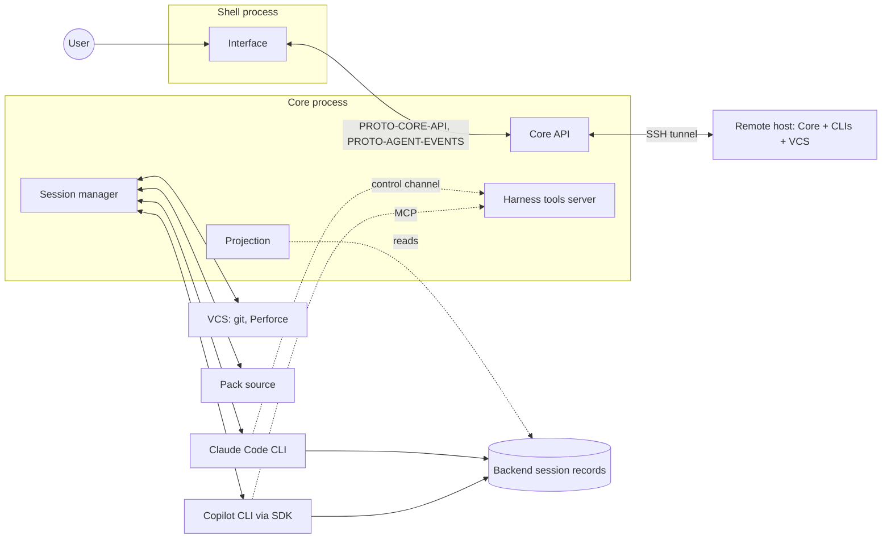

# Ersa system architecture

## Context

Ersa is a desktop application made of two processes: a shell that owns the window, and a core that owns everything else. The core talks to vendor CLIs on the local machine and on remote hosts, to version control systems, and to pack sources, and it exposes a tool server that the agents themselves call.

## Parts

### Shell

The native window (Tauri 2). Owns the webview, window lifecycle, tray, and launching or attaching to the Core process. Has no business logic.

### Interface

The TypeScript application in the webview. Renders the rail, transcript, composer, and workbench from Core's protocols. Owns presentation state only. Speaks `PROTO-CORE-API` for requests (projects, hosts, workspaces, sessions, settings, files, diffs) and consumes `PROTO-AGENT-EVENTS` as a per-session stream. Never touches a process, a file, or the network directly. During development it can be pointed at a replay server instead of a live Core.

### Core

A Rust library wrapped in a thin binary, running as its own process (ADR 0011). The same binary runs on remote hosts. Its modules:

- **Core API**: the request/response surface the Interface uses. Schema-defined; TypeScript types are generated from it.
- **Session manager**: the lifecycle of every session (created, starting, running, waiting on user, idle, disconnected, ended). Routes user input and permission decisions to adapters and backend output to the projection. Emits each session's lifecycle events itself and writes Core's operational records (process started, exited, failed to start, Core restarted) to the app log.
- **Projection**: a session's history is the backend's own session record (ADR 0017). When a session is opened, Core projects the record through the adapter into Ersa events, then appends events projected from the live stream, merged on the backend's message ids. Details only the live stream carries (text as it arrives, permission prompts, turn ends, cost, rate limits) are shown and not stored. Nothing projected is stored. The raw log, the lines exchanged with a live backend since Core opened it, is held in memory for the developer pane.
- **Adapter registry**: which backends are installed on which hosts, their versions and capabilities, and how to start them.
- **Transport layer**: starts processes and carries their stdio on a host: local spawn, or SSH. Adapters and the VCS layer run through it without knowing which one they got.
- **Workspace and VCS**: creates and destroys isolated workspaces for a project behind a VCS interface. Git worktrees first; Perforce second. Executes through the transport so remote hosts work the same way.
- **Pack client**: fetches packs from a pack source, verifies and caches them, and renders the neutral pack definition into each installed backend's native configuration.
- **Mode engine**: resolves a session's mode into the base instructions, allowed tools, and tool-server list handed to the adapter at start.
- **Harness tools server**: the MCP tools Ersa exposes to every session's backend (`PROTO-HARNESS-TOOLS`): cross-session messaging, session metadata, user-defined tools, and the interface-driving tools. For Claude Code it is served in-process over the control channel (ADR 0014). Permission requests do not go through it.
- **Persistence**: one local database per Core process holding projects, hosts, workspaces, pack cache metadata, settings, and per session only what finds and presents it: host, project, workspace, backend, and the backend's session id. The app log is kept beside it.

### Adapters

One per backend, behind one interface: start or resume a session on a transport with a configuration, send user input and permission decisions, receive the live stream, list the backend's sessions for a directory, read a session's record, stop. Adapters provide the projection from both the live stream and the session record to `PROTO-AGENT-EVENTS`.

- **Claude Code adapter**: drives the CLI in its streaming JSON mode, launched as an ordinary Claude Code session with the user's settings, with every behaviour-affecting flag passed explicitly, reads the session record from the CLI's session files, reads capabilities from the CLI's initial message, and receives permission requests over the CLI's stdio control channel (`PROTO-CLAUDE-CODE-STREAM`, ADR 0014).
- **Copilot adapter**: uses the official Copilot Rust SDK, including its session listing and history, and maps its types to Ersa events (`PROTO-COPILOT-SDK`, ADR 0009).

## Boundaries

- The Interface depends only on `PROTO-CORE-API` and `PROTO-AGENT-EVENTS`, through generated types.
- Core never renders. It emits events and answers requests.
- Adapters and the VCS layer depend on the transport interface, never on a concrete transport.
- Nothing in Core depends on Tauri.
- Harness tools can never operate permission controls, and interface-driving tools require visible per-invocation consent.
- Platform-specific code lives behind narrow modules (ADR 0006). Process trees are killed as a unit on Windows (job objects) so stopped sessions leave no orphans.

## Cross-cutting concerns

- **Persistence**: SQLite in the user's application data directory. A session's history is never copied into it; retention is the backend's, and when the backend deletes a session Ersa no longer shows it. One line from a backend is capped at 64 MiB; a process that writes past it is killed with its tree and the session ends with a `backend_exited` error. Bytes that are not valid UTF-8 are read with replacement characters. Schema migrations run at startup.
- **Errors**: every failure the user could act on appears as an event in the session's projection and, where relevant, as a rail state. Internal errors use structured tracing and are never swallowed.
- **Security**: no model credentials. Remote connections use the user's own SSH client and configuration. The harness tools server listens on a local per-launch socket; the per-session token identifies the caller and is advisory, since all local sessions share the OS user.
- **Configuration**: user settings in the database; project-level configuration in the project's own files where the backend expects it (packs render there).
- **Observability**: structured tracing in Core and the app log of its operational records; a developer pane in the Interface shows the raw log for the active session since Core opened it.

## Implementation decisions

The what; the why is in the linked ADRs.

- Rust 2024 edition, Tokio for async, serde for serialization, tracing for logs.
- Both Interface-facing protocols are defined by JSON Schema as the source of truth; Rust types implement them, conformance tests validate serialized output, TypeScript types are generated.
- Backend processes are managed through the transport interface with explicit stdin, stdout, stderr, exit, and kill. Stdin is flushed after every line. Read loops are cancellation-safe. Backends are never run in a pseudo-terminal.
- The terminal pane is a real hosted terminal: a pseudo-terminal (ConPTY on Windows, via a portable PTY library) running the user's shell in the workspace, rendered by a terminal emulator component in the Interface and carried over the same transport for remote hosts.
- SSH shells out to the user's `ssh` executable with one long-lived connection per host that multiplexes everything else, because Windows OpenSSH lacks connection sharing. The harness tools server is reached from a remote host through a reverse tunnel on that connection.
- Worktrees use short IDs under a configurable root outside the project tree, run a post-create hook (for dependency and build caches), and are removed stop-then-remove with retry.
- SQLite via a bundled driver.
- A replay server (a fake Core that serves recorded fixtures over the two protocols) is a first-class development tool used for interface work and tests.
- Interface in React 19 and TypeScript, with Motion for transitions and a development-only gallery view with screenshot tests (ADR 0008).

## Milestones

- **M0 Foundations**: Core binary with socket protocols; protocol brief for Claude Code's streaming mode written from the real CLI with recorded fixtures; Claude Code adapter with explicit flags and permission requests over the control channel; raw log and projection v1; replay server; shell window rendering raw events; Windows process-tree kill. Done when a prompt typed into a bare window gets a streamed reply, a permission request round-trips, and the session survives the window closing.
- **M1 Dogfood** (the author switches to it daily): rail with projects, worktree workspaces, and session tiles (title, backend, activity, context ring, cost); shelf for permissions and questions answerable from the rail; transcript with formatted text, tool cards, diff cards; composer; session list and resume from the backend's session record; light and dark token sets; developer pane; a minimal SSH transport tested against WSL so the adapter never grows local-only assumptions. Done when the author has used it exclusively for a week.
- **M2 Workbench**: files, diff, terminal, and browser panes. Done when the author stops opening a separate tool to review agent changes.
- **M3 Second backend and modes**: Copilot adapter via the SDK; modes as presets. Done when a Copilot and a Claude Code session run side by side with the same interface.
- **M4 Remote and VCS**: remote hosts in the rail, remote worktrees, disconnect and backfill; Perforce workspace adapter. Done when a session on a Linux VM and a session in a Perforce project both behave like local git sessions.
- **M5 Packs**: neutral pack format, renderers per backend, pack sources (directory, share, HTTP), apply and update. Done when a pack edited locally is published and picked up by a second machine.
- **M6 Harness tools**: cross-session messaging, user-defined tools, and a minimal show-me (focus, highlight, explain). Done when one session can hand work to another and a user can ask "how do I add a host" and watch it happen.

## Requirements

Verified by review at this level; testable requirements live in the protocol briefs.

- **ARCH-CORE-R01**: Core builds and its tests pass without Tauri or a display.
- **ARCH-CORE-R02**: The Interface communicates with Core exclusively through `PROTO-CORE-API` and `PROTO-AGENT-EVENTS`.
- **ARCH-CORE-R03**: Every projected event validates against the agent event schema.
- **ARCH-CORE-R04**: An adapter runs unchanged over the local and SSH transports.
- **ARCH-CORE-R05**: Workspace creation and removal for a remote host execute on that host.
- ~~**ARCH-CORE-R06**~~: retired 2026-11-01 (ADR 0017), replaced by R12.
- **ARCH-CORE-R07**: Core contains no Windows-only API outside platform modules.
- **ARCH-CORE-R08**: Core runs as a process separate from the shell, and sessions continue when the shell window closes.
- **ARCH-CORE-R09**: Each adapter ships conformance tests against recorded fixtures and declares a minimum and maximum tested backend version.
- **ARCH-CORE-R10**: No harness tool can operate a permission control.
- **ARCH-CORE-R11**: The Interface can run against the replay server with no live backend.
- **ARCH-CORE-R12**: A session's transcript, apart from details only the live stream carries, is reconstructible from the backend's own session record alone.

## Out of scope

- Calling model APIs directly (ADR 0004).
- Driving any backend through a pseudo-terminal or parsing its console output.
- A plugin system for third-party adapters in the first milestones; adapters are in-tree.

## Open questions

- Perforce isolation model (see PRD-ERSA open questions).
- Which local-inference harness to support first.

## Changes

- 2026-11-01: aligned with ADR 0017 (supersedes ADR 0010): history is the backend's session record, projected on open and merged with the live stream; nothing projected is stored; per session Ersa stores only what finds it; Core's operational records go to the app log; the raw log is in memory for the developer pane; resume open question answered. ARCH-CORE-R06 retired, ARCH-CORE-R12 added.

- 2026-11-01: backend line cap and non-UTF-8 handling stated (from M0-T6). No requirement IDs changed.

- 2026-11-01: raw log includes Core lifecycle records; projection cache key spelled out. No requirement IDs changed.

- 2026-10-31: aligned with ADR 0014 (permissions over the Claude Code control channel, harness tools in-process) and ADR 0008 (React); raw log records both directions. No requirement IDs changed.
- 2026-10-31: revised after adversarial review: Core as its own process; two Interface protocols; raw log as truth with versioned projection; harness tools server and permission routing in M0; Copilot via official SDK; SSH transport in M1 with single multiplexed connection; replay server; backends never in a PTY, terminal pane is a real hosted terminal; Perforce in M4; worktree handling; show-me constraints.
- 2026-10-31: created.
