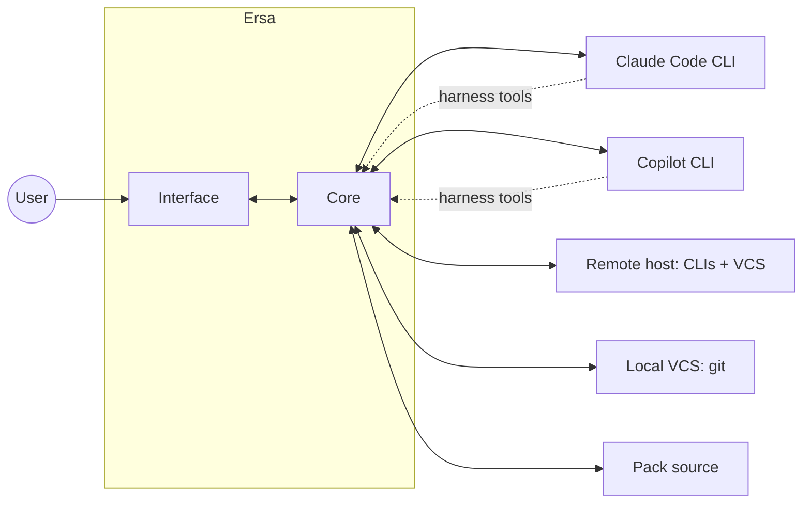

# Ersa system architecture

## Context

Ersa is a desktop application. It talks to vendor CLIs on the local machine and on remote hosts, to version control systems, and to pack sources. It exposes a small tool server that the agents themselves can call.

## Parts

### Shell

The native window and process host (Tauri 2). Owns the webview, the window lifecycle, the tray, and the bridge between Interface and Core. Owns nothing else; it has no business logic.

### Interface

The TypeScript application in the webview. Renders the shell layout (`LAY-SHELL`), the transcript, composer, rail, and workbench panes from the event stream. Owns presentation state only: which session is active, pane sizes, theme, scroll positions. Speaks `PROTO-AGENT-EVENTS` to Core and nothing else; it never touches a process, a file, or the network directly.

### Core

The Rust library that does the work. Its responsibilities, each a module with a narrow interface:

- **Session manager**: the lifecycle of every session (created, starting, running, waiting, idle, disconnected, ended). Routes commands from the Interface to the right adapter and events from adapters to the Interface and the event log.
- **Event log**: the persisted, append-only sequence of events per session. The transcript is a projection of it; resume is a replay of it.
- **Adapter registry**: knows which backends are installed on which hosts, their versions, and how to start them.
- **Transport layer**: starts processes and carries their stdio on a host: local spawn, SSH exec, container exec. Adapters and the VCS layer run through it and do not know which one they got.
- **Workspace and VCS**: creates and destroys isolated workspaces for a project through a VCS interface. Git worktrees first; Perforce later. Executes through the transport so remote hosts work the same way.
- **Pack client**: fetches packs from a pack source, verifies and caches them, and applies them to a project by writing the configuration each backend understands.
- **Mode engine**: resolves a session's mode into the base instructions and settings handed to the adapter at start.
- **Harness tools server**: an MCP server exposed to every session's backend, offering cross-session messaging, session metadata, and the "show me" interface-driving tools (`PROTO-HARNESS-TOOLS`).
- **Persistence**: one local database holding projects, workspaces, sessions, event logs, pack cache metadata, and settings.

### Adapters

One per backend, behind one interface: start a session on a transport with a configuration, send user input and permission decisions, receive a stream of Ersa events, stop. Each adapter translates between the backend's native protocol and `PROTO-AGENT-EVENTS`.

- **Claude Code adapter**: drives the CLI in its streaming JSON mode with the bidirectional control channel for permissions (`PROTO-CLAUDE-CODE-STREAM`). Documenting that protocol from the real CLI is part of the first milestone.
- **Copilot adapter**: drives the Copilot CLI's JSON-RPC server mode directly (`PROTO-COPILOT-RPC`), since no Rust SDK exists.

## Boundaries

- Interface depends only on `PROTO-AGENT-EVENTS`. It never imports Core types directly; it uses TypeScript types generated from the protocol schema.
- Core never renders. It emits events; what they look like is the Interface's concern.
- Adapters depend on the transport interface, never on a concrete transport.
- The VCS layer depends on the transport interface for the same reason.
- Nothing in Core depends on Tauri. Core is a plain library testable without a window, so the Shell could be replaced.
- Platform-specific code lives behind narrow modules with a Windows implementation and stubs or conditional compilation for others (ADR 0006).

## Cross-cutting concerns

- **Persistence**: a single SQLite database in the user's application data directory. Event logs are append-only tables keyed by session. Schema migrations run at startup.
- **Errors**: every failure that the user could act on becomes an event in the session's log (so it appears in the transcript) and, where relevant, a rail state. Internal errors are logged with structured tracing and never swallowed.
- **Security**: Ersa stores no model credentials. Remote connections use the user's SSH configuration and agent. The harness tools server listens only on a local, per-launch socket with a per-session token.
- **Configuration**: user settings in the database; project-level configuration in the project's own files where the backend expects it (packs write there).
- **Observability**: structured tracing in Core with a developer pane in the Interface that shows raw events for the active session.

## Implementation decisions

The what; the why is in the linked ADRs or belongs in a new one.

- Rust 2024 edition, Tokio for async, serde for serialization, tracing for logs.
- The agent event protocol's JSON Schema is the source of truth. Rust types implement it; a conformance test validates serialized events against the schema; TypeScript types are generated from the schema at build time.
- Processes are managed through the transport interface with explicit handling of stdin, stdout, stderr, exit, and kill. No pseudo-terminals in the first milestones.
- SQLite via a bundled driver so there is no external dependency on the host.
- Workspace layout: a project's worktrees live under a configurable root outside the project tree, named by workspace ID.
- Interface framework per ADR 0008 once accepted.

## Milestones

- **M0 Foundations**: repository, briefs, protocol brief for Claude Code's streaming mode written from the real CLI with recorded fixtures, Core skeleton that starts one local Claude Code session and round-trips a prompt, Shell window rendering raw events. Done when a prompt typed into a bare window gets a streamed reply.
- **M1 Dogfood** (the author switches to it daily): rail with projects, worktree workspaces, and sessions; transcript with formatted text, tool cards, diff cards; permission tiles with cost and context; composer; persistence and resume; light and dark themes; developer pane. Done when the author has used it exclusively for a week.
- **M2 Workbench**: files, diff, and terminal panes; browser pane. Done when the author stops opening a separate editor to review agent changes.
- **M3 Second backend and modes**: Copilot adapter; modes with Code and Content profiles. Done when a Copilot session and a Claude Code session run side by side with the same interface.
- **M4 Remote**: SSH transport; remote worktrees; disconnect and reconnect states. Done when a session on a Linux VM is indistinguishable from a local one except for latency.
- **M5 Packs**: pack format, pack sources (directory, share, HTTP), apply and update. Done when a pack edited locally is published to a source and picked up by a second machine.
- **M6 Show me and harness tools**: cross-session messaging; interface-driving tools; guided onboarding. Done when a new user can ask "how do I add a remote host" and watch it happen.

## Requirements

- **ARCH-CORE-R01**: Core builds and its tests pass without Tauri or a display.
- **ARCH-CORE-R02**: The Interface communicates with Core exclusively through `PROTO-AGENT-EVENTS`.
- **ARCH-CORE-R03**: Every event an adapter emits validates against the protocol schema.
- **ARCH-CORE-R04**: An adapter runs unchanged over the local and SSH transports.
- **ARCH-CORE-R05**: Workspace creation and removal for a remote host execute on that host.
- **ARCH-CORE-R06**: A session's transcript is reconstructible from its event log alone.
- **ARCH-CORE-R07**: Core contains no Windows-only API outside platform modules.
- **ARCH-CORE-R08**: The harness tools server accepts connections only from processes holding a valid per-session token.
- **ARCH-CORE-R09**: Each adapter ships conformance tests against recorded fixtures and declares a minimum supported backend version.

## Out of scope

- Calling model APIs directly (ADR 0004).
- A plugin system for third-party adapters in the first milestones; adapters are in-tree.
- Running Core as a separate daemon. It is a library inside the Shell process until there is a reason otherwise.

## Open questions

- Whether the event log should also store the backend's raw native messages for debugging and replay, or only translated events.
- How session resume interacts with each backend's own session persistence (Claude Code has resumable sessions; Copilot's model differs).
- Where terminal panes get their data from without a PTY on Windows.

## Changes

- 2026-10-31: created.
