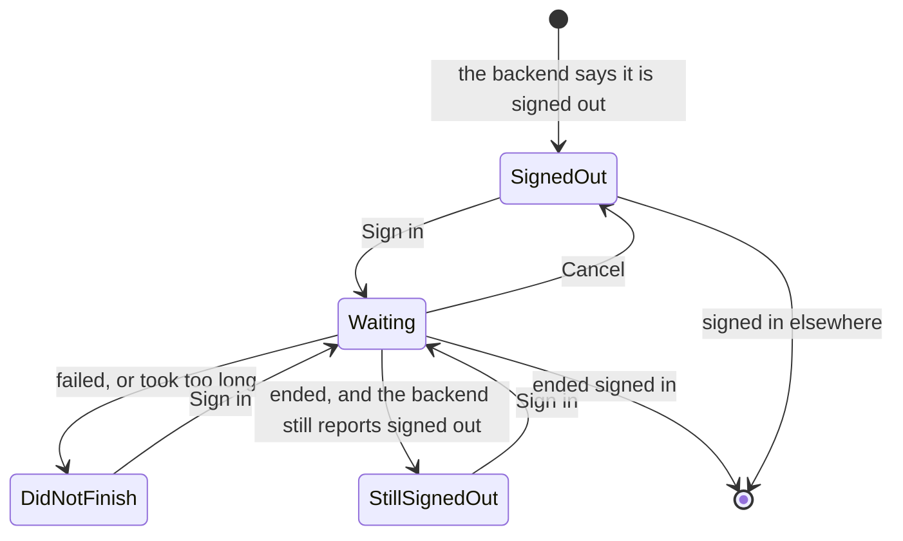

# Sign in to a backend

## Outcome

A person whose backend is installed and signed out signs in to it from inside Ersa, with no terminal, and goes on to start or continue a session. The sign-in is the backend's own, on its vendor's page in the person's browser; Ersa starts it and learns how it ended, and never sees, stores or relays what is exchanged (ADR 0040).

## Trigger

The backend says it is signed out, in one of two ways. Before a session: the host's listing reports it `signed_out` (`backend.list`, `PROTO-CORE-API`), which the new-session screen reads. In a session: a message fails as not signed in (an `error` event with `action: log_in`, `PROTO-AGENT-EVENTS`). Either shows the sign-in note above the composer, with Sign in.

## Steps

1. On the new-session screen (`LAY-SHELL`), with no backend that can run and one signed out, the sign-in note stands above the composer: it says, by the backend's label, that the backend isn't signed in, and offers Sign in. The backend chip reads as it does while no backend can run, and its list gives the backend the status Signed out.
2. The person chooses Sign in. Ersa asks Core to start that backend's sign-in on that host. The vendor's sign-in page opens in the person's browser. Once Core answers, Ersa reads the host's backends again, which now report the sign-in under way.
3. The note says Ersa is waiting for the person to sign in in their browser, and offers Cancel. The person signs in on the vendor's page. Nothing in Ersa asks for a password, a key or a code.
4. Core reports that the sign-in ended. Ersa reads the host's backends again; the backend can run, the note goes, the session controls fill with its models, and the composer takes the first message.

Under a session it is the same note above that session's composer: the message that failed shows in the transcript as a line saying the backend wasn't signed in, and after signing in the person sends again. The note goes once a sign-in has ended signed in and the backend no longer reports that it is signed out; when it still does, the note stays and says so.

## Variations and errors

- **The person cancels.** Cancel stops the sign-in, and the note offers Sign in again. Closing the browser's page without signing in leaves the note waiting; Cancel, or Core's time limit, ends it.
- **The sign-in can't start, fails or takes too long.** The note says which, with the reason Core or the backend gave, and offers Sign in again.
- **The sign-in ends and the backend still reports that it is signed out.** The note says so and offers Sign in again, so a backend that can't take a sign-in never looks as if nothing happened.
- **The person signs in elsewhere**, in a terminal or the backend's own app. On the new-session screen the note goes when the person comes back to the window: the screen reads the backends again then (FLOW-NEW-SESSION-R50), and Core asks a signed-out backend every time. Under a session the person sends again, and the note goes with the message.
- **A backend becomes signed out while Ersa runs.** The next message to it fails as not signed in, and the note shows under that session; that is where the person signs in. The new-session screen goes on offering the backend meanwhile (`PROTO-CORE-API`, Open questions).
- **Another backend can run.** The new-session screen shows no note; the signed-out backend reads Signed out in the chip's list (Open questions).
- **Another window.** A sign-in is the host's, so every window shows it once it reads the host's backends, and Cancel in any of them stops it for all. A window shows one only once it is under way, which is from Core's answer (`PROTO-CORE-API`, Signing in): while it is starting, only the window that asked shows anything. A Cancel that reaches a sign-in still starting, as from a window whose listing is out of date, stops it, and the window that asked says the sign-in couldn't be started, since it was canceled (R03).
- **Leaving and coming back.** A sign-in under way is the host's, not the screen's: the note shows it again after the person opens another session and returns, after the window is closed and shown again, and after Ersa reconnects.

## States

## Requirements

- **FLOW-SIGN-IN-R01**: While no backend on the chosen host can run and the host's listing reports one `signed_out`, the new-session screen shall show the sign-in note above the composer for the first such backend in the listing, saying by the backend's label that the backend isn't signed in and offering Sign in, and the composer shall be unavailable as it is while no backend can run.
- **FLOW-SIGN-IN-R02**: The backend chip's list shall give a `signed_out` backend the status Signed out, shown and not choosable, as it shows a missing one.
- **FLOW-SIGN-IN-R03**: When the person chooses Sign in, Ersa shall ask Core to start that backend's sign-in on that host (`backend.sign_in`), with Sign in unavailable until Core refuses or the reading R09 makes on Core's answer has ended; when Core refuses, the note shall say that the sign-in couldn't be started, with Core's reason, and offer Sign in.
- **FLOW-SIGN-IN-R04**: When `backend.sign_in` answers with a web address whose scheme is `https`, Ersa shall open it in the system's default browser.
- **FLOW-SIGN-IN-R05**: When `backend.sign_in` answers with a web address of any other scheme, Ersa shall open nothing, ask Core to stop the sign-in (`backend.cancel_sign_in`), and say in the note that it couldn't open the sign-in page, offering Sign in.
- **FLOW-SIGN-IN-R06**: While the host's listing reports a sign-in under way for the note's backend (`signing_in`), the sign-in note shall say that Ersa is waiting for the person to sign in in their browser, by the backend's label, and offer Cancel in place of Sign in.
- **FLOW-SIGN-IN-R07**: When the person chooses Cancel, Ersa shall ask Core to stop the sign-in (`backend.cancel_sign_in`), and the note shall again say that the backend isn't signed in and offer Sign in.
- **FLOW-SIGN-IN-R08**: Ersa shall offer no field that takes a password, a key, a token or a code for a backend's sign-in.
- **FLOW-SIGN-IN-R09**: When `backend.sign_in` answers that a sign-in has started, and when Core reports that a sign-in ended (`backend.sign_in_ended`), Ersa shall read that host's backends again.
- **FLOW-SIGN-IN-R10**: When the host's listing reports that the backend the new-session screen's note shows for can run, the note shall go, and Ersa shall ask Core to stop a sign-in the listing still reports under way for that backend.
- **FLOW-SIGN-IN-R11**: When the new-session screen's note goes because its backend can run, the session controls shall choose that backend as FLOW-NEW-SESSION-R51 says, the composer shall be available with keyboard focus in its words, and Ersa shall send nothing by itself.
- **FLOW-SIGN-IN-R12**: When a sign-in ends `signed_in` and the listing read after it reports the backend `signed_out`, the note shall say that the sign-in finished and that the backend still reports that it isn't signed in, and offer Sign in.
- **FLOW-SIGN-IN-R13**: When a sign-in ends `failed`, the note shall say that the sign-in didn't finish, then the backend's own reason when Core gives one, and offer Sign in.
- **FLOW-SIGN-IN-R14**: When a sign-in ends `timed_out`, the note shall say that the sign-in took too long and was stopped, and offer Sign in; one that ends `canceled` shall add no words to the note.
- **FLOW-SIGN-IN-R15**: The words R03, R05, R12, R13 and R14 add to the note shall stay until the person chooses Sign in or the note goes.
- **FLOW-SIGN-IN-R16**: An `error` event with `action: log_in` shall show in the transcript as one line that says, by the label of the session's backend, that the backend wasn't signed in, in place of the backend's own message.
- **FLOW-SIGN-IN-R17**: While a session is live and its latest `error` event with `action: log_in` has neither a message of the person's after it nor, since it arrived, a sign-in for that backend on that host that ended `signed_in` and whose reading of the host's backends (R09) did not report the backend `signed_out`, a reading that fails counting as not reporting it, that session's composer shall show the sign-in note above its status line, for the session's backend on the session's host, behaving as R03 to R09 and R12 to R15 say.
- **FLOW-SIGN-IN-R18**: Under a session the sign-in note shall leave the composer's box, send and status line as they are without it, and Ersa shall hold back no message because a backend is signed out.

## Waiting on a recording

How a backend's sign-in is started and how it reports its end is its adapter's to say, from a recording of the real thing (`docs/briefs/README.md`, Changing a brief). No adapter says it yet: for Claude Code, `PROTO-CLAUDE-CODE-STREAM` (Signing in) lists what is recorded and what the recording must show, and recording it needs a person to sign in with an account, which is the owner's to do. Until a planning pass has read that recording:

- The requirements above and `PROTO-CORE-API`'s are built and tested against a stand-in for the backend; no real backend can be signed in to through Ersa.
- Nothing says what a session's backend that was already running does with a sign-in made after it started. The requirement that a message sent after signing in is answered by a signed-in backend, and whether Core starts that session's backend again to make it so, is allocated by that pass. Until then the person may have to stop and resume such a session.

## Verification

Core's part runs against an adapter of the test's own that can start a sign-in, end it each way and report that it is signed out. The Interface's runs against a fake client and a stand-in for opening a web address. Neither needs a real sign-in. The live check that a person signs in to Claude Code through the daily build is the owner's, once the adapter's part is built.

## Out of scope

- Installing a backend, and choosing among several installations (#580).
- Signing out, switching accounts, and choosing which of a vendor's ways to sign in is used: Ersa starts the backend's sign-in as the backend offers it by default, and the rest stay in the backend's own tools.
- Showing who is signed in. A backend's account is the backend's, and Ersa shows only whether a session can run.

## Open questions

- How a person signs in to a signed-out backend while another backend on the host can run: the new-session screen shows no note then. #580's Backends section in Settings is the likely place.
- Whether the note should offer to open the sign-in page again while Ersa waits. Today a person who closed the page cancels and signs in again.
- Whether the rail should mark a session whose backend is signed out, so it is seen without opening the session.
- A sign-in for a backend on a remote host (M4): the page must open in the person's browser while the backend runs elsewhere (`FLOW-REMOTE-SESSION`).
- What the note says when the vendor's page is open and the person's account can't use the backend (no plan, an organization's policy). Today that is the backend's own reason, shown as given.
- A window that reconnects after a sign-in ended, before the person has sent again, shows the session's note once more, since the window holds that a sign-in ended (R17) and Core does not; sending clears it, and so does a sign-in after which the backend no longer reports that it is signed out.

## Changes

- 2026-11-26: from #657 inbox (#637): under a session R17 took the note away as soon as a sign-in ended `signed_in`, so the words R12 gives for a sign-in that finished while the backend still reports signed out could never show there, though R17 says the note behaves as R12 says: the person lost the note and found out only when the next message failed. The note now goes only once the reading R09 makes on that end no longer reports the backend `signed_out`, and otherwise stays and says R12's words, as the same note already does on the new-session screen; a note under a session should not tell a person less than the same note one screen away. When the note appears still follows the session's own failure and not the listing. A reading that fails reports nothing, so the note goes then, and the next message says if the backend is still signed out. R17 reworded to say what it already promised of R12, its ID unchanged: no test on `main` cites it, and none of #637's own asserts anything the new wording makes false. A call the owner can overrule. No requirement added or retired.
- 2026-11-26: from #652 inbox (#636), on where the sign-in note sits (`COMPOSER.md`, The sign-in note). The page had it open upward as the status line does, which on the new-session screen laid it over the Ersa wordmark for as long as the backend is signed out. #636 put it in the column instead, so the box moved down as the note arrived and back up as it went, which is the moment the box becomes available and takes the focus. Decided, Claude Desktop's recordings showing no note on its start screen: the note stands above the box and the wordmark moves up to clear it, so the box and the session controls keep their place and the only thing that moves is a mark nobody acts on. Where the screen is too short for that, the note takes its place in the column and the screen scrolls, as the trust question does. Under a session the note takes height at the top of the composer's column, the box staying at the foot and the transcript keeping its end in view. This differs from what #636 built, which changes to it. A call the owner can overrule. No requirement IDs changed.
- 2026-11-26: from #650 inbox (#635): a sign-in is under way from Core's answer to `backend.sign_in`, not while it is still starting (`PROTO-CORE-API`, Signing in). The note follows the host's listing (R06), and nothing made the window that asked read the listing when Core answered, so its note would have gone back to Sign in with the page open. Ersa now reads the host's backends on that answer too, and Sign in stays unavailable until that reading has ended (R03, R09; `COMPOSER.md`, The sign-in note): one more reading of a signed-out backend, for a note with one source in every window. A start that another window's Cancel stopped is a refusal like any other (R03), saying it was canceled; R14's silence is for a sign-in the windows were shown waiting for. A sign-in Core's shutdown ends is `canceled`, which no window is expected to receive. Calls the owner can overrule. R03 and R09 reworded before any test cites them; no requirement added or retired.
- 2026-11-25: created ready, by the owner's decision of 2026-11-25 that a person signs in to a backend through Ersa (ADR 0040, #622). Decided here, Claude Desktop having nothing comparable, since it signs the person in to itself: one sign-in note, a row of its own above the composer's status line, on the new-session screen and under a session alike, with the archived note's anatomy (`docs/design/COMPOSER.md`); the page opens in the person's own browser, and only over `https`, where a link in the transcript also opens `http`, since this page takes a password. On the new-session screen the note follows the host's listing, which Core asks the backend for each time. Under a session it follows that session's own failure (R17), the backend's word about that session, and not the listing: a sign-in that lapsed may still list as available, which no recording shows either way, and the person must still be offered Sign in. Ersa holds back no message on a listing's word (R18). A signed-out backend is shown and not choosable, like a missing one, so FLOW-NEW-SESSION-R02, R07 and R48 stand as written. The transcript's line says the backend wasn't signed in, in Ersa's words, where the CLI's own says to run a command no person using Ersa can run (R16). A sign-in that ends with the backend still signed out says so (R12). FLOW-SIGN-IN-R01 to R18 added.
