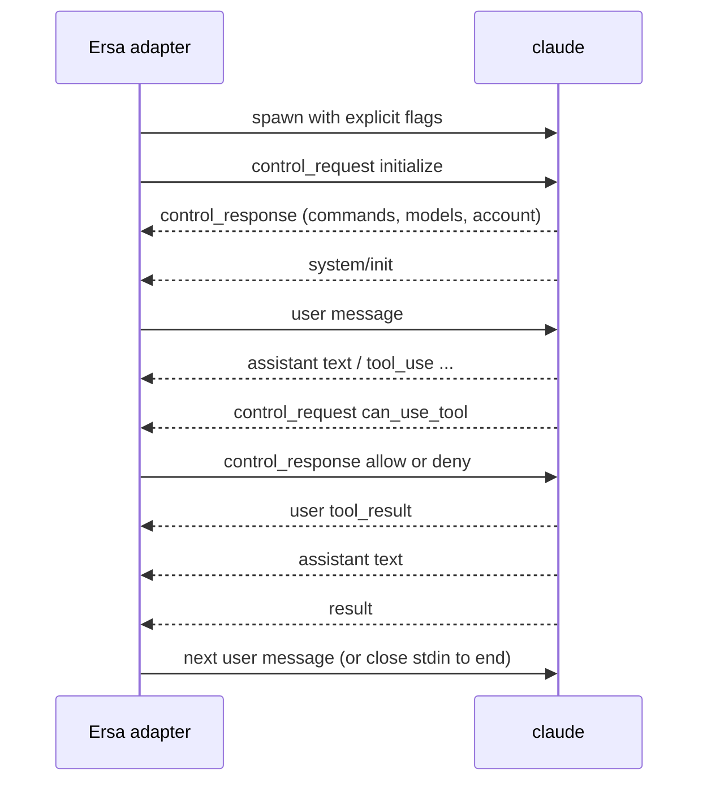

# Claude Code streaming JSON protocol

Observed on Claude Code 2.1.302 (Windows, winget install). Evidence is the fixture set in `protocol/fixtures/claude-code/2.1.302/`; each `.jsonl` is verbatim CLI output and each `.meta.json` records the exact command line, what was sent on stdin, exit code, and timings. The Claude Agent SDK's type definitions (`@anthropic-ai/claude-agent-sdk` 0.3.316, files `sdk.d.ts` and `sdk-tools.d.ts`) are the reference for field names and unions; they are proprietary and are read, not vendored.

## Parties

Ersa's Claude Code adapter (the host) and one `claude` process per session. The host starts the process, writes to its stdin, reads its stdout, and owns its lifetime.

## Transport and framing

Stdio. Newline-delimited JSON in both directions. Stdout lines are messages; stdin lines are user messages or control messages. Stdin must be flushed after every line. If stdin is left open with nothing written, the CLI waits about three seconds, warns on stderr, and proceeds (fixture 00). For one-shot runs stdin is closed or given an empty body.

## Invocation

Every behaviour-affecting flag is passed explicitly (ADR 0014). The baseline command the fixtures use:

```
claude -p --input-format stream-json --output-format stream-json --verbose
       --permission-mode default --setting-sources "" --strict-mcp-config
       --permission-prompt-tool stdio --await-initialize
```

- `--await-initialize` makes the CLI read the host's `initialize` control request during startup instead of racing it; the Agent SDK passes it. Fixtures 09 and 11 were recorded without it and still worked, so it is belt and braces, to be verified by a fixture.
- `--permission-mode` must be stated; the shelf flow depends on it.
- `--setting-sources ""` and `--strict-mcp-config` isolate a session from the user's own project and user settings; modes and packs will supply what a session should see.
- `--permission-prompt-tool stdio` makes permission prompts arrive on the control channel (fixture 11). Without it, or without `initialize`, prompts are auto-denied (fixtures 05, 08, 09).
- `--include-partial-messages` adds `stream_event` lines for token-level streaming (fixture 02).
- `--replay-user-messages` echoes each stdin user message back on stdout as a `user` message (fixture 07), useful for ordering in the raw log.
- `--resume <session_id>` continues a session; the CLI keeps the same `session_id` (fixture 04).
- `--mcp-config <absolute path> --permission-prompt-tool mcp__<server>__<tool>` is the fallback permission route (fixture 10).

## Messages (stdout)

Every message carries `type`, most carry `session_id` and `uuid`. Observed in this version:

### system / init

First stdout message of every one-shot session. In a bidirectional session the `initialize` response comes first, and `init` is emitted at the start of each turn, so the first `init` arrives only after the first user message has been sent (fixtures 09, 11). Fields of interest: `session_id`, `model`, `permissionMode`, `apiKeySource`, `claude_code_version`, `tools` (names), `mcp_servers` (name, status, source), `capabilities` (string list such as `interrupt_receipt_v1`, `msg_lifecycle_v1`, `sdk_mcp_manifests`), `output_style`, `agents`, `skills`, `plugins`, `cwd`, `fast_mode_state`, `view_mode`, `powershell_path`, `startup_timing`. Feature detection reads `capabilities` here, never version strings. On resume, `init` repeats with the same `session_id` (fixture 04); in a bidirectional session a second `init` is emitted at the start of each turn (fixture 07).

### assistant

`message.content` is an array of content blocks: `text`, `tool_use` (`id`, `name`, `input`, `caller`), `thinking` (`thinking` text, often empty, with `signature`). Carries `parent_tool_use_id` (null for the main thread). One `assistant` line per content block in practice (fixtures 03, 05).

### user

Either an echoed stdin message (with `--replay-user-messages`) or a `tool_result` block the CLI produced after running a tool: `tool_use_id`, `content`, `is_error`. Permission denials also arrive as a `tool_result` explaining the denial (fixtures 05, 06).

### stream_event

Only with `--include-partial-messages`. Wraps the Messages API stream events: `message_start`, `content_block_start`, `content_block_delta`, `content_block_stop`, `message_delta`, `message_stop` (fixture 02). The complete `assistant` line still follows.

### system / permission_denied

`tool_name`, `tool_use_id`, `message` (or `decision_reason_type` such as `asyncAgent` and `decision_reason` when `--permission-prompts none`). Emitted when an approval was needed and no host could answer (fixtures 05, 06, 08, 09).

### system / status, task_summary, post_turn_summary, thinking_tokens

Progress and summary lines. `task_summary` and `post_turn_summary` are absent from the SDK 0.3.316 types and marked internal in the CLI's own schemas, so they may change or vanish without notice; the fixtures are the reference for their shape. `post_turn_summary` carries `status_category` (`completed`, `blocked`) and `status_detail`; `thinking_tokens` carries running estimates. The rail's activity state is derived from `assistant`, `user` tool results, `control_request`, `status`, and `result`, which are supported surface; `task_summary` and `post_turn_summary` only add detail when present, and their absence changes no state.

### rate_limit_event

Emitted during turns; carries the login's rate-limit status. Source for the tile's budget readout.

### result

Ends a turn. `subtype` (`success` observed; error subtypes exist in the SDK types), `is_error`, `num_turns`, `duration_ms`, `duration_api_ms`, `total_cost_usd`, `usage` (input, output, cache tokens, service tier), `modelUsage`, `permission_denials` (array of `{tool_name, tool_use_id, tool_input}`), `terminal_reason` (`completed`, `api_error`), `result` (final text), `session_id`. The cost tile reads `total_cost_usd`; the context ring reads `usage`.

### Authentication failure

A synthetic `assistant` message with `model: "<synthetic>"`, `error: "authentication_failed"`, text "Not logged in", then a `result` with `terminal_reason: "api_error"` and zero usage (fixture 00). The adapter maps this to a session error state, not a transcript message.

## Control channel

### initialize (host to CLI)

```json
{"type":"control_request","request_id":"<host chosen>","request":{"subtype":"initialize","hooks":{}}}
```

Sent before the first user message. The CLI answers with `control_response` whose `response` carries `commands`, `agents`, `models`, `account`, `output_style`, and `claude_code_version` (fixtures 09, 11). 2.1.302 also sends `capabilities` (a shorter list than `system/init`'s, not used for feature detection), `pid`, `current_permission_mode`, and `session_state`, none of which are in the SDK 0.3.316 types. Optional request fields of interest for Ersa: `appendSystemPrompt` and `systemPrompt` (modes), `agents`, `skills`, `title`, `sdkMcpServers` with `sdkMcpServerConfigs` (in-process harness tools), `supportedDialogKinds`, `perTaskStopAffordance`.

### can_use_tool (CLI to host)

Arrives only after `initialize` and only with `--permission-prompt-tool stdio`:

```json
{"type":"control_request","request_id":"<cli chosen>","request":{"subtype":"can_use_tool",
  "tool_name":"Bash","display_name":"Bash","input":{...},"description":"...",
  "permission_suggestions":[{"type":"addRules","rules":[{"toolName":"Bash","ruleContent":"echo probe *"}],"behavior":"allow","destination":"localSettings"},
                            {"type":"addDirectories","directories":["..."],"destination":"session"}],
  "blocked_path":"...","tool_use_id":"toolu_..."}}
```

Other fields per the SDK types: `decision_reason`, `decision_reason_type`, `classifier_approvable`, `suppress_always_allow_rule`, `default_to_no`, `requires_user_interaction`, `agent_id`, `title`. The shelf renders `display_name`, `description`, `input`, `blocked_path`, and offers the `permission_suggestions` as "allow for this session" options.

The host answers:

```json
{"type":"control_response","response":{"subtype":"success","request_id":"<same>",
  "response":{"behavior":"allow","updatedInput":{...},"updatedPermissions":[...]}}}
```

or `{"behavior":"deny","message":"...","interrupt":false}`. An allow always carries `updatedInput`: the original `input` unless the user edited it, as recorded. After an allow the tool runs and its `tool_result` follows as usual (fixture 11).

### User message (host to CLI)

```json
{"type":"user","message":{"role":"user","content":[{"type":"text","text":"..."}]}}
```

`parent_tool_use_id` is omitted for the main thread. The SDK types mark it required, but every recorded stdin user message omits it and the CLI accepts that.

### Other control requests the adapter uses

`interrupt`, `set_permission_mode`, `set_model`, `get_context_usage`, `get_session_cost`, and `mcp_message` (for `sdkMcpServers`). Shapes per the SDK types; fixtures to be recorded as each is implemented.

## Sequencing



- One turn runs at a time; the next user message is sent after `result`.
- A `can_use_tool` request must be answered before the turn continues; an unanswered request stalls the turn.
- Closing stdin after `result` ends the process cleanly with exit 0 (fixtures 07 to 11).

## Errors and recovery

- Authentication failure: see above. Surface as a session error with a "log in" action.
- Process exit without `result`: treat the turn as interrupted; the raw log holds everything emitted.
- Unknown message types: store verbatim in the raw log, project to a typed passthrough event. Never drop.

## Versioning

Minimum tested: 2.1.302. Maximum tested: 2.1.302. The adapter compares versions using `claude_code_version` from the `initialize` response, because it is the only version known before the first turn; above the maximum tested version it warns and continues. Feature detection reads `capabilities` from `system/init`, which arrives with the first turn; no feature is needed before then.

## Conformance

A conforming adapter replays every fixture in `protocol/fixtures/claude-code/<version>/` through its parser and projection without error, and produces the expected `can_use_tool` round trip against a stub CLI built from fixture 11.

## Requirements

- **PROTO-CLAUDE-CODE-STREAM-R01**: The adapter shall start the CLI with every behaviour-affecting flag passed explicitly, never relying on a default.
- **PROTO-CLAUDE-CODE-STREAM-R02**: The adapter shall send an `initialize` control request before the first user message and shall not send a user message until the `initialize` response has arrived.
- **PROTO-CLAUDE-CODE-STREAM-R03**: When a `can_use_tool` control request arrives, the adapter shall emit a permission-request event carrying the tool name, display name, input, description, blocked path, and permission suggestions, and shall answer with the user's decision as a `control_response` echoing the same `request_id`.
- **PROTO-CLAUDE-CODE-STREAM-R04**: The adapter shall parse every line of every fixture for its tested version range without error and store each line verbatim in the raw log.
- **PROTO-CLAUDE-CODE-STREAM-R05**: When the CLI reports `authentication_failed`, the adapter shall emit a session error event rather than a transcript message.
- **PROTO-CLAUDE-CODE-STREAM-R06**: The adapter shall read capabilities from the `system/init` message and shall not infer behaviour from version strings.
- **PROTO-CLAUDE-CODE-STREAM-R07**: The adapter shall flush stdin after every line written.
- **PROTO-CLAUDE-CODE-STREAM-R08**: The adapter shall derive cost from `result.total_cost_usd`, context from `result.usage`, and rate-limit budget from `rate_limit_event`.
- **PROTO-CLAUDE-CODE-STREAM-R09**: The adapter shall map unknown message types to a typed passthrough event and never drop a line.
- **PROTO-CLAUDE-CODE-STREAM-R10**: When the CLI version exceeds the maximum tested version, the adapter shall emit a warning event and continue.

## Out of scope

- Driving the interactive terminal UI.
- Hooks over the control channel (`hook_callback`) until a use appears.

## Open questions

- Whether Ersa replays its own raw log or passes `--resume` on reconnect, and how the two agree.
- Exact shapes of `interrupt`, `set_model`, `get_context_usage`, `get_session_cost`, and `mcp_message` responses (to be recorded).
- Whether `--replay-user-messages` should be on by default for raw-log completeness.

## Changes

- 2026-11-01: `task_summary` and `post_turn_summary` are internal CLI surface; activity state no longer depends on them. No requirement IDs changed.

- 2026-11-01: from M0-T3 inbox: `system/init` arrives with the first turn, so version comparison uses the `initialize` response and feature detection uses `system/init`; observed fields beyond the SDK types noted; stdin user-message shape added; allow always carries `updatedInput`. No requirement IDs changed.

- 2026-10-31: written from fixtures 00 to 11 on 2.1.302; status ready; permissions via the stdio control channel per ADR 0014.
- 2026-10-31: explicit flags, feature detection, and permission routing via the harness tools server per ADR 0012.
- 2026-10-31: created as draft.
