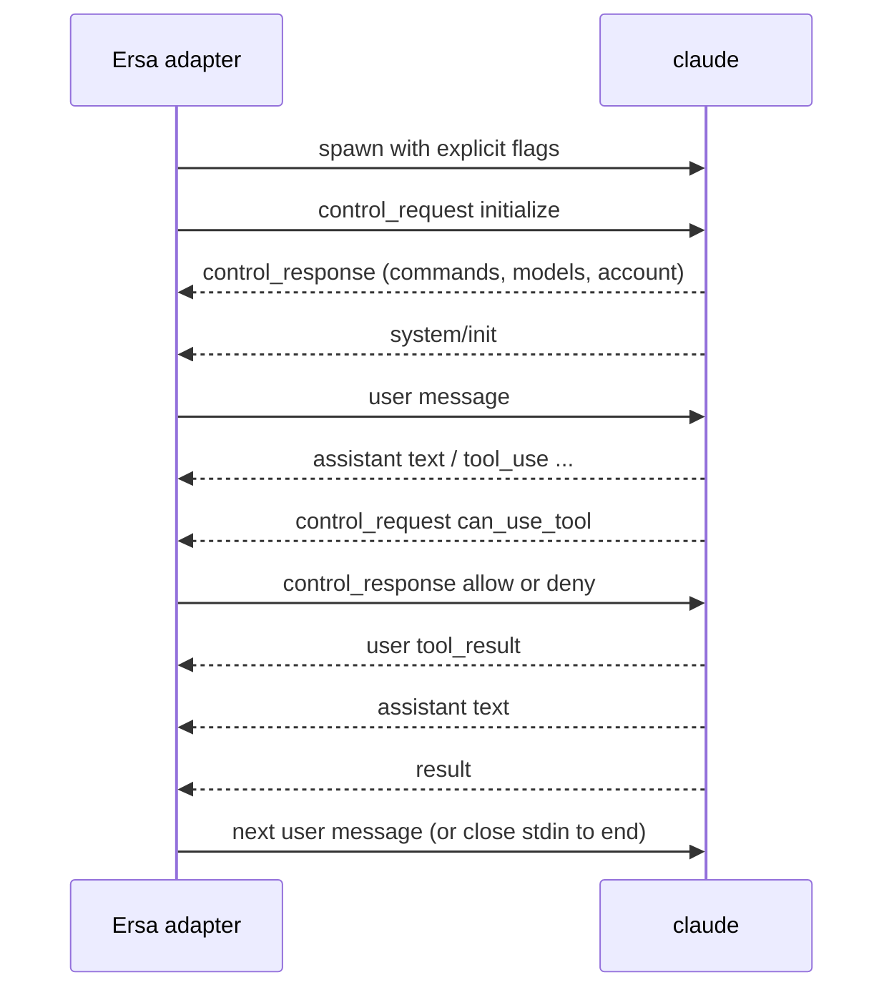

# Claude Code streaming JSON protocol

How the adapter drives the CLI's live stream, and how it reads the CLI's own session record, which is a session's history (ADR 0017). Observed on Claude Code 2.1.302 and 2.1.316 (Windows, winget install). Evidence is the fixture sets in `protocol/fixtures/claude-code/<version>/`; each stream `.jsonl` is verbatim CLI output and each `.meta.json` records the exact command line, what was sent on stdin, exit code, and timings. The 2.1.302 set (fixtures 00 to 11) was recorded with an isolating invocation; the 2.1.316 set (`00-session-tools`, `01-session-resume`, and the rest unless this brief says otherwise) was recorded with Ersa's own invocation of the day (00 to 03 with `-p`, 06 without) by the repository's session-fixture recorder, which also keeps the session record the CLI wrote for each run, under `record/`. A bare fixture number in this brief names a 2.1.302 fixture. The Claude Agent SDK's type definitions (`@anthropic-ai/claude-agent-sdk` 0.3.316, files `sdk.d.ts` and `sdk-tools.d.ts`) are the reference for field names and unions; they are proprietary and are read, not vendored.

## Parties

Ersa's Claude Code adapter (the host) and one `claude` process per session. The host starts the process, writes to its stdin, reads its stdout, and owns its lifetime.

## Transport and framing

Stdio. Newline-delimited JSON in both directions. Stdout lines are messages; stdin lines are user messages or control messages. Stdin must be flushed after every line. If stdin is left open with nothing written, the CLI waits about three seconds, warns on stderr, and proceeds (fixture 00). For one-shot runs stdin is closed or given an empty body.

## Invocation

Every behavior-affecting flag is passed explicitly (ADR 0014), and the session is otherwise an ordinary Claude Code session, launched the way the vendor's own IDE integration launches one (ADR 0017). The command Ersa uses:

```
claude --input-format stream-json --output-format stream-json --verbose
       --include-partial-messages --permission-mode default
       --setting-sources user,project,local
       --permission-prompt-tool stdio --await-initialize
```

- No `-p`. The stream-json formats put the CLI in its headless mode on their own, which is how the VS Code extension starts it; the help's "only works with --print" holds for standalone use only (fixture 2.1.316/06-invocation-without-print). The fixture recorders that drive a stream session start it the same way; the one-shot recorder still passes `-p` with its prompt.
- `--setting-sources user,project,local` loads the user's, the project's and the local settings, and without `--strict-mcp-config` the user's MCP configuration loads too, so hooks, instructions and MCP servers apply as they do in the terminal. The workspace's always-allow rules (`permissions.allow`) apply only once the CLI's own trust record marks the workspace trusted. For a trusted project the adapter asks for that through the CLI's own mechanism: the `initialize` request carries `workspaceTrust { accepted: true, directory }`, where `directory` is the project's root, which Core passes with the session, and the CLI writes its own record, keyed by the repository's git root, so every linked worktree of the project shares it (fixture 2.1.316/03-workspace-trust). The response's `workspace_trust_recorded` says whether it was recorded; anything but `true` is a warning in Core's log and the session starts regardless. From the next session on the rules apply without the CLI's stderr warning. An untrusted project's session never carries `workspaceTrust`. Ersa writes nothing to the CLI's configuration. Two consequences follow from the record being the CLI's: revoking trust in Ersa stops the attestation but leaves the CLI's record, so the repository stays trusted for terminal sessions; and a project added at a subfolder of a repository trusts that whole repository. This is for a trusted project only (ADR 0028): the CLI's own folder-trust prompt never appears in headless mode, so a session of an untrusted project loads the user's own settings and none of the workspace's configuration (its settings files and its MCP configuration). Fixtures 00 to 11 were recorded with `--setting-sources ""` and `--strict-mcp-config`, which isolate a session; Ersa no longer passes them.
- `--await-initialize` makes the CLI read the host's `initialize` control request during startup instead of racing it; the Agent SDK passes it. Fixtures 09 and 11 were recorded without it and still worked, so it is belt and braces, to be verified by a fixture.
- `--permission-mode` must be stated; the shelf flow depends on it.
- `--model` and `--effort` are passed when the session names them (`session.create`'s `model` and `effort`, PROTO-CORE-API), and on a relaunch when the session reports them (PROTO-CORE-API-R71), and left out otherwise, so the CLI's own defaults apply. For `backend.list` the adapter starts the CLI on the host, sends `initialize` and no message, reads `models` from the response (`value`, `displayName`, `resolvedModel`, `supportedEffortLevels`) and closes stdin (`stream-controls-2026-11-09.txt`); such a process writes no session record (`initialize-only-2026-11-09.txt`). The entry whose `value` is `default` is the default model, and choosing it passes no `--model`. The CLI marks no default effort. The effort labels (`low`, `medium`, `high`, `xhigh` and `max`) and the permission modes (`default`, `acceptEdits`, `plan` and `auto`) are what the adapter knows the CLI accepts. `bypassPermissions` is not offered.
- `--permission-prompt-tool stdio` makes permission prompts arrive on the control channel (fixture 11). Without it, or without `initialize`, prompts are auto-denied (fixtures 05, 08, 09).
- `--include-partial-messages` adds `stream_event` lines for token-level streaming (fixture 02). Ersa passes it, so replies stream.
- `--replay-user-messages` echoes each stdin user message back on stdout as a `user` message (fixture 07). Ersa does not pass it: Core emits `user.message` when it sends one, or for a message written during a turn when its own turn starts (R43), and the session record keeps the message.
- `--session-id <uuid>` starts a new session under an id the host chooses, so Core knows the backend session id from the moment it starts the CLI; `system/init` later reports the same id. The adapter passes it for every new session and every fork, with `--resume` only beside `--fork-session`, and Core stores the id before it starts the CLI. A stored id may name no record yet, until the first message creates it; such a session reads as empty, never as a record that can't be read.
- `--resume <session_id>` continues a session; the CLI keeps the same `session_id` and appends to the same session record (fixture 04). The id is the one Ersa passed with `--session-id`, which `system/init` reports too, or for a session started elsewhere, the `session_id` of its `system/init`.
- `--resume <session_id> --fork-session --session-id <new id>` forks a session (FLOW-FORK-SESSION): the CLI copies the conversation into a new session record under the id the host chose, which the new process's `system/init` reports (fixture 16), and leaves the original's record as it was. A turn started before the CLI has read the record is copied part way (fixture 18), which is why Core forks only when the record's conversation ends with a finished reply and no other process has the session open (R17's registry), and holds sends to the original until the fork's backend is ready. The CLI writes a fork's record only with its first message (fixture 15), as for a new session. Until then Core shows the fork from the original's record, up to the last message the fork copied, so a fork closed before its first message keeps its conversation. `--resume` can't find such a fork, so `session.resume` starts it again from its original, as the original's record is by then and under `session.fork`'s own conditions (FLOW-RESUME-SESSION-R10); Ersa still shows the fork up to its fork point until its first message. The copy keeps the original's `custom-title` unmarked (fixture 19), so the adapter names a titled original's fork at launch with `--name <title>`, which the CLI announces as `system/session_title_changed` before the `initialize` response and writes to the fork's record with its first message (`stream-controls-2026-11-09.txt`); a fork of an untitled session announces no title (fixture 14). The fork is spawned in its own stored workspace path, never the CLI's reported `cwd`. That path is not the original's for a fork of a session in an isolated workspace: `--resume` finds the original's record from another folder (`claude-desktop/fork-2026-11-08.txt`).
- `--mcp-config <absolute path> --permission-prompt-tool mcp__<server>__<tool>` is the fallback permission route (fixture 10).

Environment: the adapter sets `CLAUDE_CODE_ENTRYPOINT=ersa`, so Ersa's sessions appear in the CLI's own session lists (the CLI hides sessions whose entrypoint is `sdk-cli`, `sdk-ts` or `sdk-py`). It removes `CLAUDECODE`, `CLAUDE_CODE_CHILD_SESSION`, `CLAUDE_CODE_ENTRYPOINT`, `NODE_OPTIONS`, `TRACEPARENT` and `TRACESTATE` from the environment it inherits, so nothing from whatever started Ersa reaches the session. It also removes the variables that tie a process to another host's session (`CLAUDE_CODE_SESSION_ID`, `CLAUDE_CODE_HOST_SESSION_ID`, `CLAUDE_CODE_MESSAGING_SOCKET`, `CLAUDE_CODE_MESSAGING_TOKEN`, `CLAUDE_CODE_SSE_PORT`, `ENABLE_IDE_INTEGRATION`, `CLAUDE_AGENT_SDK_VERSION`: seen when Ersa is started from inside Claude Desktop or a VS Code terminal). It keeps every variable that configures Claude Code itself (its provider, limits and configuration folder), since the user's terminal sessions use those too, and a settings file's `env` key applies as usual. `ersa` is not a documented entrypoint value; if a release stops honoring it, sessions hide from the CLI's lists and resume by id still works.

## Messages (stdout)

Every message carries `type`, most carry `session_id` and `uuid`. Observed in this version:

### system / init

First stdout message of every one-shot session. In a bidirectional session the `initialize` response comes first, and `init` is emitted at the start of each turn, so the first `init` arrives only after the first user message has been sent (fixtures 09, 11). Fields of interest: `session_id`, `model`, `permissionMode`, `apiKeySource`, `claude_code_version`, `tools` (names), `mcp_servers` (name, status, source), `capabilities` (string list such as `interrupt_receipt_v1`, `msg_lifecycle_v1`, `sdk_mcp_manifests`), `output_style`, `agents`, `skills`, `plugins`, `cwd`, `fast_mode_state`, `view_mode`, `powershell_path`, `startup_timing`. Feature detection reads `capabilities` here, never version strings. On resume, `init` repeats with the same `session_id` (fixture 04); in a bidirectional session a second `init` is emitted at the start of each turn (fixture 07).

### assistant

`message.content` is an array of content blocks: `text`, `tool_use` (`id`, `name`, `input`, `caller`), `thinking` (`thinking` text, often empty, with `signature`). Carries `parent_tool_use_id` (null for the main thread). One `assistant` line per content block in practice (fixtures 03, 05).

### Tool targets and edits

Recorded on 2.1.316 for `Read` and `Bash` (fixture 00-session-tools), `Edit`, `Write`, `NotebookEdit`, `Grep`, `Glob`, `WebSearch` and `Agent` (fixtures 28 to 34), `ToolSearch` (fixtures 30, 33), `PowerShell` (fixture 35-tool-powershell) and an `Edit` whose `replace_all` is true (fixture 36-tool-edit-replace-all). `MultiEdit` and `WebFetch` are from the SDK types alone: 2.1.316 lists neither. A ticket that builds a row records its tool first where the CLI offers it. `system/init` lists the subagent tool as `Task`, but its call arrives named `Agent` (fixture 34), so the table names both. `NotebookEdit` and `WebSearch` are deferred tools: the model loads each through a `ToolSearch` call before its first use (fixtures 30, 33). The adapter fills `tool.requested`'s `target` and `edits` (`PROTO-AGENT-EVENTS`) from a `tool_use` block's `name` and `input`:

| Tool | `target` | `edits` |
|---|---|---|
| `Read` | `file_path` | none |
| `Write` | `file_path` | one, `new_text` from `content`, no `old_text` |
| `Edit` | `file_path` | one, from `old_string` and `new_string`, with `every_occurrence` when `replace_all` is true |
| `MultiEdit`, where the CLI still offers it | `file_path` | one per entry of `edits`, from its `old_string` and `new_string`, with `every_occurrence` when its `replace_all` is true |
| `NotebookEdit` | `notebook_path` | none |
| `Bash`, `PowerShell` | `command` | none |
| `Grep`, `Glob` | `pattern` | none |
| `WebFetch` | `url` | none |
| `WebSearch`, `ToolSearch` | `query` | none |
| `Task`, `Agent` | `description` | none |

Any other tool, an MCP server's included, carries neither. A field missing from the input, or not a string, leaves `target` or that edit out.

### user

Either an echoed stdin message (with `--replay-user-messages`) or a `tool_result` block the CLI produced after running a tool: `tool_use_id`, `content`, `is_error`. Permission denials also arrive as a `tool_result` explaining the denial (fixtures 05, 06).

### stream_event

Only with `--include-partial-messages`. Wraps the Messages API stream events: `message_start`, `content_block_start`, `content_block_delta`, `content_block_stop`, `message_delta`, `message_stop` (fixture 02). The complete `assistant` line still follows.

### system / permission_denied

`tool_name`, `tool_use_id`, `message` (or `decision_reason_type` such as `asyncAgent` and `decision_reason` when `--permission-prompts none`). Emitted when an approval was needed and no host could answer (fixtures 05, 06, 08, 09).

### system / status, task_summary, post_turn_summary, thinking_tokens

Progress and summary lines. `task_summary` and `post_turn_summary` are absent from the SDK 0.3.316 types and marked internal in the CLI's own schemas, so they may change or vanish without notice; the fixtures are the reference for their shape. `post_turn_summary` carries `status_category` (`completed`, `blocked`) and `status_detail`; `thinking_tokens` carries running estimates. The rail's activity state is derived from `assistant`, `user` tool results, `control_request`, `status`, and `result`, which are supported surface; `task_summary` and `post_turn_summary` only add detail when present, and their absence changes no state.

### rate_limit_event

Emitted during turns; carries the login's rate-limit status. Source for the tile's budget readout.

### result

Ends a turn. `subtype` (`success` observed; error subtypes exist in the SDK types), `is_error`, `num_turns`, `duration_ms`, `duration_api_ms`, `total_cost_usd`, `usage` (input, output, cache tokens, service tier), `modelUsage`, `permission_denials` (array of `{tool_name, tool_use_id, tool_input}`), `terminal_reason` (`completed`, `api_error`), `result` (final text), `session_id`. The cost tile reads `total_cost_usd`, which is a running total for the session (fixture 07). The context ring reads `usage`, but its top-level token counts are summed over every API call in the turn and overstate the context; the context in use is the last entry of `usage.iterations`, falling back to the top-level counts when that list is absent.

### Authentication failure

A synthetic `assistant` message with `model: "<synthetic>"`, `error: "authentication_failed"`, text "Not logged in", then a `result` with `terminal_reason: "api_error"` and zero usage (fixture 00). The adapter maps this to a session error state, not a transcript message.

## Session record

The CLI keeps each session at `~/.claude/projects/<encoded cwd>/<session id>.jsonl`, where the encoded cwd is the session's working directory with every UTF-16 code unit other than an ASCII letter or digit replaced by `-` (observed: `C:\Users\user\repo` becomes `C--Users-user-repo`; an emoji, two code units, becomes two dashes). An encoded name longer than 200 characters is cut to 200 and suffixed with `-` and the base-36 digits of the absolute value of a 32-bit hash of the path's UTF-16 units, computed from 0 as `h = h*31 + unit` with wrapping (verified on 2.1.316). One JSON entry per line, appended as the session runs, including turns taken outside Ersa. It is a session's history (ADR 0017); retention is the CLI's (`cleanupPeriodDays`, 30 by default), and a deleted record is a session Ersa no longer shows.

Entries the adapter reads:

- `user` and `assistant` entries: their `message` content blocks are identical to those of the stream message with the same `uuid` (the stream's `stop_reason` and `usage` are partial where the record's are final), so one projection of messages serves both inputs, and `uuid` is the message id on which record and live stream are merged.
- `system` entries with subtype `local_command`: a local command's output (from `/rename`, say), which the stream carries as a synthetic `assistant` message (`model: "<synthetic>"`) with the same `uuid`. The adapter projects it as it projects that synthetic message, so history shows what was shown live, with one difference: the stream numbers the message's block under its own `message.id`, which the record entry does not carry, so the record's block id is the entry's `uuid` followed by the block index. The output is the entry's `content` inside `<local-command-stdout>` or `<local-command-stderr>` tags, either or both; the text inside the tags is projected as the stream carried it. An entry whose `content` has neither tag is the command's echo, which older CLIs (2.1.215) wrote beside the output, and projects to nothing. An entry whose `content` starts a tag it does not close, or is not a string, is a drifted entry: a protocol error and a passthrough, as for a drifted `user` or `assistant` entry.
- On a `user` entry carrying a tool result, `permissionDecision` (`decision`, `source`, `reasonType`, `grantScope`): parsed, but how history shows a decision is open (`PROTO-AGENT-EVENTS`, open questions).
- `custom-title`, `ai-title` and `last-prompt` entries: the title the user set, the title the CLI generated, and the latest prompt the CLI noted.

The conversation is one chain, not the whole file. Each entry names its `parentUuid`; a rewind or a prompt edit in the terminal starts a new branch while the old one stays in the file, and a subagent's entries (`isSidechain`) may sit in it too. The conversation is the chain from the latest main-thread entry back through `parentUuid`, following `logicalParentUuid` across a compaction so the history before it stays. Abandoned branches and sidechain entries are not the conversation.

The record omits text deltas (`stream_event`), permission prompts, `result` (turn end, cost) and rate limits; those are live only. The adapter ignores every other entry. The wrapper around `message` (every field of an entry other than `message`) is internal to the CLI and changes between versions. It is pinned the way the stream is: session-record fixtures recorded per CLI version beside the stream fixtures, and the same warning above the newest tested version. The only supported readers (`listSessions`, `getSessionMessages`) are in the TypeScript and Python Agent SDKs, which Core cannot use.

### Listing

The sessions of a directory are the record files under its encoded path. To list them the adapter reads the head and the tail of each file, never the whole file. Each session's title is its latest `custom-title`, else its latest `ai-title`, else its last prompt, else its first prompt. The last prompt is the latest `last-prompt` entry, else the last prompt entry in the tail; a prompt is a `user` entry the person wrote, never one the CLI wrote (`PROTO-AGENT-EVENTS`, projection rules). A title is one line, cut at 200 characters. In print mode `/rename <title>`, sent as a user message, writes a `custom-title` entry, and no `ai-title` appears unless the host asks for one (2.1.316 fixture `01-session-resume`), so an Ersa session the user has not renamed lists under the name the CLI generated when the adapter asked (Naming a new session), else under its last prompt. A session's last activity is the `timestamp` of the latest `user` or `assistant` entry in the tail. Its model and effort are those of the latest `assistant` entry whose model is not `<synthetic>` (`message.model`, `effort`), and its permission mode that of the latest `user` entry that carries `permissionMode`; tool results, meta and local-command entries carry none (`record-reports-2026-11-09.txt`). Core weighs each against its own last request (PROTO-CORE-API-R71). Listing reads only the tail, so a value the tail does not hold is reported as none and Core's request stands; before a relaunch the adapter reads back from the end of the record until it finds the value or reaches the time of Core's request. Entries are not written in time order, so the latest is the one with the latest `timestamp`.

### Renaming

A session's title is the backend's, so renaming a session from Ersa renames it in the CLI and the new title shows in the CLI's own tools too. While Ersa's CLI process for the session is live, the adapter sends the `rename_session` control request: `{ subtype: "rename_session", title, source: "host", session_id }` (fixture 2.1.316/03-session-rename). `source: "host"` makes the CLI count it as the user's rename, and `session_id` makes a CLI that has moved to another session refuse it. The CLI answers with a bare `{ subtype: "success", request_id }` after writing a `system/session_title_changed` line (`title`) and then writes the `custom-title` entry itself; `session_title_changed` projects as a passthrough. `session_title_changed` announces the session's name, the user's: the CLI sends it after each change to the name and never for a title it generated, and a name another session already has may be announced with a suffix that makes it unique (the 2.1.316 CLI's own schema for the message; no fixture records a suffix yet). The name the CLI announced, suffix included, is the session's title, not the one the rename asked for. The CLI takes `rename_session` before the session's first message too: it answers success and announces `system/session_title_changed` at once, holds the name, and writes it as the `custom-title` entry when the first message creates the record (fixture 2.1.316/09-session-id-rename). So a starting session is renamed like any live one: a rename that arrives before the CLI has answered `initialize` waits for that answer, and until the record holds a title the session's title is the latest one the CLI announced. A new session is started with its first message (FLOW-NEW-SESSION-R04), so the CLI writes the name as soon as that message reaches it; a CLI that exits before then has failed to start, and its session goes, name and all (FLOW-NEW-SESSION-R08). The user's name (`custom-title`) and the CLI's own (`ai-title`) are separate entries, and the user's wins (Listing). Otherwise the adapter appends a `custom-title` entry to the session record (`{"type":"custom-title","customTitle":"<title>","sessionId":"<session id>"}`, as the 2.1.316 fixtures record it), as the vendor's IDE extension does. Besides deleting a session (Deleting), this is the only change Ersa makes to a session record. It appends even when the live-session registry says another process has the session open: that process shows the new name when it next reads its record's tail (after about 32 KB of its own writes, or at a compaction) and may write its old name again until then, so Core tells the user with the same notices a resume gives (PROTO-AGENT-EVENTS-R15).

### Naming a new session

The CLI names a session only when its host asks, as the VS Code extension does; a session whose host never asks gets no generated title (probed on 2.1.316 with Ersa's invocation, #280). The request and its answer are recorded in `2.1.316/session-title-2026-11-13.txt`. The adapter asks once, for a new session it started with `--session-id`, when the CLI has accepted the first of the session's messages that has words (a message of attachments alone waits for the next): the `generate_session_title` control request, `{ subtype: "generate_session_title", description: <the message's words>, persist: true }`. With `persist: true` the CLI writes the `ai-title` entry itself, so Ersa stores no title (ADR 0033). The CLI answers with `{ subtype: "success", response: { title } }`, in the recording before the turn's first reply; later turns leave the name unchanged. The adapter doesn't wait on it: the turn goes on, and the request has a deadline of 5 minutes, since a model writes the answer, longer than the adapter allows other control requests. A generated name raises no stream line, so the answer is when the adapter learns it. A resumed session or a fork asks nothing: a fork is named at launch (PROTO-CLAUDE-CODE-STREAM-R45).

A rename wins: once a rename has been sent or `system/session_title_changed` seen at any time in the session, a generated name is not reported as the title. Until the record holds the `ai-title` entry, the adapter reports the generated name as the title, as R36 does for an announced one. When the CLI declines, answers an error or an unknown subtype, returns no title, or the deadline passes, the session has no generated name and is titled as Listing says; nothing is shown to the user and the turn is not delayed.

### Deleting

When the user deletes a session (FLOW-ARCHIVE-DELETE-SESSION), the adapter deletes its record file, `<session id>.jsonl`, and the folder of the same name beside it, which holds the session's subagent transcripts and stored tool results; it deletes nothing else of the CLI's. It deletes only when the live-session registry shows no process has the session open, Core having stopped its own first (PROTO-CORE-API, `session.delete`), never when the registry cannot say, and a record already gone counts as deleted. PROTO-CLAUDE-CODE-STREAM-R31, R33 and R37 are its requirements. This and appending a `custom-title` entry (R22) are the only changes the adapter makes to the CLI's files.

### Live-session registry

The CLI writes `~/.claude/sessions/<pid>.json` for each running process, naming the session it has open. Before resuming a session the adapter reads the registry and reports one of three answers: not open, open by running processes (with every pid that has it open), or unknown (a registry file it could not read). Core's resume asks before starting the backend and turns an open or unknown answer into a `session.notice` (`PROTO-AGENT-EVENTS`), since resuming a session another process has open would interleave both transcripts in one record. Core asks the same before appending a title to the record of a session it is not running.

## Control channel

### initialize (host to CLI)

```json
{"type":"control_request","request_id":"<host chosen>","request":{"subtype":"initialize","hooks":{}}}
```

Sent before the first user message. The CLI answers with `control_response` whose `response` carries `commands`, `agents`, `models`, `account`, `output_style`, and `claude_code_version` (fixtures 09, 11). 2.1.302 also sends `capabilities` (a shorter list than `system/init`'s, not used for feature detection), `pid`, `current_permission_mode`, and `session_state`, none of which are in the SDK 0.3.316 types. Optional request fields of interest for Ersa: `appendSystemPrompt` and `systemPrompt` (modes), `agents`, `skills`, `title`, `sdkMcpServers` with `sdkMcpServerConfigs` (in-process harness tools), `supportedDialogKinds`, `perTaskStopAffordance`.

### can_use_tool (CLI to host)

Arrives only after `initialize` and only with `--permission-prompt-tool stdio`:

```json
{"type":"control_request","request_id":"<cli chosen>","request":{"subtype":"can_use_tool",
  "tool_name":"Bash","display_name":"Bash","input":{...},"description":"...",
  "permission_suggestions":[{"type":"addRules","rules":[{"toolName":"Bash","ruleContent":"echo probe *"}],"behavior":"allow","destination":"localSettings"},
                            {"type":"addDirectories","directories":["..."],"destination":"session"}],
  "blocked_path":"...","tool_use_id":"toolu_..."}}
```

Other fields per the SDK types: `decision_reason`, `decision_reason_type`, `classifier_approvable`, `suppress_always_allow_rule`, `default_to_no`, `requires_user_interaction`, `agent_id`, `title`. The shelf renders `display_name`, `description`, `input`, `blocked_path`, and offers the `permission_suggestions` as "allow for this session" options.

The host answers:

```json
{"type":"control_response","response":{"subtype":"success","request_id":"<same>",
  "response":{"behavior":"allow","updatedInput":{...},"updatedPermissions":[...]}}}
```

or `{"behavior":"deny","message":"...","interrupt":false}`. An allow always carries `updatedInput`: the original `input` unless the user edited it, as recorded. After an allow the tool runs and its `tool_result` follows as usual (fixture 11).

### Questions

Claude Code asks the user a question through its `AskUserQuestion` tool, which arrives as a `can_use_tool` request like any other, with `tool_name` and `display_name` `AskUserQuestion`, `requires_user_interaction: true`, and no `description` or `permission_suggestions`. Its `input` is `questions`, one to four of `{ question, header, options, multiSelect }`, where `header` is a short label and `options` are `{ label, description }`. Observed on 2.1.316 in fixtures `07-question-answer`, `08-question-interrupt` and `09-question-deny`, which were recorded with an isolating invocation (`--setting-sources ""`, `--strict-mcp-config`, no `--include-partial-messages`), not Ersa's own.

The adapter projects such a request to `question.asked`, not `permission.requested` (`PROTO-AGENT-EVENTS`): each question's id is its index, each option's id its index, and `takes_text` is true. It answers `session.answer_question` with an allow whose `updatedInput` is the request's `input` plus `answers`, an object keyed by each question's `question` text whose value is the chosen option's `label`, the chosen labels joined by ", " for a multi-select question, or the user's own words. The CLI takes any string as an answer, words that are no option's label included, and its tool result echoes the answers back (`tool_use_result.answers`). A declined question is a deny whose `message` is "The user declined to answer."; the agent reads that message and carries on without answers.

The host's answer projects to `question.answered`, read back from the line Ersa wrote: each `answers` key names the question with that text, and its value is the option whose label it equals, or for a multi-select question the options whose labels, joined by ", " in the request's order, equal it; any other value is the user's own words. Two questions with the same text share one key in the CLI's own answer too, so the adapter gives both the same answer, and `session.answer_question` refuses answers that give them different ones (`PROTO-CORE-API`). A question whose text has no key gets no answer, so `question.answered` may hold fewer answers than there are questions; a key that names no question is ignored; an empty value for a multi-select question is no options chosen; and where labels holding ", " let more than one set of options join to the value, the set whose labels come earliest wins. A deny projects as `declined`. After an interrupt the CLI sends `control_cancel_request` for the pending question and ends the turn; that, or a question left unanswered when the turn ends, projects as `answered_by` `backend`.

### User message (host to CLI)

```json
{"type":"user","message":{"role":"user","content":[{"type":"text","text":"..."}]}}
```

`parent_tool_use_id` is omitted for the main thread. The SDK types mark it required, but every recorded stdin user message omits it and the CLI accepts that.

A message with attachments (PROTO-CORE-API, Turns and attachments) carries more content blocks, in this order: the user's text block, when there is text; one `image` block per image, `{"type":"image","source":{"type":"base64","media_type":"image/png","data":"..."}}`, in the order attached; then, when there are files or folders, one text block listing their paths relative to the workspace, one per line, each after `file: ` or `folder: `, between an opening `<ersa-attachments>` line and a closing `</ersa-attachments>` line. The CLI takes PNG, JPEG, GIF and WebP images of up to 5 MB each; those are the limits the adapter states. Projecting a record entry, the adapter reads an `image` block, and a text block that is exactly such a list, as the message's attachments, never as its text, so neither reaches the transcript's words. Listing leaves them out of a prompt's text too, so a message of attachments alone titles nothing and the title rule moves on. The record keeps the blocks as sent (fixture 2.1.316/07-attachments). Beside an image, the CLI writes an `isMeta` user entry whose only text is `[Image: source: <path of the CLI's cached copy>]`; the adapter projects such a record entry only to `backend.passthrough`, never to a `user.message`, since the image already shows as the message's attachment. The live stream does not carry it. The fixture has one image, so whether several images make one entry or several is not yet recorded. For a message of a file list alone the CLI leaves `last-prompt` at the prompt before, which agrees with the title rule; a message of an image alone is not yet recorded.

### control_cancel_request and keep_alive

Either side may send `{"type":"control_cancel_request","request_id":"..."}` to withdraw one of its own in-flight control requests; the receiver stops working on it and ignores any late answer. From the CLI it typically withdraws a pending `can_use_tool` prompt (after an interrupt, say), so the adapter treats the request as no longer pending and the shelf drops it. `{"type":"keep_alive"}` is a heartbeat with no meaning beyond liveness. Both are modeled from the SDK types and not yet recorded; record a fixture when the adapter implements interrupt.

### Other control requests the adapter uses

`interrupt`, `set_permission_mode`, `set_model`, `get_context_usage`, `get_session_cost`, and `mcp_message` (for `sdkMcpServers`). Shapes per the SDK types; `set_model`, `set_permission_mode` and `apply_flag_settings` are recorded (fixtures 25, 26), the rest to be recorded as each is implemented. `set_model` takes a model's `value` and answers the resolved id, and `set_permission_mode` takes `mode` and is followed at once by a `system/status` line carrying `permissionMode`; the next `system/init` reports both (`stream-controls-2026-11-09.txt`). `apply_flag_settings` with `effortLevel`, sent between turns, changes the effort from the next turn, which the record's next `assistant` entry shows (`record-reports-2026-11-09.txt`). Before the first turn the `initialize` response's `current_permission_mode` says the mode. Sent during a turn, `set_model`, `set_permission_mode` and `apply_flag_settings` apply at once, from the turn's next model call, and `set_permission_mode` governs the turn's later tool calls (fixture 26); `set_model` answers `{"model":"<resolved id>"}`, `set_permission_mode` answers `{"mode":...}`, and `apply_flag_settings` `{"settings":{"effortLevel":...}}` answers success with no `response` (25, 26). `set_model` and `/compact` write a local-command exchange to the record as `user` entries (`<command-name>`, `<local-command-stdout>`), appended after a running turn ends and stamped when sent; a control writes no `queue-operation`.

## Sequencing



- One turn runs at a time. A user message written during a turn waits in the CLI and runs as the next turn, opened by its own `system/init` after `result`; `interrupt` ends only the running turn, and the waiting message then runs (`stream-controls-2026-11-09.txt`). The record's `queue-operation` entries say what waits: a message written during a turn has its `enqueue` when written and its `dequeue` when the turn before it ends, and neither carries the message (`record-reports-2026-11-09.txt`). Its prompt's `user` entry is stamped when its turn starts, not when written, and holds the permission mode its turn starts with (fixtures 22, 23). An interrupt with a message waiting answers `{"still_queued":[]}`; the interrupted turn keeps its partial `assistant` entry and adds a `[Request interrupted by user]` `user` entry with no `permissionMode` (24). A compaction writes `system/compact_boundary`, an `isCompactSummary` `user` entry and the `/compact` local-command entries, none with `permissionMode` and no `assistant` entry (27).
- Live and record differ on three kinds of line: a local-command's stdout, the interrupt marker and a compaction summary arrive on the stream as `user` lines, projected as `backend.passthrough`, and are projected from the record as a `system` `user.message`. The parity tests name them as known divergences; a view kept across a resume holds the record's projection of what came before the resume and the live one of what comes after (PROTO-AGENT-EVENTS-R24).
- A `can_use_tool` request must be answered before the turn continues; an unanswered request stalls the turn.
- Closing stdin after `result` ends the process cleanly with exit 0 (fixtures 07 to 11).

## Errors and recovery

- Authentication failure: see above. Surface as a session error with a "log in" action.
- Process exit without `result`: treat the turn as interrupted; the session record keeps the messages already written.
- Unknown message types: project to a typed passthrough event. Never drop.

### Bare mode

The CLI's `--bare` minimal mode skips the user's sign-in, hooks, CLAUDE.md and auto-memory. Ersa never passes it, but the CLI's makers have said a future version may make it the default for runs like Ersa's, and no flag turns it off. In bare mode the session fails on its first message as if the user were signed out, and its `system/init` has none of `scratchpad_path`, `memory_paths` and `messaging_socket_path` (fixture 2.1.316/37-bare-mode). The first two are not enough, alone or together: a signed-out session's lacks `scratchpad_path` (fixture 2.1.302/00-not-logged-in), and with auto-memory off it lacks `memory_paths` too, while it keeps `messaging_socket_path` (fixture 2.1.316/38-signed-out-no-auto-memory). The adapter takes a live session as bare only when all three are missing, so that a signed-out user is always asked to sign in. A session opened from its record has no `system/init`, so its history shows the failure as a sign-out, and the conformance fixtures of each newly tested version show the mode the CLI starts in.

## Versioning

Minimum tested: 2.1.316. Maximum tested: 2.1.316. The 2.1.302 fixtures still parse, but the invocation (setting sources per trust, entrypoint, environment) was verified on 2.1.316 only. Core takes this range from the adapter. The tested range covers the session record's wrapper as well as the stream. The adapter compares versions using `claude_code_version` from the `initialize` response, because it is the only version known before the first turn; above the maximum tested version it warns and continues. Feature detection reads `capabilities` from `system/init`, which arrives with the first turn; no feature is needed before then.

## Conformance

A conforming adapter replays every fixture in `protocol/fixtures/claude-code/<version>/`, stream and session record, through its parser and projection without error, and produces the expected `can_use_tool` round trip against a stub CLI built from fixture 11. Session-record fixtures keep verbatim only the entries the adapter reads and cut every other entry to its kind, because those bodies carry the CLI's system prompt and the machine's configuration; that is the intended evidence, and reading a new entry kind means recording the fixtures again.

## Requirements

- **PROTO-CLAUDE-CODE-STREAM-R01**: The adapter shall start the CLI with every behavior-affecting flag passed explicitly, never relying on a default.
- **PROTO-CLAUDE-CODE-STREAM-R02**: The adapter shall send an `initialize` control request before the first user message and shall not send a user message until the `initialize` response has arrived.
- ~~**PROTO-CLAUDE-CODE-STREAM-R03**~~: retired 2026-11-05 (a question is not a permission request), replaced by R30.
- ~~**PROTO-CLAUDE-CODE-STREAM-R04**~~: retired 2026-11-01 (ADR 0017: no line is stored), replaced by R11.
- **PROTO-CLAUDE-CODE-STREAM-R05**: When the CLI reports `authentication_failed`, the adapter shall emit a session error event rather than a transcript message.
- **PROTO-CLAUDE-CODE-STREAM-R06**: The adapter shall read capabilities from the `system/init` message and shall not infer behavior from version strings.
- **PROTO-CLAUDE-CODE-STREAM-R07**: The adapter shall flush stdin after every line written.
- **PROTO-CLAUDE-CODE-STREAM-R08**: The adapter shall derive cost from `result.total_cost_usd`, context from `result.usage` (its last `iterations` entry when present), and rate-limit budget from `rate_limit_event`.
- **PROTO-CLAUDE-CODE-STREAM-R09**: The adapter shall map unknown message types to a typed passthrough event and never drop a line.
- **PROTO-CLAUDE-CODE-STREAM-R10**: When the CLI version exceeds the maximum tested version, the adapter shall emit a `session.notice` with level `warning` and code `backend_version_untested`, and continue.
- **PROTO-CLAUDE-CODE-STREAM-R11**: The adapter shall parse every line of every stream fixture and every entry of every session-record fixture for its tested version range without error.
- **PROTO-CLAUDE-CODE-STREAM-R12**: When the session's project is trusted, the adapter shall start the CLI with `--setting-sources user,project,local` and without `--strict-mcp-config`.
- **PROTO-CLAUDE-CODE-STREAM-R13**: The adapter shall start the CLI with `CLAUDE_CODE_ENTRYPOINT` set to `ersa` and with `CLAUDECODE`, `CLAUDE_CODE_CHILD_SESSION`, `NODE_OPTIONS`, `TRACEPARENT` and `TRACESTATE` absent from its environment.
- **PROTO-CLAUDE-CODE-STREAM-R14**: When resuming a session, the adapter shall pass `--resume` with the `session_id` from that session's `system/init`.
- **PROTO-CLAUDE-CODE-STREAM-R15**: The adapter shall project a `user` or `assistant` entry of the session record to the same events as the stream message with the same `uuid`, whose content blocks it shares, apart from details only the live stream carries.
- **PROTO-CLAUDE-CODE-STREAM-R16**: When listing a directory's sessions, the adapter shall read only the head and tail of each record file, and shall title each session by its latest `custom-title`, else its latest `ai-title`, else its last prompt, else its first prompt.
- **PROTO-CLAUDE-CODE-STREAM-R17**: Before resuming a session, the adapter shall read the live-session registry and report when a running CLI process has that session open.
- **PROTO-CLAUDE-CODE-STREAM-R18**: When the session's project is not trusted, the adapter shall start the CLI so that it loads the user's own settings and no settings file or MCP configuration from the workspace.
- **PROTO-CLAUDE-CODE-STREAM-R19**: The adapter shall start the CLI with `CLAUDE_CODE_SESSION_ID`, `CLAUDE_CODE_HOST_SESSION_ID`, `CLAUDE_CODE_MESSAGING_SOCKET`, `CLAUDE_CODE_MESSAGING_TOKEN`, `CLAUDE_CODE_SSE_PORT`, `ENABLE_IDE_INTEGRATION` and `CLAUDE_AGENT_SDK_VERSION` absent from its environment.
- **PROTO-CLAUDE-CODE-STREAM-R20**: When projecting a session record, the adapter shall project only the conversation: the chain from the latest main-thread entry back through `parentUuid`, following `logicalParentUuid` across a compaction, and no entry of an abandoned branch or a sidechain.
- ~~**PROTO-CLAUDE-CODE-STREAM-R21**~~: retired 2026-11-02 (the record cannot reproduce the stream's block id), replaced by R23.
- **PROTO-CLAUDE-CODE-STREAM-R22**: When renaming a session, the adapter shall send a `rename_session` control request if its CLI process for that session is live, and otherwise append one `custom-title` entry to the session record; it shall write nothing else to a session record.
- **PROTO-CLAUDE-CODE-STREAM-R23**: The adapter shall project a `system/local_command` entry of the session record to the same events as the synthetic `assistant` message with the same `uuid` on the stream, except that each block id is the entry's `uuid` and the block's index, and shall project an entry whose `content` carries no output tag to nothing.
- **PROTO-CLAUDE-CODE-STREAM-R24**: When the session's project is trusted, the adapter shall send `workspaceTrust` with `accepted: true` and the project's root as `directory` in the `initialize` request, and otherwise shall send no `workspaceTrust`.
- ~~**PROTO-CLAUDE-CODE-STREAM-R28**~~: retired 2026-11-08 (a fork may run in a workspace of its own), replaced by R38.
- **PROTO-CLAUDE-CODE-STREAM-R38**: When forking a session, the adapter shall start the CLI in the fork's stored workspace path with `--resume` and the original's backend session id, `--fork-session`, and `--session-id` with an id the host chose, store that id as the fork's before it starts the CLI, and write nothing to the original's record.
- **PROTO-CLAUDE-CODE-STREAM-R45**: When forking a titled session, the adapter shall pass the fork's name with `--name`.
- **PROTO-CLAUDE-CODE-STREAM-R31**: When deleting a session, the adapter shall delete its record file and the folder of the same name beside it, and nothing else of the CLI's.
- ~~**PROTO-CLAUDE-CODE-STREAM-R32**~~: retired 2026-11-07 (it exempted Core's own process, which the registry can't tell apart), replaced by R37.
- **PROTO-CLAUDE-CODE-STREAM-R33**: When the record of a session being deleted is already gone, the adapter shall count it as deleted.
- **PROTO-CLAUDE-CODE-STREAM-R25**: When a user message has attachments, the adapter shall send each image as a base64 `image` content block and the files and folders as one `<ersa-attachments>` text block of `file: ` and `folder: ` lines, after the user's text block.
- **PROTO-CLAUDE-CODE-STREAM-R26**: When projecting a user entry, the adapter shall project its `image` blocks and an `<ersa-attachments>` text block to the `user.message` event's attachments, and shall leave them out of its text.
- **PROTO-CLAUDE-CODE-STREAM-R27**: When listing sessions, the adapter shall take a prompt's text without its `image` blocks and `<ersa-attachments>` block, and shall pass over a prompt with no other text when choosing a title.
- **PROTO-CLAUDE-CODE-STREAM-R29**: When the user answers a pending `AskUserQuestion` request, the adapter shall send an allow `control_response` echoing its `request_id`, whose `updatedInput` is the request's `input` with `answers` keyed by each question's text: the chosen option's label, the chosen labels joined by ", ", or the user's own words; when the user declines it, the adapter shall send a deny echoing its `request_id` with the message "The user declined to answer."
- **PROTO-CLAUDE-CODE-STREAM-R30**: When a `can_use_tool` control request arrives for any tool but `AskUserQuestion`, the adapter shall emit a permission-request event carrying the tool name, display name, input, description, blocked path, and permission suggestions, and shall answer with the user's decision as a `control_response` echoing the same `request_id`.
- **PROTO-CLAUDE-CODE-STREAM-R34**: When projecting an `isMeta` user entry in which every text block, and every line of it, starts with `[Image: source: ` and ends with `]`, the adapter shall project it only to `backend.passthrough`.
- **PROTO-CLAUDE-CODE-STREAM-R35**: When starting a new session, the adapter shall pass `--session-id` with an id Core chose and stored as the session's backend session id.
- **PROTO-CLAUDE-CODE-STREAM-R36**: When renaming a starting session, the adapter shall hold a rename until the CLI has answered `initialize` and then send `rename_session`, and shall report the latest `system/session_title_changed` as the session's title until its record holds one.
- **PROTO-CLAUDE-CODE-STREAM-R37**: The adapter shall delete a session's record only when the live-session registry shows no process with the session open, and shall refuse when the registry cannot say.
- **PROTO-CLAUDE-CODE-STREAM-R39**: For `backend.list`, the adapter shall read the models from the `initialize` response of a CLI it started on the host with no user message, and that process shall leave no session record.
- **PROTO-CLAUDE-CODE-STREAM-R40**: The adapter shall report a live session's model from each `system/init` and from `set_model`'s answer, and its permission mode from each `system/init`, from a `system/status` line carrying `permissionMode`, and from the `initialize` response before the first turn.
- **PROTO-CLAUDE-CODE-STREAM-R41**: The adapter shall change a live session's model with `set_model`, its permission mode with `set_permission_mode`, and its effort with `apply_flag_settings` carrying `effortLevel`.
- **PROTO-CLAUDE-CODE-STREAM-R42**: When listing sessions, the adapter shall report as last activity the `timestamp` of the latest `user` or `assistant` entry in the tail it reads.
- **PROTO-CLAUDE-CODE-STREAM-R43**: When a user message is written to the CLI during a turn, the adapter shall project its `user.message` at the start of the turn the CLI runs for it, at that turn's `system/init`, in the order written, and shall not join it to the running turn.
- **PROTO-CLAUDE-CODE-STREAM-R44**: While a user message written to the CLI has not started its turn, the adapter shall report the session as working, including between one turn's `result` and the next `system/init`.
- **PROTO-CLAUDE-CODE-STREAM-R47**: The adapter shall report a session's model and effort from the `assistant` entry with the latest `timestamp` whose model is not `<synthetic>`, and its permission mode from the `user` entry with the latest `timestamp` that carries `permissionMode`, each only from a turn that began after a time Core gives, when it gives one; when listing it shall read only the tail and report none for a value the tail does not hold, and before a relaunch it shall read back as far as that time.
- **PROTO-CLAUDE-CODE-STREAM-R46**: The adapter shall report how many messages a live session's CLI holds as the `enqueue` entries in its record written since that CLI process started, less the `dequeue` entries written since then, reading them when Core hands a message over during a turn and when a turn starts.
- **PROTO-CLAUDE-CODE-STREAM-R49**: When the CLI accepts the first message that has words of a new session the adapter started with `--session-id`, the adapter shall send `generate_session_title` once with that message's words and `persist: true`, without holding the turn for its answer, and with a deadline of 5 minutes; it shall send none for a resumed session or a fork.
- **PROTO-CLAUDE-CODE-STREAM-R50**: The adapter shall report the title a `generate_session_title` answer carries as the session's title until the record holds it, unless a rename was sent or `system/session_title_changed` seen at any time in the session; a decline, an error, an answer with no title or a passed deadline shall report no title and no error.
- ~~**PROTO-CLAUDE-CODE-STREAM-R51**~~: retired 2026-11-13 (its two-field signal also matched a signed-out session with auto-memory off), replaced by R53.
- ~~**PROTO-CLAUDE-CODE-STREAM-R52**~~: retired 2026-11-13 (the same signal), replaced by R54.
- **PROTO-CLAUDE-CODE-STREAM-R53**: When a live session's `system/init` has none of `scratchpad_path`, `memory_paths` and `messaging_socket_path` and its turn then fails as not signed in, the adapter shall project the failure as an `error` with `code: backend_error`, `recoverable: false`, no `action`, and a message saying Claude Code started in its minimal mode, which Ersa can't use, instead of `authentication_failed`.
- **PROTO-CLAUDE-CODE-STREAM-R54**: The adapter's conformance tests shall fail when a fixture at the newest tested version whose recorded arguments are the adapter's own invocation has a `system/init` with none of `scratchpad_path`, `memory_paths` and `messaging_socket_path`.
- **PROTO-CLAUDE-CODE-STREAM-R48**: The adapter shall project each `tool_use` block of a tool named in Tool targets and edits to a `tool.requested` carrying the `target` and `edits` that table gives, and any other tool's to one carrying neither.

## Out of scope

- Driving the interactive terminal UI.
- Hooks over the control channel (`hook_callback`) until a use appears.

## Open questions

- Whether `messaging_socket_path` tells bare mode apart on macOS and Linux: every recording is from Windows, where it is a named pipe. A bare session that kept it would be asked to sign in.
- Whether `system/session_title_changed` becomes an event of its own rather than a passthrough.
- Exact shapes of `get_context_usage`, `get_session_cost`, and `mcp_message` responses (to be recorded).
- Whether `permissions.allow` already applies in the session that first attests trust: the CLI logs that it re-applies project settings after recording trust, but its stderr warning is printed before `initialize` is read, and checking needs a tool call. The opt-in live test checks the next session only.
- What the CLI keys its trust record to for a folder outside any git repository: assumed to be the folder itself, but fixture 03-workspace-trust was recorded in a git repository.
- Whether Ersa can read the CLI's trust record instead of keeping its own answer: `~/.claude.json` holds a `hasTrustDialogAccepted` per project, which is the CLI's internal configuration with no supported reader.

## Changes

- 2026-11-13: from #353 inbox: a fork with no record is resumed by forking its original again as it is by then, under `session.fork`'s own conditions (FLOW-RESUME-SESSION-R10). No requirement IDs changed.
- 2026-11-13: from #350 inbox: Bare mode's signal narrowed to all three of `scratchpad_path`, `memory_paths` and `messaging_socket_path` missing: a signed-out session with auto-memory off lacks the first two (fixture 2.1.316/38-signed-out-no-auto-memory) and was told signing in can't help. Bare mode cites fixture 2.1.316/37-bare-mode in place of the summary it replaced. PROTO-CLAUDE-CODE-STREAM-R51 and R52 retired for R53 and R54.
- 2026-11-13: from #351 inbox: Tool targets and edits corrected from fixtures 28 to 34: the subagent tool is listed as `Task` and called as `Agent`; `NotebookEdit` and `WebSearch` load through `ToolSearch`, which joins `WebSearch`'s row; `PowerShell` joins `Bash`'s row, since it is the shell the CLI offers on Windows (fixture 35); an edit that replaces every occurrence says so (PROTO-AGENT-EVENTS-R23, fixture 36). No requirement IDs changed: R48 follows the table.
- 2026-11-13: from #345 inbox: recordings 22 to 27 answer two open questions: a message written during a turn is stamped at its turn's start and holds the mode it starts with, and model, effort and mode controls sent during a turn apply at once. The control shapes, the record's local-command entries, and where live and record projections differ are recorded. No requirement IDs changed.
- 2026-11-13: from #148: Bare mode added, recorded on 2.1.316 (`bare-mode-2026-11-13.txt`): a bare session's failure is told apart from a signed-out one (PROTO-CLAUDE-CODE-STREAM-R51), and the conformance tests catch a version that starts bare by default (R52).
- 2026-11-13: owner's decisions on #280: Naming a new session added: the adapter asks the CLI to name a new session (new sessions only), and a rename wins over a name that answers after it. PROTO-CLAUDE-CODE-STREAM-R49 and R50 added.
- 2026-11-13: for FLOW-READ-TRANSCRIPT: Tool targets and edits added, from the SDK types and to be recorded before it is built; `NotebookEdit` edits cells, not text, so it carries no `edits`. The adapter's projection version changes with it. PROTO-CLAUDE-CODE-STREAM-R48 added.
- 2026-11-13: for FLOW-RESUME-SESSION: resuming is no longer a milestone away. No requirement IDs changed.
- 2026-11-09: owner's decisions from the audit against Claude Desktop and the backend rule, on what `stream-controls-2026-11-09.txt` shows: the models come from `initialize` (R39); a live session's model and permission mode come from the CLI (R40) and change through it (R41); last activity comes from the record's tail (R42); a message written during a turn waits in the CLI and opens its own turn (R43, R44); the record says how many wait (R46) and what a session's model, effort and permission mode are (R47); effort changes through `apply_flag_settings` (R41). The open question on a note when trust is revoked is closed by FLOW-NEW-SESSION-R31.
- 2026-11-09: owner's decision from the audit against the backend rule: a fork is named at launch with `--name` (R45), which the CLI announces before the first message.
- 2026-11-08: owner's decision: a fork can run in a workspace of its own, and a titled original's fork is named `<title> (fork)`. PROTO-CLAUDE-CODE-STREAM-R28 retired for R38.
- 2026-11-08: from #272 inbox: a fork takes `--session-id`, so Core knows its id from the start (R28 reworded, its ID unchanged); a fork has no record until its first message, what Core shows meanwhile, and what `session.resume` must do; fixtures 14 to 19 recorded.
- 2026-11-08: from #266 inbox: the question fixtures 07 to 09 are committed and say how they were recorded; Questions says how an answer the rules leave open reads back, and that answers differing for questions sharing a text are refused. No requirement IDs changed.
- 2026-11-07: from #260 inbox: a rename before the first message is now recorded (fixture 2.1.316/09-session-id-rename); `system/session_title_changed` announces only the user's name, never a generated title, and may carry a suffix that makes the name unique, and the announced name is the session's title. No requirement IDs changed.
- 2026-11-07: from #252 inbox: Core stops its own process before deleting a session, since the registry can't tell it apart, so the record is deleted only when no process has it open: PROTO-CLAUDE-CODE-STREAM-R32 retired for R37. The registry's answer names every process that has the session open, for `session.fork`'s count.
- 2026-11-07: owner's decision that rename works at once, using the CLI's own naming: a new session starts with `--session-id`, so its id is known at once, and the CLI takes `rename_session` before the first message, writing `custom-title` with the record (checked by hand on 2.1.316). PROTO-CLAUDE-CODE-STREAM-R35 and R36 added.
- 2026-11-07: from #240 inbox: what fixture 2.1.316/07-attachments shows: the CLI's `[Image: source: …]` entry projects only to `backend.passthrough` (PROTO-CLAUDE-CODE-STREAM-R34 added), and `last-prompt` stays at the prompt before a message of attachments alone.
- 2026-11-06: open question on what the CLI keys its trust record to outside a git repository. No requirement IDs changed.
- 2026-11-05: Questions recorded on 2.1.316 (answer, interrupt, deny): the request's shape, answers taken as any string, the interrupt's `control_cancel_request`, and a deny as a decline; R29 gains the decline. No other requirement IDs changed.
- 2026-11-05: for FLOW-APPROVE-PERMISSION: Questions added, from the SDK types and not yet recorded: `AskUserQuestion` projects to `question.asked` and is answered by an allow carrying `answers` (PROTO-CLAUDE-CODE-STREAM-R29 added); R03 retired for R30, which leaves the question tool out of permission requests.
- 2026-11-05: Deleting's rules made testable: PROTO-CLAUDE-CODE-STREAM-R31 to R33 added (R29 and R30 are the shelf pass's).
- 2026-11-05: Deleting added under Session record: the adapter deletes a session's record file and its folder when the user deletes the session (owner). No requirement IDs changed.
- 2026-11-05: forking with `--resume <id> --fork-session` (FLOW-FORK-SESSION), to be recorded as a fixture; PROTO-CLAUDE-CODE-STREAM-R28 added.
- 2026-11-05: for FLOW-SEND-MESSAGE: a user message's attachments go as `image` blocks and an `<ersa-attachments>` list of paths, which projection reads back as attachments (User message). PROTO-CLAUDE-CODE-STREAM-R25 to R27 added.
- 2026-11-04: from #141 inbox: the encoded-cwd example uses the recordings' placeholder path instead of the owner's, since the repository is public. No requirement IDs changed.
- 2026-11-02: owner: the invocation drops `-p`, matching the VS Code extension; verified by fixture 2.1.316/06-invocation-without-print. No requirement IDs changed.
- 2026-11-02: from #54 inbox: Core asks the live-session registry before appending a title too, and a rename gives both open-elsewhere notices (PROTO-AGENT-EVENTS-R15). No requirement IDs changed.
- 2026-11-02: US spelling (ADR 0020, docs/design/CONTENT.md). Meaning unchanged; PROTO-CLAUDE-CODE-STREAM-R01 and R06 reworded for spelling only.
- 2026-11-02: from #43 inbox: `rename_session`'s recorded shapes (request with `source: "host"` and `session_id`, bare success after a `system/session_title_changed` line, the CLI writing `custom-title` itself); a rename of a session another process has open appends regardless and is told with the `session_open_elsewhere` notice. No requirement IDs changed; the shapes open question closed.
- 2026-11-02: from #52 inbox: the adapter marks `opus` and `medium` as the defaults it believes, and the brief says why a session given no value reports none. No requirement IDs changed.
- 2026-11-02: from #41 inbox: a `local_command` entry's block id is the entry's `uuid` and the block index, since the record lacks the stream's `message.id`; the echo entry older CLIs wrote projects to nothing; an unclosed tag or non-string content is a drifted entry. PROTO-CLAUDE-CODE-STREAM-R21 retired, R23 added.
- 2026-11-02: from #46 inbox: a trusted project's session attests trust through `initialize`'s `workspaceTrust`, keyed by the CLI to the git root; the response's outcome is a log warning at worst; the two consequences of the record being the CLI's named; open questions on the first attesting session and on a user-facing note; Core passes the project's root with the session. PROTO-CLAUDE-CODE-STREAM-R24 added (R23 is allocated on #49's branch); the headless-trust open question answered.
- 2026-11-02: for FLOW-NEW-SESSION: `--model` and `--effort` passed when named; the models, efforts and permission modes the adapter lists for `backend.list`. No requirement IDs changed.
- 2026-11-01: owner: Ersa trusts a workspace only through Claude Code's own mechanism, never by writing its configuration file. No requirement IDs changed.
- 2026-11-01: from #40 inbox: a trusted project's always-allow rules wait on the CLI's own trust record, named; minimum tested version raised to 2.1.316, where the invocation was verified, and Core takes the range from the adapter. No requirement IDs changed.
- 2026-11-01: from #35 inbox: Renaming added under Session record: a rename goes to the CLI, by `rename_session` on a live session, else by appending a `custom-title` entry, the only write Ersa makes to a session record (PROTO-CLAUDE-CODE-STREAM-R22 added).

- 2026-11-01: from #34 inbox: tested range 2.1.302 to 2.1.316, 2.1.316 stream and session-record fixtures named; record content blocks match the stream's (R15 reworded, meaning unchanged); session-record fixtures elide the entries the adapter does not read; the encoded cwd counts UTF-16 units and hashes long names; listing names the `last-prompt` entry and bounds titles; the record is a tree whose conversation is one chain (R20 added); `system/local_command` entries project like the stream's synthetic message (R21 added); `permissionDecision` parsed, its display open; the live-session check's three answers reach the user through Core's resume.

- 2026-11-01: from #33 inbox: R12 applies to a trusted project (ADR 0028), wording narrowed; R18 (an untrusted project loads no workspace configuration) and R19 (host-session variables removed, Claude Code's own configuration kept) added; open questions on the effective permission mode and the CLI's trust record.

- 2026-11-01: aligned with ADR 0017: the user's settings and MCP configuration load (`--setting-sources user,project,local`, no `--strict-mcp-config`), entrypoint `ersa`, inherited variables cleared, resume by the `system/init` id; Session record section added (entries read, wrapper pinned by fixtures, listing, live-session registry); reconnect open question answered. PROTO-CLAUDE-CODE-STREAM-R04 retired, R11 to R17 added.

- 2026-11-01: from M0-T4 inbox: context comes from the last `usage.iterations` entry, since the top-level counts sum every call; R08 reworded to say where, meaning unchanged.

- 2026-11-01: Ersa passes `--include-partial-messages` and not `--replay-user-messages` (host lines are in the raw log); that open question closed.

- 2026-11-01: R10 names the event it emits (`session.notice`); meaning unchanged.

- 2026-11-01: `control_cancel_request` and `keep_alive` described, from the SDK types. No requirement IDs changed.

- 2026-11-01: `task_summary` and `post_turn_summary` are internal CLI surface; activity state no longer depends on them. No requirement IDs changed.

- 2026-11-01: from M0-T3 inbox: `system/init` arrives with the first turn, so version comparison uses the `initialize` response and feature detection uses `system/init`; observed fields beyond the SDK types noted; stdin user-message shape added; allow always carries `updatedInput`. No requirement IDs changed.

- 2026-10-31: written from fixtures 00 to 11 on 2.1.302; status ready; permissions via the stdio control channel per ADR 0014.
- 2026-10-31: explicit flags, feature detection, and permission routing via the harness tools server per ADR 0012.
- 2026-10-31: created as draft.
