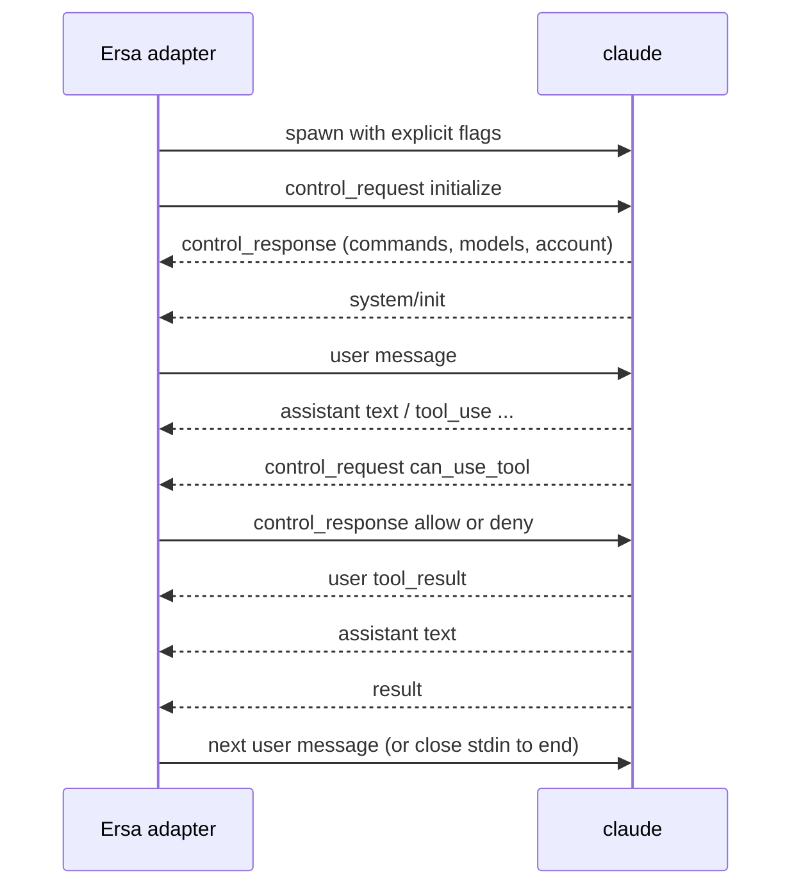

# Claude Code streaming JSON protocol

How the adapter drives the CLI's live stream, and how it reads the CLI's own session record, which is a session's history (ADR 0017). Observed on Claude Code 2.1.302 and 2.1.316 (Windows, winget install). Evidence is the fixture sets in `protocol/fixtures/claude-code/<version>/`; each stream `.jsonl` holds one line for each line the CLI wrote, in order, and each `.meta.json` records the command line, what was sent on stdin, exit code, and timings. Neither is the CLI's output untouched: every recording has the details of the login and of the machine it was made on replaced by placeholders before it is kept. Replaced are who the login is (every email address, the organization's name and id, and the plan's name, `subscriptionType`), how much it has used (every field named `utilization`, which reads 0.5 wherever it appears), and where things are on that machine (the home folder, the repository's own folder, in a path and in the CLI's encoded folder names, and the pair of ids in a synced plugin's path), and, in a sign-in's recordings, the one-time values in the sign-in page's address, its challenge and its state. So a fixture is evidence for the shape of those fields and never for their values: not for which plan a login has, how full a usage window is, whether two windows differ or what scale a share is on, nor for a real folder's name. What a recorder cuts besides, this brief says where it cites the fixture. The 2.1.302 set (fixtures 00 to 11) was recorded with an isolating invocation; the 2.1.316 set (`00-session-tools`, `01-session-resume`, and the rest unless this brief says otherwise) was recorded with Ersa's own invocation of the day (00 to 03 with `-p`, 06 without) by the repository's session-fixture recorder, which also keeps the session record the CLI wrote for each run, under `record/`. The model probe's exchange is recorded twice, with no session record since a probe writes none: fixture `2.1.316/55-probe-get-settings`, from the CLI unpacked from that version's npm package, and fixture `2.1.330/00-probe-get-settings`, above the tested range. A sign-in is recorded on 2.1.330 too, under `2.1.330/sign-in/`, by the repository's sign-in recorder (Signing in). A bare fixture number in this brief names a 2.1.302 fixture. The Claude Agent SDK's type definitions (`@anthropic-ai/claude-agent-sdk` 0.3.316, files `sdk.d.ts` and `sdk-tools.d.ts`) are the reference for field names and unions; they are proprietary and are read, not vendored.

## Parties

Ersa's Claude Code adapter (the host) and one `claude` process per session. The host starts the process, writes to its stdin, reads its stdout, and owns its lifetime. Two more processes belong to no session and are driven the same way: the model probe's (Invocation) and a sign-in's (Signing in).

## Transport and framing

Stdio. Newline-delimited JSON in both directions. Stdout lines are messages; stdin lines are user messages or control messages. Stdin must be flushed after every line. If stdin is left open with nothing written, the CLI waits about three seconds, warns on stderr, and proceeds (fixture 00). For one-shot runs stdin is closed or given an empty body.

## Invocation

Every behavior-affecting flag is passed explicitly (ADR 0014), and the session is otherwise an ordinary Claude Code session, launched the way the vendor's own IDE integration launches one (ADR 0017). The command Ersa uses:

```
claude --input-format stream-json --output-format stream-json --verbose
       --include-partial-messages --replay-user-messages
       --permission-mode default
       --setting-sources user,project,local
       --permission-prompt-tool stdio --await-initialize
```

- The command is the CLI's own name, `claude`, which Core finds on the host as PROTO-CORE-API-R148 says, for the probe and for a session alike; the process is given the search path Core looked along, beside the environment rules below. Ersa asks nobody where the CLI is. A test or a development setup can name another program in its place, which is no part of what a person sets up.
- No `-p`. The stream-json formats put the CLI in its headless mode on their own, which is how the VS Code extension starts it; the help's "only works with --print" holds for standalone use only (fixture 2.1.316/06-invocation-without-print). The fixture recorders that drive a stream session start it the same way; the one-shot recorder still passes `-p` with its prompt.
- `--setting-sources user,project,local` loads the user's, the project's and the local settings, and without `--strict-mcp-config` the user's MCP configuration loads too, so hooks, instructions and MCP servers apply as they do in the terminal. The workspace's always-allow rules (`permissions.allow`) apply only once the CLI's own trust record marks the workspace trusted. For a trusted project the adapter asks for that through the CLI's own mechanism: the `initialize` request carries `workspaceTrust { accepted: true, directory }`, where `directory` is the project's root, which Core passes with the session, and the CLI writes its own record, keyed by the repository's git root, so every linked worktree of the project shares it (fixture 2.1.316/03-workspace-trust). The response's `workspace_trust_recorded` says whether it was recorded; anything but `true` is a warning in the diagnostic log and the session starts regardless. From the next session on the rules apply without the CLI's stderr warning. An untrusted project's session never carries `workspaceTrust`. Ersa writes nothing to the CLI's configuration. Two consequences follow from the record being the CLI's: revoking trust in Ersa stops the attestation but leaves the CLI's record, so the repository stays trusted for terminal sessions; and a project added at a subfolder of a repository trusts that whole repository. This is for a trusted project only (ADR 0028): the CLI's own folder-trust prompt never appears in headless mode, so a session of an untrusted project loads the user's own settings and none of the workspace's configuration (its settings files and its MCP configuration). Fixtures 00 to 11 were recorded with `--setting-sources ""` and `--strict-mcp-config`, which isolate a session; Ersa no longer passes them.
- `--await-initialize` makes the CLI read the host's `initialize` control request during startup instead of racing it; the Agent SDK passes it. Fixtures 09 and 11 were recorded without it and still worked, so it is belt and braces, to be verified by a fixture.
- `--permission-mode` must be stated; the shelf flow depends on it.
- `--model` and `--effort` are passed when the session names them (`session.create`'s `model` and `effort`, PROTO-CORE-API), and on a relaunch as PROTO-CORE-API-R71, R98 and R99 say: what Core asked for while the record shows no change since, else the record's latest. They are left out otherwise, so the CLI's own defaults apply. For `backend.list` the adapter starts the CLI on the host, sends `initialize` and no message, reads `models` from the response (`value`, `displayName`, `resolvedModel`, `supportedEffortLevels`) and closes stdin (`stream-controls-2026-11-09.txt`); such a process writes no session record (`initialize-only-2026-11-09.txt`). The probe starts as a new session does (`--session-id`), in Core's own folder, with the user's settings alone and no project, which is the case that recording shows writing no record. It has 60 seconds, the time a session's `initialize` has: a CLI that does not answer in that time, exits first, or lists no models cannot report its models (PROTO-CLAUDE-CODE-STREAM-R56). The answer's `account` says whether the CLI is signed in. Signed out, it is `tokenSource: "none"` with `apiProvider: "firstParty"` and nothing else, and the answer still lists models (fixtures 2.1.316/38-signed-out-no-auto-memory, recorded in a scratch configuration folder, and 2.1.316/55-probe-get-settings and 2.1.330/00-probe-get-settings, recorded on the machine's own configuration). Signed in, it names an email, an organization and a plan and carries no `tokenSource` (fixture 2.1.316/00-session-tools, values replaced). Given a key by its environment and no sign-in, it carries `tokenSource: "none"` too, and beside it `apiKeySource`, naming where the key came from (fixture 2.1.330/01-probe-key-in-environment, a placeholder key, nobody signed in). Such a CLI was given a key in place of a sign-in, so Ersa does not list it as signed out; the recording sent no message and shows nothing of whether its sessions run. So the adapter lists the CLI as `signed_out`, with the models it reports, only for the first shape: `tokenSource` `none`, `apiProvider` `firstParty`, and no `apiKeySource` (PROTO-CLAUDE-CODE-STREAM-R83). Any other `account`, one of another provider or one a later version shapes differently, lists as before, and a session of it whose message fails as not signed in projects that as any session's does (PROTO-AGENT-EVENTS-R22). The CLI in its minimal mode gives the signed-out shape as well (fixture 2.1.316/37-bare-mode), and the probe sends no message, so it has no `system/init` to tell the two apart (Bare mode): a version that started bare by default would list as signed out, and no sign-in would change that. R54 is the guard against such a version, for a version that has a session recording, and FLOW-SIGN-IN-R12 is what the person is then told. The entry whose `value` is `default` is the default model, and choosing it passes no `--model`. The response marks no default effort, so the probe then asks `get_settings`, whose `applied.effort` is the effort a session given none runs with, and the adapter marks that level as the default (PROTO-CLAUDE-CODE-STREAM-R82). 2.1.316 and 2.1.330 both answer `medium`, 11 and 31 ms after the request (fixtures `2.1.316/55-probe-get-settings` and `2.1.330/00-probe-get-settings`, each recorded with a session's setting sources in an empty repository, where the probe passes the user's alone, as `applied-settings-2026-11-24.txt` did on 2.1.330 with the same answer). A CLI that doesn't answer it marks none. The effort labels (`low`, `medium`, `high`, `xhigh` and `max`) and the permission modes (`auto`, `default`, `acceptEdits` and `plan`) are what the adapter knows the CLI accepts. The CLI gives the modes no names to show, so the adapter names, orders and describes them as Claude Desktop's permission menu does (`claude-desktop/permission-menu-2026-11-24.txt`): Auto, Manual, Accept edits and Plan, each with the menu's sentence for it (PROTO-CLAUDE-CODE-STREAM-R80, R81). `default`, which reads Manual, is the mode the CLI starts in. `bypassPermissions` is not offered: the CLI refuses it to a session that was not launched with `--dangerously-skip-permissions`, which Ersa does not pass.
- `--permission-prompt-tool stdio` makes permission prompts arrive on the control channel (fixture 11). Without it, or without `initialize`, prompts are auto-denied (fixtures 05, 08, 09).
- `--include-partial-messages` adds `stream_event` lines for token-level streaming (fixture 02). Ersa passes it, so replies stream.
- `--replay-user-messages` echoes each stdin user message back on stdout as a `user` message with `isReplay: true`, when the CLI takes the message into a turn (fixture 07; 2.1.316 fixtures `52-replay-message-during-tool-turn` and `53-replay-two-messages-during-turn`). Ersa passes it (R62): the echo is the one thing on the stream that says when a message written during a turn stops waiting, and which turn took it in (Sequencing).
- `--session-id <uuid>` starts a new session under an id the host chooses, so Core knows the backend session id from the moment it starts the CLI; `system/init` later reports the same id. The adapter passes it for every new session and every fork, with `--resume` only beside `--fork-session`, and Core stores the id before it starts the CLI. A stored id may name no record yet, until the first message creates it; such a session reads as empty, never as a record that can't be read.
- `--resume <session_id>` continues a session; the CLI keeps the same `session_id` and appends to the same session record (fixture 04). The id is the one Ersa passed with `--session-id`, which `system/init` reports too, or for a session started elsewhere, the `session_id` of its `system/init`.
- `--resume <session_id> --fork-session --session-id <new id>` forks a session (FLOW-FORK-SESSION): the CLI copies the conversation into a new session record under the id the host chose, which the new process's `system/init` reports (fixture 16), and leaves the original's record as it was. A turn started before the CLI has read the record is copied part way (fixture 18), which is why Core forks only when the record's conversation ends with a finished reply and no other process has the session open (R17's registry), and holds sends to the original until the fork's backend is ready. The CLI writes a fork's record only with its first message (fixture 15), as for a new session. Until then Core shows the fork from the original's record, up to the last message the fork copied, so a fork closed before its first message keeps its conversation. `--resume` can't find such a fork, so `session.resume` starts it again from its original, as the original's record is by then and under `session.fork`'s own conditions (FLOW-RESUME-SESSION-R10); Ersa still shows the fork up to its fork point until its first message. The copy keeps the original's `custom-title` unmarked (fixture 19), so the adapter names a titled original's fork at launch with `--name <title>`, which the CLI announces as `system/session_title_changed` before the `initialize` response and writes to the fork's record with its first message (`stream-controls-2026-11-09.txt`); a fork of an untitled session announces no title (fixture 14). The fork is spawned in its own stored workspace path, never the CLI's reported `cwd`. That path is not the original's for a fork of a session in an isolated workspace: `--resume` finds the original's record from another folder (`claude-desktop/fork-2026-11-08.txt`).
- `--mcp-config <absolute path> --permission-prompt-tool mcp__<server>__<tool>` is the fallback permission route (fixture 10).

Environment: the adapter sets `CLAUDE_CODE_ENTRYPOINT=ersa`, so Ersa's sessions appear in the CLI's own session lists (the CLI hides sessions whose entrypoint is `sdk-cli`, `sdk-ts` or `sdk-py`). Listing a folder's sessions, the adapter hides the same ones, by the `entrypoint` their record's entries carry, so runs the SDK made with no one at the keyboard stay out of Ersa's list as they stay out of the CLI's (R79). It removes `CLAUDECODE`, `CLAUDE_CODE_CHILD_SESSION`, `CLAUDE_CODE_ENTRYPOINT`, `NODE_OPTIONS`, `TRACEPARENT` and `TRACESTATE` from the environment it inherits, so nothing from whatever started Ersa reaches the session. It also removes the variables that tie a process to another host's session (`CLAUDE_CODE_SESSION_ID`, `CLAUDE_CODE_HOST_SESSION_ID`, `CLAUDE_CODE_MESSAGING_SOCKET`, `CLAUDE_CODE_MESSAGING_TOKEN`, `CLAUDE_CODE_SSE_PORT`, `ENABLE_IDE_INTEGRATION`, `CLAUDE_AGENT_SDK_VERSION`: seen when Ersa is started from inside Claude Desktop or a VS Code terminal). It keeps every variable that configures Claude Code itself (its provider, limits and configuration folder), since the user's terminal sessions use those too, and a settings file's `env` key applies as usual. `ersa` is not a documented entrypoint value; if a release stops honoring it, sessions hide from the CLI's lists and resume by id still works.

## Messages (stdout)

Every message carries `type`, most carry `session_id` and `uuid`. Observed in this version:

### system / init

First stdout message of every one-shot session. In a bidirectional session the `initialize` response comes first, and `init` is emitted at the start of each turn, so the first `init` arrives only after the first user message has been sent (fixtures 09, 11). Fields of interest: `session_id`, `model`, `permissionMode`, `apiKeySource`, `claude_code_version`, `tools` (names), `mcp_servers` (name, status, source), `capabilities` (string list such as `interrupt_receipt_v1`, `msg_lifecycle_v1`, `sdk_mcp_manifests`), `output_style`, `agents`, `skills`, `plugins`, `cwd`, `fast_mode_state`, `view_mode`, `powershell_path`, `startup_timing`. Feature detection reads `capabilities` here, never version strings. On resume, `init` repeats with the same `session_id` (fixture 04); in a bidirectional session a second `init` is emitted at the start of each turn (fixture 07).

### assistant

`message.content` is an array of content blocks: `text`, `tool_use` (`id`, `name`, `input`, `caller`), `thinking` (`thinking` text, often empty, with `signature`). Carries `parent_tool_use_id` (null for the main thread). One `assistant` line per content block in practice (fixtures 03, 05). `message.usage` holds the token counts of the API call the message came from (`input_tokens`, `cache_creation_input_tokens`, `cache_read_input_tokens`, `output_tokens`), the same on each of the message's lines, with the output count partial until the message ends. Their sum is what the model holds after that call, so on a main-thread line it is the session's context in use (R71); a subagent's line counts the subagent's own context (2.1.316 fixture `34-tool-agent`).

### Tool targets and edits

Recorded on 2.1.316 for `Read` and `Bash` (fixture 00-session-tools), `Edit`, `Write`, `NotebookEdit`, `Grep`, `Glob`, `WebSearch` and `Agent` (fixtures 28 to 34), `ToolSearch` (fixtures 30, 33), `PowerShell` (fixture 35-tool-powershell) and an `Edit` whose `replace_all` is true (fixture 36-tool-edit-replace-all). `MultiEdit` and `WebFetch` are from the SDK types alone: 2.1.316 lists neither. A ticket that builds a row records its tool first where the CLI offers it. `system/init` lists the subagent tool as `Task`, but its call arrives named `Agent` (fixture 34), so the table names both. `NotebookEdit` and `WebSearch` are deferred tools: the model loads each through a `ToolSearch` call before its first use (fixtures 30, 33). The adapter fills `tool.requested`'s `target` and `edits` (`PROTO-AGENT-EVENTS`) from a `tool_use` block's `name` and `input`:

| Tool | `target` | `edits` |
|---|---|---|
| `Read` | `file_path` | none |
| `Write` | `file_path` | one, `new_text` from `content`, no `old_text` |
| `Edit` | `file_path` | one, from `old_string` and `new_string`, with `every_occurrence` when `replace_all` is true |
| `MultiEdit`, where the CLI still offers it | `file_path` | one per entry of `edits`, from its `old_string` and `new_string`, with `every_occurrence` when its `replace_all` is true |
| `NotebookEdit` | `notebook_path` | none |
| `Bash`, `PowerShell` | `command` | none |
| `Grep`, `Glob` | `pattern` | none |
| `WebFetch` | `url` | none |
| `WebSearch`, `ToolSearch` | `query` | none |
| `Task`, `Agent` | `description` | none |

A target's `target_kind` follows its tool: `path` for `Read`, `Write`, `Edit`, `MultiEdit` and `NotebookEdit`; `command` for `Bash` and `PowerShell`; `search` for `Grep`, `Glob`, `WebSearch` and `ToolSearch`; `address` for `WebFetch`; `task` for `Task` and `Agent` (PROTO-CLAUDE-CODE-STREAM-R61). Any other tool, an MCP server's included, carries neither. A field missing from the input, or not a string, leaves `target` or that edit out.

### user

Either an echoed stdin message (with `--replay-user-messages`; it carries `isReplay: true`, as a local command's output does too: 2.1.316 fixtures 25 to 27) or a `tool_result` block the CLI produced after running a tool: `tool_use_id`, `content`, `is_error`. Permission denials also arrive as a `tool_result` explaining the denial (fixtures 05, 06).

### stream_event

Only with `--include-partial-messages`. Wraps the Messages API stream events: `message_start`, `content_block_start`, `content_block_delta`, `content_block_stop`, `message_delta`, `message_stop` (fixture 02). The complete `assistant` line still follows.

### system / permission_denied

`tool_name`, `tool_use_id`, `message` (or `decision_reason_type` such as `asyncAgent` and `decision_reason` when `--permission-prompts none`). Emitted when an approval was needed and no host could answer (fixtures 05, 06, 08, 09).

### system / status, task_summary, post_turn_summary, thinking_tokens

Progress and summary lines. `task_summary` and `post_turn_summary` are absent from the SDK 0.3.316 types and marked internal in the CLI's own schemas, so they may change or vanish without notice; the fixtures are the reference for their shape. `post_turn_summary` carries `status_category` (`completed`, `blocked`) and `status_detail`; `thinking_tokens` carries running estimates. The rail's activity state is derived from `assistant`, `user` tool results, `control_request`, `status`, and `result`, which are supported surface; `task_summary` and `post_turn_summary` only add detail when present, and their absence changes no state.

### rate_limit_event

Emitted during turns; carries the login's rate-limit status in `rate_limit_info`: `status`, `resetsAt` (epoch seconds), `rateLimitType`, the overage fields, and `unifiedWindows`, the usage windows the login is counted against, each `{ utilization (from 0 to 1), resetsAt }` under its key, some with a `status` too. The fixtures show `seven_day` and `seven_day_overage_included`; the CLI's schema also has `five_hour`, not yet recorded. Every recorded `utilization` is the placeholder 0.5, so the recordings show a window's shape and never its share: the scale is as fixture 11 first read, 0.04 and 0.06, before the shares were replaced, and no recording has shown a share above 1. The adapter projects every one of them, in the line's order, as `usage.updated.rate_limit.windows` (R76). The CLI gives a window no name to show, so the adapter names the ones it knows as Claude Desktop's list of plan usage limits does (`claude-desktop/usage-limits-2026-11-15.txt`): Weekly · all models for `seven_day`, 5-hour limit for `five_hour` and Weekly · overage for `seven_day_overage_included`. A window under any other key keeps its key as its name, so a limit the adapter has not met still counts. A line with no `unifiedWindows` reports no list, so the last one stands. One whose `unifiedWindows` is empty reports an empty list, which replaces the last: the login is then counted against no window. No recording has one. A session has no windows until a turn has run.

### result

Ends a turn. `subtype` (`success` observed; error subtypes exist in the SDK types), `is_error`, `num_turns`, `duration_ms`, `duration_api_ms`, `total_cost_usd`, `usage` (input, output, cache tokens, service tier), `modelUsage`, `permission_denials` (array of `{tool_name, tool_use_id, tool_input}`), `terminal_reason` (`completed`, `api_error`), `result` (final text), `session_id`. The cost tile reads `total_cost_usd`, which is a running total for the session (fixture 07). The context ring reads `usage`, but its top-level token counts are summed over every API call in the turn and overstate the context; the context in use is the last entry of `usage.iterations`, falling back to the top-level counts when that list is absent. `modelUsage` gives each model's `contextWindow`, which is the session's window only while `get_context_usage` has given none for its current model (R74).

### Authentication failure

A synthetic `assistant` message with `model: "<synthetic>"`, `error: "authentication_failed"`, text "Not logged in", then a `result` with `terminal_reason: "api_error"` and zero usage (fixture 00). The adapter maps this to a session error state, not a transcript message.

## Session record

The CLI keeps each session at `~/.claude/projects/<encoded cwd>/<session id>.jsonl`, where the encoded cwd is the session's working directory with every UTF-16 code unit other than an ASCII letter or digit replaced by `-` (observed: `C:\Users\user\repo` becomes `C--Users-user-repo`; an emoji, two code units, becomes two dashes). An encoded name longer than 200 characters is cut to 200 and suffixed with `-` and the base-36 digits of the absolute value of a 32-bit hash of the path's UTF-16 units, computed from 0 as `h = h*31 + unit` with wrapping (verified on 2.1.316). One JSON entry per line, appended as the session runs, including turns taken outside Ersa. It is a session's history (ADR 0017); retention is the CLI's (`cleanupPeriodDays`, 30 by default), and a deleted record is a session Ersa no longer shows.

Entries the adapter reads:

- `user` and `assistant` entries: their `message` content blocks are identical to those of the stream message with the same `uuid` (the stream's `stop_reason` and `usage` are partial where the record's are final), so one projection of messages serves both inputs, and `uuid` is the message id on which record and live stream are merged.
- `system` entries with subtype `local_command`: a local command's output (from `/rename`, say), which the stream carries as a synthetic `assistant` message (`model: "<synthetic>"`) with the same `uuid`. The adapter projects it as it projects that synthetic message, so history shows what was shown live, with one difference: the stream numbers the message's block under its own `message.id`, which the record entry does not carry, so the record's block id is the entry's `uuid` followed by the block index. The output is the entry's `content` inside `<local-command-stdout>` or `<local-command-stderr>` tags, either or both; the text inside the tags is projected as the stream carried it. An entry whose `content` has neither tag is the command's echo, which older CLIs (2.1.215) wrote beside the output, and projects to nothing. An entry whose `content` starts a tag it does not close, or is not a string, is a drifted entry: a protocol error and a passthrough, as for a drifted `user` or `assistant` entry.
- On a `user` entry carrying a tool result, `permissionDecision` (`decision`, `source`, `reasonType`, `grantScope`): parsed, but how history shows a decision is open (`PROTO-AGENT-EVENTS`, open questions).
- `custom-title`, `ai-title` and `last-prompt` entries: the title the user set, the title the CLI generated, and the latest prompt the CLI noted.

The conversation is one chain, not the whole file. Each entry names its `parentUuid`; a rewind or a prompt edit in the terminal starts a new branch while the old one stays in the file, and a subagent's entries (`isSidechain`) may sit in it too. The conversation is the chain from the latest main-thread entry back through `parentUuid`, following `logicalParentUuid` across a compaction so the history before it stays. A compaction that keeps part of the conversation leaves the entries after it chained to the kept segment, not to the summary: only its `system/compact_boundary` names the summary, as `compactMetadata.preservedSegment.anchorUuid`, with the kept segment's first entry as `headUuid` (fixtures 44, 45). So from that first entry the chain also reaches the summary, and through it the boundary. Such a boundary's `logicalParentUuid` is not followed: it names the kept segment's last entry as it was when the compaction ran, which a later edit inside the segment may have left on an abandoned branch, and the history before the compaction comes through the first entry's own `parentUuid`. The conversation's entries are read in the record's order, so the summary shows once, after the kept segment, where the compaction happened. Abandoned branches and sidechain entries are not the conversation.

The record omits text deltas (`stream_event`), permission prompts, `result` (turn end, cost) and rate limits; those are live only. The adapter ignores every other entry. The wrapper around `message` (every field of an entry other than `message`) is internal to the CLI and changes between versions. It is pinned the way the stream is: session-record fixtures recorded per CLI version beside the stream fixtures, and the same warning above the newest tested version. The only supported readers (`listSessions`, `getSessionMessages`) are in the TypeScript and Python Agent SDKs, which Core cannot use.

### Listing

The sessions of a directory are the record files under its encoded path. To list them the adapter reads the head and the tail of each file, never the whole file. Each session's title is its latest `custom-title`, else its latest `ai-title`, else its last prompt, else its first prompt. The last prompt is the latest `last-prompt` entry, else the last prompt entry in the tail; a prompt is a `user` entry the person wrote, never one the CLI wrote (`PROTO-AGENT-EVENTS`, projection rules). A title is one line, cut at 200 characters. In print mode `/rename <title>`, sent as a user message, writes a `custom-title` entry, and no `ai-title` appears unless the host asks for one (2.1.316 fixture `01-session-resume`), so an Ersa session the user has not renamed lists under the name the CLI generated when the adapter asked (Naming a new session), else under its last prompt. A session's last activity is the `timestamp` of the latest `user` or `assistant` entry in the tail. Its model and effort are those of the session's own latest `assistant` entry whose model is not `<synthetic>` (`message.model`, `effort`), never a subagent's entry (`isSidechain`), whose model is not the session's, and its permission mode that of the latest `user` entry that carries `permissionMode`; tool results, meta and local-command entries carry none (`record-reports-2026-11-09.txt`). Core weighs each against its own last request for that value (PROTO-CORE-API-R71), so it gives the adapter a time per value, and the adapter reports with each value when its turn began. A turn begins at a prompt: only a prompt carries `permissionMode`, stamped when its turn starts (2.1.316 fixtures `22-message-during-turn` and `23-mode-change-while-waiting`), so an entry's turn began at the latest `user` entry carrying `permissionMode` that is not after it. A value counts only from a turn that began after the time Core gave for it, and from any turn when Core gave none. Listing reads only the tail, so a value the tail does not hold is reported as none and Core's request stands; a value the tail holds without its turn's start is reported only when Core made no request for it. Before a relaunch the adapter reads back from the end of the record until it has found each value or reached the time of Core's request for it, and it also reports what the first turn after each request ran with, which Core's relaunch rule compares with the latest (PROTO-CLAUDE-CODE-STREAM-R60). Entries are not written in time order, so the latest is the one with the latest `timestamp`.

### Renaming

A session's title is the backend's, so renaming a session from Ersa renames it in the CLI and the new title shows in the CLI's own tools too. While Ersa's CLI process for the session is live, the adapter sends the `rename_session` control request: `{ subtype: "rename_session", title, source: "host", session_id }` (fixture 2.1.316/03-session-rename). `source: "host"` makes the CLI count it as the user's rename, and `session_id` makes a CLI that has moved to another session refuse it. The CLI answers with a bare `{ subtype: "success", request_id }` after writing a `system/session_title_changed` line (`title`) and then writes the `custom-title` entry itself; `session_title_changed` projects as a passthrough. `session_title_changed` announces the session's name, the user's: the CLI sends it after each change to the name and never for a title it generated, and a name another session already has may be announced with a suffix that makes it unique (the 2.1.316 CLI's own schema for the message; no fixture records a suffix yet). The name the CLI announced, suffix included, is the session's title, not the one the rename asked for. The CLI takes `rename_session` before the session's first message too: it answers success and announces `system/session_title_changed` at once, holds the name, and writes it as the `custom-title` entry when the first message creates the record (fixture 2.1.316/09-session-id-rename). So a starting session is renamed like any live one: a rename that arrives before the CLI has answered `initialize` waits for that answer, and until the record holds a title the session's title is the latest one the CLI announced. A new session is started with its first message (FLOW-NEW-SESSION-R04), so the CLI writes the name as soon as that message reaches it; a CLI that exits before then has failed to start, and its session goes, name and all (FLOW-NEW-SESSION-R08). The user's name (`custom-title`) and the CLI's own (`ai-title`) are separate entries, and the user's wins (Listing). Otherwise the adapter appends a `custom-title` entry to the session record (`{"type":"custom-title","customTitle":"<title>","sessionId":"<session id>"}`, as the 2.1.316 fixtures record it), as the vendor's IDE extension does. Besides deleting a session (Deleting), this is the only change Ersa makes to a session record. It appends even when the live-session registry says another process has the session open: that process shows the new name when it next reads its record's tail (after about 32 KB of its own writes, or at a compaction) and may write its old name again until then, so Core tells the user with the same notices a resume gives (PROTO-AGENT-EVENTS-R15).

### Naming a new session

The CLI names a session only when its host asks, as the VS Code extension does; a session whose host never asks gets no generated title (probed on 2.1.316 with Ersa's invocation, #280). The request and its answer are fixture `2.1.316/43-session-title`: the answer arrives before the CLI's echo of the first message, and the record gets the `ai-title` entry. The adapter asks once, for a new session it started with `--session-id`, when the CLI has accepted the first of the session's messages that has words (a message of attachments alone waits for the next): the `generate_session_title` control request, `{ subtype: "generate_session_title", description: <the message's words>, persist: true }`. With `persist: true` the CLI writes the `ai-title` entry itself, so Ersa stores no title (ADR 0033). The CLI answers with `{ subtype: "success", response: { title } }`, in the recording before the turn's first reply; later turns leave the name unchanged. The adapter doesn't wait on it: the turn goes on, and the request has a deadline of 5 minutes, since a model writes the answer, longer than the adapter allows other control requests. A generated name raises no stream line, so the answer is when the adapter learns it. A resumed session or a fork asks nothing: a fork is named at launch (PROTO-CLAUDE-CODE-STREAM-R45). So only the process that started the new session asks. A relaunch before any message, when the session has no record yet, starts it under its id again and asks there; a relaunch after a message resumes it and asks nothing, so a session relaunched before its first message with words keeps the title its record gives, its last prompt (Open questions).

A rename wins: once a rename has been sent or `system/session_title_changed` seen at any time in the session, a generated name is not reported as the title. Until the record holds the `ai-title` entry, the adapter reports the generated name as the title, as R36 does for an announced one. When the CLI declines, answers an error or an unknown subtype, returns no title, or the deadline passes, the session has no generated name and is titled as Listing says; nothing is shown to the user and the turn is not delayed.

### Deleting

When the user deletes a session (FLOW-ARCHIVE-DELETE-SESSION), the adapter deletes its record file, `<session id>.jsonl`, and the folder of the same name beside it, which holds the session's subagent transcripts and stored tool results; it deletes nothing else of the CLI's. It deletes only when the live-session registry shows no process has the session open, Core having stopped its own first (PROTO-CORE-API, `session.delete`), never when the registry cannot say, and a record already gone counts as deleted. The folder goes first and the record file last, so a deletion that stops part way leaves the file. Core can call a deletion off, as it does when it gives up on one that takes too long (PROTO-CORE-API-R91): the adapter then begins no further deletion, so a deletion called off before the record file's removal has begun leaves the session in the CLI's own tools. PROTO-CLAUDE-CODE-STREAM-R31, R33, R37 and R55 are its requirements. This and appending a `custom-title` entry (R22) are the only changes the adapter makes to the CLI's files.

### Live-session registry

The CLI writes `~/.claude/sessions/<pid>.json` for each running process, naming the session it has open. Before resuming a session the adapter reads the registry and reports one of three answers: not open, open by running processes (with every pid that has it open), or unknown (a registry file it could not read). Core's resume asks before starting the backend and turns an open or unknown answer into a `session.notice` (`PROTO-AGENT-EVENTS`), since resuming a session another process has open would interleave both transcripts in one record. Core asks the same before appending a title to the record of a session it is not running.

## Control channel

### initialize (host to CLI)

```json
{"type":"control_request","request_id":"<host chosen>","request":{"subtype":"initialize","hooks":{}}}
```

Sent before the first user message. The CLI answers with `control_response` whose `response` carries `commands`, `agents`, `models`, `account`, `output_style`, and `claude_code_version` (fixtures 09, 11). 2.1.302 also sends `capabilities` (a shorter list than `system/init`'s, not used for feature detection), `pid`, `current_permission_mode`, and `session_state`, none of which are in the SDK 0.3.316 types. Optional request fields of interest for Ersa: `appendSystemPrompt` and `systemPrompt` (modes), `agents`, `skills`, `title`, `sdkMcpServers` with `sdkMcpServerConfigs` (in-process harness tools), `supportedDialogKinds`, `perTaskStopAffordance`.

### can_use_tool (CLI to host)

Arrives only after `initialize` and only with `--permission-prompt-tool stdio`:

```json
{"type":"control_request","request_id":"<cli chosen>","request":{"subtype":"can_use_tool",
  "tool_name":"Bash","display_name":"Bash","input":{...},"description":"...",
  "permission_suggestions":[{"type":"addRules","rules":[{"toolName":"Bash","ruleContent":"echo probe *"}],"behavior":"allow","destination":"localSettings"},
                            {"type":"addDirectories","directories":["..."],"destination":"session"}],
  "blocked_path":"...","tool_use_id":"toolu_..."}}
```

Other fields per the SDK types: `decision_reason`, `decision_reason_type`, `classifier_approvable`, `suppress_always_allow_rule`, `default_to_no`, `requires_user_interaction`, `agent_id`, `title`. The shelf renders `display_name`, `description`, `input`, `blocked_path`, and offers the `permission_suggestions` as "allow for this session" options.

The host answers:

```json
{"type":"control_response","response":{"subtype":"success","request_id":"<same>",
  "response":{"behavior":"allow","updatedInput":{...},"updatedPermissions":[...]}}}
```

or `{"behavior":"deny","message":"...","interrupt":false}`. An allow always carries `updatedInput`: the original `input` unless the user edited it, as recorded. After an allow the tool runs and its `tool_result` follows as usual (fixture 11).

### Questions

Claude Code asks the user a question through its `AskUserQuestion` tool, which arrives as a `can_use_tool` request like any other, with `tool_name` and `display_name` `AskUserQuestion`, `requires_user_interaction: true`, and no `description` or `permission_suggestions`. Its `input` is `questions`, one to four of `{ question, header, options, multiSelect }`, where `header` is a short label and `options` are `{ label, description }`. Observed on 2.1.316 in fixtures `07-question-answer`, `08-question-interrupt` and `09-question-deny`, which were recorded with an isolating invocation (`--setting-sources ""`, `--strict-mcp-config`, no `--include-partial-messages`), not Ersa's own.

The adapter projects such a request to `question.asked`, not `permission.requested` (`PROTO-AGENT-EVENTS`): each question's id is its index, each option's id its index, and `takes_text` is true. It answers `session.answer_question` with an allow whose `updatedInput` is the request's `input` plus `answers`, an object keyed by each question's `question` text whose value is the chosen option's `label`, the chosen labels joined by ", " for a multi-select question, or the user's own words. The CLI takes any string as an answer, words that are no option's label included, and its tool result echoes the answers back (`tool_use_result.answers`). A declined question is a deny whose `message` is "The user declined to answer."; the agent reads that message and carries on without answers.

The host's answer projects to `question.answered`, read back from the line Ersa wrote: each `answers` key names the question with that text, and its value is the option whose label it equals, or for a multi-select question the options whose labels, joined by ", " in the request's order, equal it; any other value is the user's own words. Two questions with the same text share one key in the CLI's own answer too, so the adapter gives both the same answer, and `session.answer_question` refuses answers that give them different ones (`PROTO-CORE-API`). A question whose text has no key gets no answer, so `question.answered` may hold fewer answers than there are questions; a key that names no question is ignored; an empty value for a multi-select question is no options chosen; and where labels holding ", " let more than one set of options join to the value, the set whose labels come earliest wins. A deny projects as `declined`. After an interrupt the CLI sends `control_cancel_request` for the pending question and ends the turn; that, or a question left unanswered when the turn ends, projects as `answered_by` `backend`.

### User message (host to CLI)

```json
{"type":"user","message":{"role":"user","content":[{"type":"text","text":"..."}]}}
```

`parent_tool_use_id` is omitted for the main thread. The SDK types mark it required, but every recorded stdin user message omits it and the CLI accepts that.

A message with attachments (PROTO-CORE-API, Turns and attachments) carries more content blocks, in this order: the user's text block, when there is text; one `image` block per image, `{"type":"image","source":{"type":"base64","media_type":"image/png","data":"..."}}`, in the order attached; then, when there are files or folders, one text block listing their paths relative to the workspace, one per line, each after `file: ` or `folder: `, between an opening `<ersa-attachments>` line and a closing `</ersa-attachments>` line. The CLI takes PNG, JPEG, GIF and WebP images of up to 5 MB each; those are the limits the adapter states. Projecting a record entry, the adapter reads an `image` block, and a text block that is exactly such a list, as the message's attachments, never as its text, so neither reaches the transcript's words. Listing leaves them out of a prompt's text too, so a message of attachments alone titles nothing and the title rule moves on. The record keeps the blocks as sent (fixture 2.1.316/07-attachments). Beside an image, the CLI writes an `isMeta` user entry whose only text is `[Image: source: <path of the CLI's cached copy>]`; the adapter projects such a record entry only to `backend.passthrough`, never to a `user.message`, since the image already shows as the message's attachment. The live stream does not carry it. The fixture has one image, so whether several images make one entry or several is not yet recorded. For a message of a file list alone the CLI leaves `last-prompt` at the prompt before, which agrees with the title rule; a message of an image alone is not yet recorded.

### control_cancel_request and keep_alive

Either side may send `{"type":"control_cancel_request","request_id":"..."}` to withdraw one of its own in-flight control requests; the receiver stops working on it and ignores any late answer. From the CLI it typically withdraws a pending `can_use_tool` prompt (after an interrupt, say), so the adapter treats the request as no longer pending and the shelf drops it. `{"type":"keep_alive"}` is a heartbeat with no meaning beyond liveness. Both are modeled from the SDK types. A host's cancel is recorded once, for a sign-in's pending wait: the CLI wrote nothing in reply, neither an acknowledgment nor an answer to the withdrawn request (fixtures 00-sign-in-stopped and 03-sign-in-abandoned; Signing in). `keep_alive` is not yet recorded; record a fixture when the adapter implements interrupt.

### Other control requests the adapter uses

`interrupt`, `set_permission_mode`, `set_model`, `get_context_usage`, `get_session_cost`, and `mcp_message` (for `sdkMcpServers`). Shapes per the SDK types; `set_model`, `set_permission_mode` and `apply_flag_settings` are recorded (fixtures 25, 26), as is `get_context_usage` (fixtures 44 to 46), the rest to be recorded as each is implemented. `set_model` takes a model's `value` and answers the resolved id, and `set_permission_mode` takes `mode`, answers it (`{"mode":…}`) and is followed at once by a `system/status` line carrying `permissionMode`; the adapter takes the mode from the answer as well as the line, so the session reports its new mode as soon as the request is answered (PROTO-CLAUDE-CODE-STREAM-R70); the next `system/init` reports both (`stream-controls-2026-11-09.txt`). `apply_flag_settings` with `effortLevel`, sent between turns, changes the effort from the next turn, which the record's next `assistant` entry shows (`record-reports-2026-11-09.txt`). Before the first turn the `initialize` response's `current_permission_mode` says the mode. Sent during a turn, `set_model`, `set_permission_mode` and `apply_flag_settings` apply at once, from the turn's next model call, and `set_permission_mode` governs the turn's later tool calls (fixture 26); `set_model` answers `{"model":"<resolved id>"}`, `set_permission_mode` answers `{"mode":...}`, and `apply_flag_settings` `{"settings":{"effortLevel":...}}` answers success with no `response` (25, 26). `set_model` and `/compact` write a local-command exchange to the record as `user` entries (`<command-name>`, `<local-command-stdout>`), appended after a running turn ends and stamped when sent; a control writes no `queue-operation`.

`get_context_usage` takes nothing and answers what the CLI's `/context` shows (2.1.316 fixtures `44-context-usage`, `45-context-usage-resumed` and `46-context-usage-during-compact`): `totalTokens`, the tokens the model holds for the conversation; `rawMaxTokens` and `maxTokens`, the context window; `model`, the model those figures are for; and more that Ersa does not read, among it `categories`, `percentage`, `apiUsage`, the CLI's compaction settings, and lists of the machine's own agents, skills, MCP tools and memory files, which the recorder elides. It answers before the first turn, with what the system prompt and the tools take, and for a resumed session before any message, with the whole resumed conversation. `totalTokens` is the CLI's estimate, summed from its categories, and leaves out the latest reply's output, which R71's count includes, so the two differ by that reply's length. The adapter asks when the CLI has answered `initialize`, after each `set_model` the CLI answers, and after each `compact_boundary`, so a session shows its context before its first turn ends, a resumed one as soon as it starts, and a compacted one its new size (R72). The first request is written within the time `initialize` has, so a CLI that has stopped reading its input fails the start as it would fail the first message. A `set_model` the CLI refuses changes no model, so nothing is asked after it. The request after a `compact_boundary` is answered once the compacting turn has ended, with the compacted count (fixture 46). A request that fails or is never answered changes nothing (R73). Its window is the CLI's own answer about the model the session runs with, so it is the one Ersa reports; `result.modelUsage` gives the window only while this request has given none for the current model (R74). The current model is the one the stream last reported (`system/init`, `set_model`'s answer), and an answer's window counts for the model the answer names, else for that one. On the pinned CLI both sources give the same window (fixture 44). A `compact_boundary`'s own `post_tokens` is not the context in use: the turn after it reports far more (2.1.316 fixture `27-compact-between-turns`).

## Sequencing



- One turn runs at a time. A user message written during a turn waits in the CLI, which takes it in at its next model call. A turn that uses tools takes it into itself after a tool's result, and no turn runs for it (2.1.316 fixture `52-replay-message-during-tool-turn`). A turn with no model call left ends first, and the message runs as the next turn, opened by its own `system/init` after `result` (`22-message-during-turn`). The CLI takes in every message waiting at once, as one message holding their content blocks in the order written (`53-replay-two-messages-during-turn`), and its echo says when (Invocation). `interrupt` ends only the running turn, and the waiting message then runs (`24-interrupt-with-waiting`, `stream-controls-2026-11-09.txt`).
- A waiting message projects from its echo. A message written while a turn runs, or while another waits, projects only a passthrough from its host line; the echo that takes it in is its `user.message`, under the echo's `uuid`, in the turn that takes it in (R63), and several taken in together are one `user.message`, as the record keeps them (R64). A message written to an idle CLI opens its turn and projects from its host line, so Core's answer to `session.send` names the turn and the message shows at once; its echo projects to nothing more, unless it also holds messages written just after it, which project from the rest (R65). Echoes are matched to messages in the order written, by their first content block (the CLI ends a text block it joins to another with a newline). An echo that begins as no message it could repeat or take in, as a local command's output does, is a passthrough (R66), and a message written to an idle CLI that has no echo by its turn's end, as `/compact` has only its output's, is not waited for. How many messages wait is those written while a turn ran or others waited, less those the echoes hold (R68); the session is working while any does (R67). The count follows what the stream says: Ersa keeps no queue of its own to send from.
- The record follows. A message that runs as its own turn has a `queue-operation` `enqueue` when written and a `dequeue` when the turn before it ends, neither carrying the message (`record-reports-2026-11-09.txt`). Its prompt's `user` entry, whose `uuid` is its echo's, is stamped when its turn starts, not when written, and holds the permission mode its turn starts with (fixtures 22, 23); messages taken in together share one entry (53). A message a turn takes in part way has no prompt `user` entry: after its `enqueue` the record holds an `attachment` entry of type `queued_command`, on the conversation's chain, with the message's content blocks as sent in `attachment.prompt` and its echo's `uuid` in `attachment.source_uuid`; then a `queue-operation` with `operation` `remove`, `reason` `absorbed_mid_turn`, the echo's `uuid` in `commandUuid` and, in `content`, the message's text blocks joined by newlines, so its images are not there and its `<ersa-attachments>` block sits among its words (52, 54). Read back, the message is the attachment entry's blocks, projected as a prompt entry's are (R26) and shown where the `remove` is; a record with no such attachment entry shows the `remove`'s `content` (R77). The adapter counts no `queue-operation` entries: the echo says the same on the stream, and only a live session shows a count (PROTO-CORE-API-R81). An interrupt with a message waiting answers `{"still_queued":[]}`; the interrupted turn keeps its partial `assistant` entry and adds a `[Request interrupted by user]` `user` entry with no `permissionMode` (24). A compaction writes `system/compact_boundary`, an `isCompactSummary` `user` entry and the `/compact` local-command entries, none with `permissionMode` and no `assistant` entry (27).
- Live and record differ on three kinds of line: a local-command's stdout, the interrupt marker and a compaction summary arrive on the stream as `user` lines, projected as `backend.passthrough`, and are projected from the record as a `system` `user.message`. The parity tests name them as known divergences; a view kept across a resume holds the record's projection of what came before the resume and the live one of what comes after (PROTO-AGENT-EVENTS-R24).
- A `can_use_tool` request must be answered before the turn continues; an unanswered request stalls the turn.
- Closing stdin after `result` ends the process cleanly with exit 0 (fixtures 07 to 11).

## Errors and recovery

- Authentication failure: see above. Surface as a session error with the action `log_in`, which Ersa shows as the backend not being signed in, with Sign in (FLOW-SIGN-IN-R16, R17).
- Process exit without `result`: treat the turn as interrupted; the session record keeps the messages already written.
- Unknown message types: project to a typed passthrough event. Never drop.

### Bare mode

The CLI's `--bare` minimal mode skips the user's sign-in, hooks, CLAUDE.md and auto-memory. Ersa never passes it, but the CLI's makers have said a future version may make it the default for runs like Ersa's, and no flag turns it off. In bare mode the session fails on its first message as if the user were signed out, and its `system/init` has none of `scratchpad_path`, `memory_paths` and `messaging_socket_path` (fixture 2.1.316/37-bare-mode). The first two are not enough, alone or together: a signed-out session's lacks `scratchpad_path` (fixture 2.1.302/00-not-logged-in), and with auto-memory off it lacks `memory_paths` too, while it keeps `messaging_socket_path` (fixture 2.1.316/38-signed-out-no-auto-memory). The adapter takes a live session as bare only when all three are missing, so that a signed-out user is always asked to sign in. A session opened from its record has no `system/init`, so its history shows the failure as a sign-out, and the conformance fixtures of each newly tested version show the mode the CLI starts in. A signed-out 2.1.330 started with Ersa's session command line is not in its minimal mode: its `system/init` keeps `memory_paths` and `messaging_socket_path` (fixtures 01-sign-in-stopped-running and 04-sign-in-abandoned-running).

### Signing in

A person signs in to Claude Code from inside Ersa, through the CLI's own sign-in (ADR 0040, FLOW-SIGN-IN). The adapter starts it and learns how it ended over the control channel. Everything here comes from recordings made on Windows by the repository's sign-in recorder, each with a session that ran all along and a probe made afterward. The first set, of 2026-11-26 on 2.1.330: a sign-in the host stopped at once (fixture 00-sign-in-stopped), one nobody completed, which the host stopped after two minutes (fixture 03-sign-in-abandoned), and one a person finished (fixture 06-sign-in-finished); `sign-in/notes-2026-11-26.txt` says how each was made. The second, of 2026-11-27, needed no account: six more cases on 2.1.330 (fixtures 10-sign-in-closed-after-cancel to 28-sign-in-key-in-environment-probe) and a start and a stop on 2.1.316, the tested version (`2.1.316/sign-in/`), each folder's `notes-2026-11-27.txt` saying how. 2.1.330 is above the tested range (Versioning). What one of the vendor's own hosts does with the same requests, the Claude Code extension for VS Code, is written down in `claude-code-vscode/sign-in-2026-11-27.txt`, read from the extension and not run. The rules are for the local host, the only one Core has. What no recording shows is listed at the end, and no requirement of this brief rests on it.

**The process.** A sign-in runs on a CLI process of its own, which the adapter starts for that sign-in alone (PROTO-CLAUDE-CODE-STREAM-R84). It starts as the model probe's process does (Invocation): a new session under an id of its own, in Core's own folder, with the user's settings alone and a session's environment, sent `initialize` and no user message. It is never a session's process: a sign-in is a backend's on a host and no session's (PROTO-CORE-API, Signing in), the new-session screen has no session, a session's process can be stopped while the person is still on the vendor's page, and the recordings show a second CLI and nothing else. The recorded process differed from the adapter's in three ways no recording covers: it had a session's setting sources in an empty folder, its configuration folder was a scratch one, so the machine's own CLI stayed signed out, and it was started without `ANTHROPIC_API_KEY`, `ANTHROPIC_AUTH_TOKEN` and `CLAUDE_CODE_OAUTH_TOKEN`, which the adapter leaves as it finds them.

**Starting.** Once the CLI has answered `initialize`, the adapter sends:

```json
{"type":"control_request","request_id":"<host chosen>","request":{"subtype":"claude_authenticate","loginWithClaudeAi":true}}
```

`loginWithClaudeAi: true` asks for the sign-in with a Claude subscription, which the CLI's help gives as `auth login`'s default (`sign-in-help-2026-11-25.txt`); FLOW-SIGN-IN starts a backend's sign-in as the backend offers it by default. The CLI answered `success` within about 20 ms, with two web addresses and nothing else (fixtures 00-sign-in-stopped, 03-sign-in-abandoned and 06-sign-in-finished), and in the one run a person watched it opened no browser itself (fixture 06-sign-in-finished: the person said no page had opened, and the recorder opened one). Both addresses are the vendor's sign-in page over `https`, and they differ in where that page sends the person afterward. `automaticUrl` returns to a callback the CLI listens on, on the machine it runs on, so the CLI learns the outcome with nobody carrying anything to it. `manualUrl` returns to a page of the vendor's, where the person would copy a code for a host to pass on with `claude_oauth_callback`. Ersa relays no code and has no field for one (ADR 0040, FLOW-SIGN-IN-R08), so the adapter never hands over `manualUrl` and never sends `claude_oauth_callback`. It sends `claude_oauth_wait_for_completion`, then hands Core `automaticUrl` as the address of the sign-in's page, and the sign-in has started (PROTO-CLAUDE-CODE-STREAM-R85); the Interface opens the address in the person's browser (PROTO-CORE-API-R155, FLOW-SIGN-IN-R04). The wait goes first, as recorded: a browser already signed in to the vendor may finish within seconds of the page opening (`sign-in/notes-2026-11-26.txt`), and a wait sent after a sign-in is done is not recorded.

A start that does not get that far fails, and no process of the adapter's is left (PROTO-CLAUDE-CODE-STREAM-R86). When the CLI answers `claude_authenticate` with an error, as it answers a control request it does not know (`stream-controls-2026-11-09.txt`, `set_effort`), the backend has refused, and the reason is the CLI's own words (PROTO-CORE-API-R157). When the CLI answers `initialize` with an error, answers `claude_authenticate` with no such address, or ends before the address is handed over, the adapter could not start one, and says which in words of its own (PROTO-CORE-API-R166). A start Core gives up on, at its 20 seconds or on a cancel, is not the adapter's to stop: Core lets go of it, which ends its process (PROTO-CORE-API-R157, R162).

**Ending.** Once a sign-in has started, the adapter learns its ending from the answer to `claude_oauth_wait_for_completion` (PROTO-CLAUDE-CODE-STREAM-R87):

- **Signed in.** The CLI answers `success`, in the recording about 10 seconds after the page opened (fixture 06-sign-in-finished). The answer names the account, and the adapter reads none of it.
- **Failed.** The CLI answers with an error, and the reason is the CLI's own words; or the process ends with the wait unanswered, and there is no reason of the backend's to give, so the note says only that the sign-in didn't finish (FLOW-SIGN-IN-R13). No recording shows either: this is what the adapter does with them, not a claim that the CLI ends a sign-in so.
- **Nothing.** A sign-in nobody completes is never answered: the CLI wrote nothing for two minutes (fixture 03-sign-in-abandoned), and nothing when its host withdrew the wait. So `canceled` and `timed_out` are Core's to name (PROTO-CORE-API-R160, R161).

A line that is not the first answer to one of the adapter's own requests changes nothing, before the start or after (PROTO-CLAUDE-CODE-STREAM-R88); the finished recording has one, a `system` line of subtype `commands_changed`, written just before the answer. Core then stops the sign-in, whatever its ending, and detects the backend again before it reports `signed_in` (PROTO-CORE-API-R159). A CLI started after a finished sign-in's process had exited answered `initialize` as signed in at once, its `account` naming an email, an organization and a plan with no `tokenSource` (fixture 08-sign-in-finished-probe), which R83 does not list as signed out. After a stopped or an abandoned sign-in it read signed out as before (fixtures 02-sign-in-stopped-probe and 05-sign-in-abandoned-probe).

**Stopping.** Core stops a sign-in when the person cancels, when its 10 minutes are up, when Core shuts down, and after an ending the CLI reported. The adapter withdraws a wait the CLI has not answered, with `control_cancel_request`, closes the process's stdin, and has stopped once the process has exited (PROTO-CLAUDE-CODE-STREAM-R89). It waits for no word about the cancel, since the CLI gives none: stopped at once or after two minutes, it wrote no answer and no acknowledgment, and exited 0 within about 0.2 seconds of its stdin closing (fixtures 00-sign-in-stopped and 03-sign-in-abandoned). After a finished sign-in, with no wait left to withdraw, closing stdin ended it the same way (fixture 06-sign-in-finished). Those recordings closed stdin 5 seconds after the cancel, and the adapter closes at once, which a later one shows ends the process the same way: stdin closed 1 ms after the cancel, nothing more written, exit 0 within about 0.25 seconds (fixture 10-sign-in-closed-after-cancel), and the same on 2.1.316 (`2.1.316/sign-in/notes-2026-11-27.txt`). Closing stdin with the wait pending and no cancel ended it too (fixture 13-sign-in-closed-while-waiting). A process still running 3 seconds after its stdin closed is ended by the adapter, so none is left either way (PROTO-CORE-API-R162).

**What Ersa keeps of a sign-in: nothing.** No line either way carried a token, a key or an authorization code (`sign-in/notes-2026-11-26.txt`, the redactor's check), which is why Ersa can use this route (ADR 0040). The address still carries one-time values, and the ending's answer names the account. PROTO-CORE-API-R163 is the rule: nothing a sign-in exchanges is written to the diagnostic log or the app log, and nothing of one is stored. The adapter is part of Core (ADR 0031), so the rule is the adapter's too, and covers every line the sign-in's process reads or writes, its stderr included: the model probe's process writes its stderr to the diagnostic log, and the sign-in's does not. The adapter may log words of its own: that a sign-in started, how it ended, and the process's exit code. Two things are the adapter's alone to keep (PROTO-CLAUDE-CODE-STREAM-R90). It hands Core the address, how the sign-in ended and a failure's reason, and nothing else the process wrote; a reason quotes nothing of the process but the error text of its answer to one of the adapter's requests. And the process has no raw log, which is a session's.

**Sessions already running.** Nothing here touches a session: the sign-in's process is its own (R84), and in Core a sign-in touches no session (PROTO-CORE-API, Signing in). The recordings show one case where that is enough. A session started signed out before the sign-in, and sent its first message after a finished one, was answered by the model with no restart (fixture 07-sign-in-finished-running); after a stopped or an abandoned sign-in the same message failed as not signed in (fixtures 01-sign-in-stopped-running and 04-sign-in-abandoned-running). Such a session goes on with the model it started with, which its `system/init` reports.

So after a sign-in that ends signed in, the adapter and Core do nothing to a session that was already running, and the person sends the message again, to the process that was running all along. That is what the vendor's VS Code extension does: after an ordinary sign-in it restarts, resumes and sends again for no conversation, and its interface says "Signed in. Send your message again." (`claude-code-vscode/sign-in-2026-11-27.txt`). This is the working decision, and it is unconfirmed. FLOW-SIGN-IN-R19 names a session whose message had already failed as not signed in, and no recording shows that session sending again after a finished sign-in: the recorded one had sent nothing before, and the extension's file lists the case as not observed too. So nothing here says R19 is met. It stays unverified, and Ersa builds nothing for it, until the owner's recording of that case exists (first in the list below), and then one of two things follows. If the message is answered, the recording becomes R19's test (#686). If it fails again, the decision is wrong, and a planning pass gives Core a way to start that session's backend again, with a requirement of its own in PROTO-CORE-API. Until then a person whose message fails again sees the note again, and archiving the session and resuming it starts a new CLI, which a CLI started after a finished sign-in showed reads signed in (fixture 08-sign-in-finished-probe).

One case is left as it is on purpose: an answer to `claude_oauth_wait_for_completion` that carries `hybridSignIn`, after which the extension closes its other conversations' processes. The adapter reads nothing of the answer (R87, R90) and Ersa stops no session; Open questions says why, and whose it is to decide.

**What the second set of recordings showed.** None of it changes a rule above. 2.1.316, the tested version, takes `claude_authenticate` and answers as 2.1.330 does, in about 225 ms where 2.1.330 took about 20 (fixture 00-sign-in-stopped under `2.1.316/sign-in/`, and that folder's notes). A second `claude_authenticate` on a process whose first sign-in's wait was pending was answered with a new pair of addresses, and the first wait was never answered (fixture 16-sign-in-second-same-process); a second CLI's sign-in ran beside the first, and neither ended the other (fixtures 19-sign-in-second-other-process and 20-sign-in-second-other-process-second). Core starts one sign-in at a time for a backend on a host (PROTO-CORE-API-R156), so Ersa asks for neither. `loginWithClaudeAi: false` starts the Console's sign-in, on another page (fixture 23-sign-in-console-account), which Ersa does not start. A key in the environment of the sign-in's process refused nothing (fixture 26-sign-in-key-in-environment). No sign-in's process left a session record, as expected of a process sent no message. And in every case the running session's message, sent after a sign-in that was stopped, failed as not signed in.

**Not recorded yet.** Each of these waits on a recording, and no requirement of this brief rests on one. The first four need a person to sign in with an account, which is the owner's to do.

- A session whose message had already failed as not signed in, sent another after a finished sign-in, and that session stopped and resumed after it. The recorder makes both in its finished ending. The session recorded so far had sent nothing before the sign-in, and the note under a session shows only after such a failure (FLOW-SIGN-IN-R17). Sessions already running, above, says what Ersa does meanwhile and what this recording decides.
- A sign-in that fails at the vendor: a person who refuses on the page, an account that can't use Claude Code, a page left open past whatever time the vendor allows. It may arrive as an error, which the note shows as given, or as nothing, which Core's 10 minutes end.
- A CLI that is already signed in and is asked to sign in again; and a finished sign-in on any other version.
- An answer to `claude_oauth_wait_for_completion` that carries `hybridSignIn`, and so what an organization's sign-in asks of a host (Sessions already running, above).
- A CLI that refuses `claude_authenticate`. Neither recorded version did. One that does leaves the person reading that the sign-in couldn't be started, with the CLI's words, and signing in with the CLI's own tools.
- A start and a stop on any version but 2.1.316 and 2.1.330.
- The finish of a sign-in with an Anthropic Console account, which Ersa does not start and which needs such an account; and what a CLI given a key or a token by its environment does with a sign-in that finishes (Open questions).
- macOS and Linux, where whether the CLI opens a browser itself is also unknown; and a remote host, where `automaticUrl`'s callback is on the host's machine and the person's browser is not (FLOW-SIGN-IN, Open questions).

Ersa uses neither `setup-token`, which the CLI's help says sets up a long-lived authentication token (`sign-in-help-2026-11-25.txt`; ADR 0040 rules out any route by which Ersa would be handed a token), nor `auth login` run as a process, which the control channel made unnecessary and nobody recorded. That holds when the CLI refuses the request too: the adapter has no second route, as the vendor's VS Code extension has none (`claude-code-vscode/sign-in-2026-11-27.txt`), and the person reads the CLI's own words.

## Versioning

Minimum tested: 2.1.316. Maximum tested: 2.1.316. The 2.1.302 fixtures still parse, but the invocation (setting sources per trust, entrypoint, environment) was verified on 2.1.316 only. Core takes this range from the adapter. The tested range covers the session record's wrapper as well as the stream. The adapter compares versions using `claude_code_version` from the `initialize` response, because it is the only version known before the first turn; above the maximum tested version it warns and continues. Feature detection reads `capabilities` from `system/init`, which arrives with the first turn; no feature is needed before then.

## Conformance

A conforming adapter replays every fixture in `protocol/fixtures/claude-code/<version>/`, stream and session record, through its parser and projection without error, and produces the expected `can_use_tool` round trip against a stub CLI built from fixture 11. Session-record fixtures keep whole, with the same details replaced, only the entries the adapter reads, and cut every other entry to its kind, because those bodies carry the CLI's system prompt and the machine's configuration; that is the intended evidence, and reading a new entry kind means recording the fixtures again. The sign-in recordings are checked another way, since a sign-in is no session: a stand-in CLI answers the adapter's sign-in with the lines each ending recorded (fixtures 00-sign-in-stopped, 03-sign-in-abandoned and 06-sign-in-finished), and the adapter must write the requests the recording's host wrote, in that order, and reach that ending (R84 to R89).

## Requirements

- **PROTO-CLAUDE-CODE-STREAM-R01**: The adapter shall start the CLI with every behavior-affecting flag passed explicitly, never relying on a default.
- **PROTO-CLAUDE-CODE-STREAM-R02**: The adapter shall send an `initialize` control request before the first user message and shall not send a user message until the `initialize` response has arrived.
- ~~**PROTO-CLAUDE-CODE-STREAM-R03**~~: retired 2026-11-05 (a question is not a permission request), replaced by R30.
- ~~**PROTO-CLAUDE-CODE-STREAM-R04**~~: retired 2026-11-01 (ADR 0017: no line is stored), replaced by R11.
- **PROTO-CLAUDE-CODE-STREAM-R05**: When the CLI reports `authentication_failed`, the adapter shall emit a session error event rather than a transcript message.
- **PROTO-CLAUDE-CODE-STREAM-R06**: The adapter shall read capabilities from the `system/init` message and shall not infer behavior from version strings.
- **PROTO-CLAUDE-CODE-STREAM-R07**: The adapter shall flush stdin after every line written.
- **PROTO-CLAUDE-CODE-STREAM-R08**: The adapter shall derive cost from `result.total_cost_usd`, context from `result.usage` (its last `iterations` entry when present), and rate-limit budget from `rate_limit_event`.
- **PROTO-CLAUDE-CODE-STREAM-R76**: The adapter shall project every window in a `rate_limit_event`'s `unifiedWindows` as an entry of `usage.updated.rate_limit.windows`, in the line's order, with its key as `id`, `used` from `utilization`, `resets_at` from `resetsAt`, and as `label` the adapter's name for the key, else the key itself.
- **PROTO-CLAUDE-CODE-STREAM-R09**: The adapter shall map unknown message types to a typed passthrough event and never drop a line.
- **PROTO-CLAUDE-CODE-STREAM-R10**: When the CLI version exceeds the maximum tested version, the adapter shall emit a `session.notice` with level `warning` and code `backend_version_untested`, and continue.
- **PROTO-CLAUDE-CODE-STREAM-R11**: The adapter shall parse every line of every stream fixture and every entry of every session-record fixture for its tested version range without error.
- **PROTO-CLAUDE-CODE-STREAM-R12**: When the session's project is trusted, the adapter shall start the CLI with `--setting-sources user,project,local` and without `--strict-mcp-config`.
- **PROTO-CLAUDE-CODE-STREAM-R13**: The adapter shall start the CLI with `CLAUDE_CODE_ENTRYPOINT` set to `ersa` and with `CLAUDECODE`, `CLAUDE_CODE_CHILD_SESSION`, `NODE_OPTIONS`, `TRACEPARENT` and `TRACESTATE` absent from its environment.
- **PROTO-CLAUDE-CODE-STREAM-R14**: When resuming a session, the adapter shall pass `--resume` with the `session_id` from that session's `system/init`.
- **PROTO-CLAUDE-CODE-STREAM-R15**: The adapter shall project a `user` or `assistant` entry of the session record to the same events as the stream message with the same `uuid`, whose content blocks it shares, apart from details only the live stream carries.
- **PROTO-CLAUDE-CODE-STREAM-R16**: When listing a directory's sessions, the adapter shall read only the head and tail of each record file, and shall title each session by its latest `custom-title`, else its latest `ai-title`, else its last prompt, else its first prompt.
- **PROTO-CLAUDE-CODE-STREAM-R17**: Before resuming a session, the adapter shall read the live-session registry and report when a running CLI process has that session open.
- **PROTO-CLAUDE-CODE-STREAM-R18**: When the session's project is not trusted, the adapter shall start the CLI so that it loads the user's own settings and no settings file or MCP configuration from the workspace.
- **PROTO-CLAUDE-CODE-STREAM-R19**: The adapter shall start the CLI with `CLAUDE_CODE_SESSION_ID`, `CLAUDE_CODE_HOST_SESSION_ID`, `CLAUDE_CODE_MESSAGING_SOCKET`, `CLAUDE_CODE_MESSAGING_TOKEN`, `CLAUDE_CODE_SSE_PORT`, `ENABLE_IDE_INTEGRATION` and `CLAUDE_AGENT_SDK_VERSION` absent from its environment.
- ~~**PROTO-CLAUDE-CODE-STREAM-R20**~~: retired 2026-11-15 (a compaction that keeps a segment chains what follows to the segment, so the chain as stated never reached its summary), replaced by R78.
- **PROTO-CLAUDE-CODE-STREAM-R78**: When projecting a session record, the adapter shall project only the conversation, in the record's order: the chain from the latest main-thread entry back through `parentUuid`, following `logicalParentUuid` across a compaction whose `compact_boundary` names no `preservedSegment` and, from an entry a `compact_boundary` names as its `compactMetadata.preservedSegment.headUuid`, reaching the summary that boundary names as `anchorUuid` as well, and no entry of an abandoned branch or a sidechain.
- ~~**PROTO-CLAUDE-CODE-STREAM-R21**~~: retired 2026-11-02 (the record cannot reproduce the stream's block id), replaced by R23.
- **PROTO-CLAUDE-CODE-STREAM-R22**: When renaming a session, the adapter shall send a `rename_session` control request if its CLI process for that session is live, and otherwise append one `custom-title` entry to the session record; it shall write nothing else to a session record.
- **PROTO-CLAUDE-CODE-STREAM-R23**: The adapter shall project a `system/local_command` entry of the session record to the same events as the synthetic `assistant` message with the same `uuid` on the stream, except that each block id is the entry's `uuid` and the block's index, and shall project an entry whose `content` carries no output tag to nothing.
- **PROTO-CLAUDE-CODE-STREAM-R24**: When the session's project is trusted, the adapter shall send `workspaceTrust` with `accepted: true` and the project's root as `directory` in the `initialize` request, and otherwise shall send no `workspaceTrust`.
- ~~**PROTO-CLAUDE-CODE-STREAM-R28**~~: retired 2026-11-08 (a fork may run in a workspace of its own), replaced by R38.
- **PROTO-CLAUDE-CODE-STREAM-R38**: When forking a session, the adapter shall start the CLI in the fork's stored workspace path with `--resume` and the original's backend session id, `--fork-session`, and `--session-id` with an id the host chose, store that id as the fork's before it starts the CLI, and write nothing to the original's record.
- **PROTO-CLAUDE-CODE-STREAM-R45**: When forking a titled session, the adapter shall pass the fork's name with `--name`.
- **PROTO-CLAUDE-CODE-STREAM-R31**: When deleting a session, the adapter shall delete its record file and the folder of the same name beside it, and nothing else of the CLI's.
- ~~**PROTO-CLAUDE-CODE-STREAM-R32**~~: retired 2026-11-07 (it exempted Core's own process, which the registry can't tell apart), replaced by R37.
- **PROTO-CLAUDE-CODE-STREAM-R33**: When the record of a session being deleted is already gone, the adapter shall count it as deleted.
- **PROTO-CLAUDE-CODE-STREAM-R25**: When a user message has attachments, the adapter shall send each image as a base64 `image` content block and the files and folders as one `<ersa-attachments>` text block of `file: ` and `folder: ` lines, after the user's text block.
- **PROTO-CLAUDE-CODE-STREAM-R26**: When projecting a user entry, the adapter shall project its `image` blocks and an `<ersa-attachments>` text block to the `user.message` event's attachments, and shall leave them out of its text.
- **PROTO-CLAUDE-CODE-STREAM-R27**: When listing sessions, the adapter shall take a prompt's text without its `image` blocks and `<ersa-attachments>` block, and shall pass over a prompt with no other text when choosing a title.
- **PROTO-CLAUDE-CODE-STREAM-R29**: When the user answers a pending `AskUserQuestion` request, the adapter shall send an allow `control_response` echoing its `request_id`, whose `updatedInput` is the request's `input` with `answers` keyed by each question's text: the chosen option's label, the chosen labels joined by ", ", or the user's own words; when the user declines it, the adapter shall send a deny echoing its `request_id` with the message "The user declined to answer."
- **PROTO-CLAUDE-CODE-STREAM-R30**: When a `can_use_tool` control request arrives for any tool but `AskUserQuestion`, the adapter shall emit a permission-request event carrying the tool name, display name, input, description, blocked path, and permission suggestions, and shall answer with the user's decision as a `control_response` echoing the same `request_id`.
- **PROTO-CLAUDE-CODE-STREAM-R34**: When projecting an `isMeta` user entry in which every text block, and every line of it, starts with `[Image: source: ` and ends with `]`, the adapter shall project it only to `backend.passthrough`.
- **PROTO-CLAUDE-CODE-STREAM-R35**: When starting a new session, the adapter shall pass `--session-id` with an id Core chose and stored as the session's backend session id.
- **PROTO-CLAUDE-CODE-STREAM-R36**: When renaming a starting session, the adapter shall hold a rename until the CLI has answered `initialize` and then send `rename_session`, and shall report the latest `system/session_title_changed` as the session's title until its record holds one.
- **PROTO-CLAUDE-CODE-STREAM-R37**: The adapter shall delete a session's record only when the live-session registry shows no process with the session open, and shall refuse when the registry cannot say.
- **PROTO-CLAUDE-CODE-STREAM-R55**: When Core calls off a record deletion, the adapter shall begin no further deletion, so that one called off before the record file's removal has begun leaves the record file.
- **PROTO-CLAUDE-CODE-STREAM-R56**: A model probe whose CLI does not answer `initialize` within 60 seconds, exits before answering, or answers with no models shall report an error and no models.
- **PROTO-CLAUDE-CODE-STREAM-R39**: For `backend.list`, the adapter shall read the models from the `initialize` response of a CLI it started on the host with no user message, and that process shall leave no session record.
- **PROTO-CLAUDE-CODE-STREAM-R40**: The adapter shall report a live session's model from each `system/init` and from `set_model`'s answer, and its permission mode from each `system/init`, from a `system/status` line carrying `permissionMode`, and from the `initialize` response before the first turn.
- **PROTO-CLAUDE-CODE-STREAM-R70**: The adapter shall also report a live session's permission mode from the answer to its own `set_permission_mode` request.
- **PROTO-CLAUDE-CODE-STREAM-R71**: While a turn runs, each main-thread `assistant` line whose model is not `<synthetic>` shall project a `usage.updated` whose `context_tokens` is the sum of the input, cache-creation, cache-read and output tokens in its `message.usage`; a line whose counts sum to nothing, and a subagent's line, shall project no `context_tokens`.
- **PROTO-CLAUDE-CODE-STREAM-R72**: When the CLI has answered `initialize`, after each `set_model` it answers and after each `compact_boundary`, the adapter shall send `get_context_usage` and project its answer as a `usage.updated` carrying `context_tokens` from `totalTokens` and `context_window` from `rawMaxTokens`, else `maxTokens`.
- **PROTO-CLAUDE-CODE-STREAM-R73**: A `get_context_usage` request that fails, or whose answer holds neither figure, shall project nothing and leave the session's state as it was.
- **PROTO-CLAUDE-CODE-STREAM-R74**: The adapter shall report a `context_window` from `result.modelUsage` only while no `get_context_usage` answer has given one for the session's current model.
- ~~**PROTO-CLAUDE-CODE-STREAM-R75**~~: retired 2026-11-24 (Claude Desktop names the asking mode Manual and lists Auto first), replaced by R80.
- **PROTO-CLAUDE-CODE-STREAM-R80**: For `backend.list`, the adapter shall list the permission modes `auto`, `default`, `acceptEdits` and `plan`, in that order, labeled Auto, Manual, Accept edits and Plan, with `default` the one marked as the default.
- **PROTO-CLAUDE-CODE-STREAM-R81**: For `backend.list`, the adapter shall give the permission modes `auto`, `default`, `acceptEdits` and `plan` the descriptions "Claude handles permission decisions", "Always ask before making changes", "Automatically accept all file edits" and "Create a plan before making changes".
- **PROTO-CLAUDE-CODE-STREAM-R83**: For `backend.list`, the adapter shall report the CLI as `signed_out`, with the models it reports, when the probe's `initialize` answer carries an `account` whose `tokenSource` is `none`, whose `apiProvider` is `firstParty` and which has no `apiKeySource`, and shall report it as before for any other `account`.
- **PROTO-CLAUDE-CODE-STREAM-R82**: For `backend.list`, the adapter shall send `get_settings` to the CLI it started to read the models, once that CLI has answered `initialize`, and mark as the default effort the level its answer's `applied.effort` names; when the CLI refuses the request, exits before answering it, has not answered it 60 seconds after the probe started, which is the one limit the probe has (R56), or names no level the adapter lists, the adapter shall mark no default effort and still report the models.
- **PROTO-CLAUDE-CODE-STREAM-R84**: To start a sign-in, the adapter shall start a CLI process for that sign-in alone, as it starts the model probe's, send it `initialize` and no user message, and, once the CLI has answered `initialize`, send `claude_authenticate` with `loginWithClaudeAi: true`.
- **PROTO-CLAUDE-CODE-STREAM-R85**: When the CLI answers `claude_authenticate` with `success` and an `automaticUrl` that is a string with something in it, the adapter shall send `claude_oauth_wait_for_completion` and then hand Core that `automaticUrl`, unchanged, as the address of the sign-in's page, the sign-in having started; it shall hand over no other address and shall never send `claude_oauth_callback`.
- **PROTO-CLAUDE-CODE-STREAM-R86**: The adapter shall fail to start a sign-in, leaving no process it started running, with the CLI's own error text as the backend's reason when the CLI answers `claude_authenticate` with an error, and with a reason in words of its own when the CLI answers `initialize` with an error, when its answer to `claude_authenticate` holds no such address, and when the process ends before the adapter has handed the address over.
- **PROTO-CLAUDE-CODE-STREAM-R87**: Once a sign-in has started, the adapter shall report it signed in when the CLI answers `claude_oauth_wait_for_completion` with `success`, failed with the CLI's own error text as the reason when it answers with an error, and failed with no reason when the process ends with the wait unanswered.
- **PROTO-CLAUDE-CODE-STREAM-R88**: A line the sign-in's process writes that is not the first answer to one of the adapter's own requests, a line that is not JSON included, shall change nothing about the sign-in, before it has started and after.
- **PROTO-CLAUDE-CODE-STREAM-R89**: To stop a sign-in, the adapter shall send `control_cancel_request` for a `claude_oauth_wait_for_completion` the CLI has not answered, close the process's stdin without waiting for any answer, end the process itself when it is still running 3 seconds later, and count the sign-in stopped once the process has exited.
- **PROTO-CLAUDE-CODE-STREAM-R90**: The adapter shall hand Core nothing the sign-in's process wrote but its page's address and, as a reason, the error text of an answer to one of the adapter's own requests, and shall give the sign-in's process no raw log.
- **PROTO-CLAUDE-CODE-STREAM-R41**: The adapter shall change a live session's model with `set_model`, its permission mode with `set_permission_mode`, and its effort with `apply_flag_settings` carrying `effortLevel`.
- **PROTO-CLAUDE-CODE-STREAM-R79**: When listing a folder's sessions, the adapter shall leave out a record whose entries carry the `entrypoint` `sdk-cli`, `sdk-ts` or `sdk-py`.
- **PROTO-CLAUDE-CODE-STREAM-R42**: When listing sessions, the adapter shall report as last activity the `timestamp` of the latest `user` or `assistant` entry in the tail it reads.
- ~~**PROTO-CLAUDE-CODE-STREAM-R43**~~: retired 2026-11-14 (the CLI takes a waiting message into a running turn that uses tools, and takes several in as one), replaced by R62 to R66.
- **PROTO-CLAUDE-CODE-STREAM-R62**: The adapter shall start the CLI with `--replay-user-messages`.
- **PROTO-CLAUDE-CODE-STREAM-R63**: When a user message is written to the CLI while a turn runs or while another message waits, the adapter shall project no `user.message` from its host line, and shall project its `user.message` from the echo with which the CLI takes it in, under the echo's `uuid`, in the turn that takes it in.
- **PROTO-CLAUDE-CODE-STREAM-R64**: When one echo holds several waiting messages, the adapter shall project them as one `user.message`, in the order written.
- **PROTO-CLAUDE-CODE-STREAM-R65**: When a user message is written to an idle CLI with no message waiting, the adapter shall project its `user.message` from its host line, and from its echo only the messages the echo holds beyond it.
- **PROTO-CLAUDE-CODE-STREAM-R66**: An echo whose first content block is not the first of the message it would repeat or take in shall project to `backend.passthrough` alone and take in no waiting message.
- ~~**PROTO-CLAUDE-CODE-STREAM-R44**~~: retired 2026-11-14 (a message a running turn takes in never starts a turn of its own), replaced by R67.
- **PROTO-CLAUDE-CODE-STREAM-R67**: While a user message written to the CLI waits to be taken in, the adapter shall report the session as working, including between one turn's `result` and the next `system/init`.
- ~~**PROTO-CLAUDE-CODE-STREAM-R47**~~: retired 2026-11-14 (it gave one time where Core keeps one per value, and named neither a turn's start nor a subagent's entries), replaced by R57, R58 and R59.
- ~~**PROTO-CLAUDE-CODE-STREAM-R46**~~: retired 2026-11-14 (a message taken in part way has a `remove` entry and no `dequeue`, and the echo says the same on the stream), replaced by R68.
- **PROTO-CLAUDE-CODE-STREAM-R68**: The adapter shall report how many messages a live session's CLI holds as the messages written to it while a turn ran or others waited, less those its echoes hold.
- ~~**PROTO-CLAUDE-CODE-STREAM-R69**~~: retired 2026-11-15 (the `remove` entry's `content` drops a message's images and holds its file list as words; the `queued_command` attachment entry holds the message as sent), replaced by R77.
- **PROTO-CLAUDE-CODE-STREAM-R77**: When reading a session record, the adapter shall project a `queue-operation` entry with `operation` `remove` and `reason` `absorbed_mid_turn` as a `user.message` under its `commandUuid`, at its place in the record, holding the content blocks of the `queued_command` `attachment` entry whose `source_uuid` is that id, or, when the record holds no such entry, its `content`.
- **PROTO-CLAUDE-CODE-STREAM-R49**: When the CLI accepts the first message that has words of a new session the adapter started with `--session-id`, the adapter shall send `generate_session_title` once with that message's words and `persist: true`, without holding the turn for its answer, and with a deadline of 5 minutes; it shall send none for a resumed session or a fork.
- **PROTO-CLAUDE-CODE-STREAM-R50**: The adapter shall report the title a `generate_session_title` answer carries as the session's title until the record holds it, unless a rename was sent or `system/session_title_changed` seen at any time in the session; a decline, an error, an answer with no title or a passed deadline shall report no title and no error.
- ~~**PROTO-CLAUDE-CODE-STREAM-R51**~~: retired 2026-11-13 (its two-field signal also matched a signed-out session with auto-memory off), replaced by R53.
- ~~**PROTO-CLAUDE-CODE-STREAM-R52**~~: retired 2026-11-13 (the same signal), replaced by R54.
- **PROTO-CLAUDE-CODE-STREAM-R53**: When a live session's `system/init` has none of `scratchpad_path`, `memory_paths` and `messaging_socket_path` and its turn then fails as not signed in, the adapter shall project the failure as an `error` with `code: backend_error`, `recoverable: false`, no `action`, and a message saying Claude Code started in its minimal mode, which Ersa can't use, instead of `authentication_failed`.
- **PROTO-CLAUDE-CODE-STREAM-R54**: The adapter's conformance tests shall fail when a fixture at the newest tested version whose recorded arguments are the adapter's own invocation has a `system/init` with none of `scratchpad_path`, `memory_paths` and `messaging_socket_path`.
- **PROTO-CLAUDE-CODE-STREAM-R48**: The adapter shall project each `tool_use` block of a tool named in Tool targets and edits to a `tool.requested` carrying the `target` and `edits` that table gives, and any other tool's to one carrying neither.
- **PROTO-CLAUDE-CODE-STREAM-R61**: A `tool.requested` the adapter gives a `target` shall carry the `target_kind` Tool targets and edits names for its tool.
- **PROTO-CLAUDE-CODE-STREAM-R57**: The adapter shall report a session's model and effort from the `assistant` entry with the latest `timestamp` that is not a subagent's (`isSidechain`) and whose model is not `<synthetic>`, and its permission mode from the `user` entry with the latest `timestamp` that carries `permissionMode`; a session with no record shall report none.
- **PROTO-CLAUDE-CODE-STREAM-R58**: The adapter shall report with each value when its turn began, which is the `timestamp` of the latest `user` entry carrying `permissionMode` that is not after the value's entry; given a time for a value, it shall report that value only from a turn that began after that time, and a value whose turn's start it did not read only when no time was given for it.
- **PROTO-CLAUDE-CODE-STREAM-R59**: When listing, the adapter shall read only the tail and report none for a value the tail does not hold; before a relaunch it shall read back until each value is found or the record reaches the time Core gave for it.
- **PROTO-CLAUDE-CODE-STREAM-R60**: Before a relaunch the adapter shall also report, for each value Core gave a time for, the value the first turn that began after that time ran with: the permission mode of the first such turn, and the model and effort of the earliest `assistant` entry R57 counts in such a turn, so a turn interrupted before any reply gives its permission mode alone.

## Out of scope

- Driving the interactive terminal UI.
- Hooks over the control channel (`hook_callback`) until a use appears.

## Open questions

- Whether Ersa should stop the sessions already running after an organization's sign-in. The vendor's VS Code extension closes its other conversations' processes when the answer to `claude_oauth_wait_for_completion` carries `hybridSignIn` (`claude-code-vscode/sign-in-2026-11-27.txt`). No recording shows such an answer, so when the CLI sends one, and what its notice says, are unknown; and following the extension would have Core stop a session by itself, which PROTO-CORE-API-R03 rules out and `FLOW-CLEAN-UP` says Ersa never does. Until it is decided Ersa does nothing, and such a session's next message may fail again as not signed in. The owner's to decide, since it changes when Ersa stops a session.
- What `account` reads where this brief has no recording: a long-lived token given by the environment, a key from a helper, single sign-on, a console account, a key that is not valid, and a sign-in that has lapsed or been withdrawn. R83 lists as signed out only the shape a signed-out CLI was recorded giving, so an unrecorded one that matched it would be told to sign in, and one that is in truth signed out and reads otherwise lists as available, its session failing and offering Sign in (FLOW-SIGN-IN-R17).
- `rate_limit_event` with a `five_hour` window on the pinned CLI: not recorded, since the recording login had none. Its key comes from the CLI's schema.
- Claude Desktop's rows for a five-hour and an overage window: the recording (`claude-desktop/usage-limits-2026-11-15.txt`) shows the weekly row, and holds the other two names as the owner's notes from earlier use. To be captured when an account shows them. Its row for one model's limit comes with `get_usage`, as the next question says.
- Whether the adapter asks the CLI for the windows with `get_usage`, so a session shows them before its first turn, with the per-model windows and the plan's name that request gives. Not built: the ring reads what `rate_limit_event` reports.
- Whether a resumed session whose record holds no `custom-title` or `ai-title` is asked to name itself at its next message with words: a new session relaunched before its first message with words, and a session started in the CLI's own tools, are listed under their last prompt, and asking would write a title into a record another tool may also show.
- What the CLI echoes for a local command, such as `/compact`, written during a turn, and so when it stops counting as waiting: not recorded.
- Whether the CLI can take in some waiting messages and leave others: every recording shows it take all of them (53).
- Whether the default effort should be read for a project and for each model: the probe reads it once for a host, for the default model, with the user's settings alone (R82), so a project whose settings name an effort, or a model with a default of its own, runs at another level than the effort chip reads until the session reports its own. Every model seen on 2.1.330 had the same default (`applied-settings-2026-11-24.txt`). A live session's own CLI answers `get_settings` too, so the adapter could report a session's effort from it when it starts, as it reports the permission mode from `initialize`; not built.
- Whether `get_settings` has a wait of its own in the probe: it gets what is left of the probe's 60 seconds (R82), so a CLI that answered `initialize` and then ignored `get_settings` would keep the host's backends in detection, and the new-session screen's composer unavailable (FLOW-NEW-SESSION-R23), for the rest of that minute, and then list its models with no default effort. No version seen does: 2.1.316 and 2.1.330 answer within 31 ms, and 2.1.316 refuses a control request it does not know (`stream-controls-2026-11-09.txt`, `set_effort`).
- Whether Auto is offered for a model that doesn't take it: 2.1.330's model entries carry `supportsAutoMode`, true for every model seen (`applied-settings-2026-11-24.txt`), and Claude Desktop's menu for such a model was not observed.
- Whether the models should be read for a project and not once for a host: a trusted project's settings can narrow them (`availableModels`), and the probe, which reads the user's settings alone, then lists models that project's sessions cannot use.
- Whether `messaging_socket_path` tells bare mode apart on macOS and Linux: every recording is from Windows, where it is a named pipe. A bare session that kept it would be asked to sign in.
- Whether `system/session_title_changed` becomes an event of its own rather than a passthrough.
- Exact shapes of `get_session_cost` and `mcp_message` responses (to be recorded).
- Whether `permissions.allow` already applies in the session that first attests trust: the CLI logs that it re-applies project settings after recording trust, but its stderr warning is printed before `initialize` is read, and checking needs a tool call. The opt-in live test checks the next session only.
- What the CLI keys its trust record to for a folder outside any git repository: assumed to be the folder itself, but fixture 03-workspace-trust was recorded in a git repository.
- Whether Ersa can read the CLI's trust record instead of keeping its own answer: `~/.claude.json` holds a `hasTrustDialogAccepted` per project, which is the CLI's internal configuration with no supported reader.

## Changes

- 2026-11-27: planning pass for #672, how a message sent after signing in is answered (FLOW-SIGN-IN-R19), with the recordings of 2026-11-27 (#683) and a reading of the vendor's VS Code extension as a host of the same requests (`claude-code-vscode/sign-in-2026-11-27.txt`). Decided, on the owner's standing rule that a detail is settled from what Claude Desktop does, then VS Code: after a sign-in that ends signed in, Ersa does nothing to a session that was already running, and the person sends again, as the extension has them do. That is the working decision and it is unconfirmed: no recording shows the session R19 names, one whose message had already failed, sending again after the sign-in, so R19 stays unverified and nothing is built for it yet. The recording is the owner's to make, and #686 turns it into R19's test when it shows the message answered; when it shows the message failing again, a planning pass gives Core a way to start that session's backend again. Nothing else waits on it. Not followed: the extension closes its conversations' processes when the sign-in's answer carries `hybridSignIn`. No recording shows that answer, a brief says no more than the vendor was seen to do, and it would have Core stop a session by itself, which is the owner's to decide (Open questions). Also decided: no second route when the CLI refuses the request, since the extension has none and 2.1.316 takes it. The second set of recordings moves six things out of Not recorded yet (2.1.316, stdin closed at once and with no cancel, a second sign-in, a Console account's start, a key in the environment, a sign-in's session record) and changes no rule. Calls the owner can overrule. No requirement added, retired or reworded.
- 2026-11-26: planning pass for #638, from the sign-in recordings of 2026-11-26 (`2.1.330/sign-in/`, #633). Signing in was a section waiting on a recording and is now rules: the adapter starts a CLI process of its own, sends `claude_authenticate` with `loginWithClaudeAi: true`, sends `claude_oauth_wait_for_completion`, hands Core `automaticUrl`, learns the ending from the wait's answer, and stops by withdrawing the wait and closing stdin (R84 to R90). What it must not log or keep is PROTO-CORE-API-R163, which binds an adapter as it binds Core; R90 adds only what the adapter hands Core and that the process has no raw log. No line of the route carries a token, a key or a code, so the route is one ADR 0040 allows. Calls made here, each one the owner can overrule: the address is `automaticUrl`, never `manualUrl`, since that one ends on a code Ersa would have to relay; the process is the sign-in's own and never a session's; only the sign-in with a Claude subscription is started, the CLI's default, so a Console account stays with the CLI's own tools; a process that ends mid-sign-in is a failure with no reason, since `backend.sign_in_ended`'s reason is the backend's own; 3 seconds for the process to exit once its stdin closes, the time the adapter gives a session's CLI; and the tested range stays 2.1.316, the sign-in being specified from 2.1.330 alone. Not decided, because not recorded: how a session whose message had already failed as not signed in comes to answer after a sign-in, which is the case the note under a session serves. FLOW-SIGN-IN-R19 promises that it does; whether the running CLI answers by itself or Core must start the session's backend again waits on a recording, and the section lists it first among what waits, with who can record each. Also corrected: Parties named one process per session; the header's list of replaced details now names a sign-in address's one-time values; a host's `control_cancel_request` is recorded; Conformance says how the sign-in recordings are replayed; and the open question whether the signed-out 2.1.330 probe was a CLI in its minimal mode is answered by the running sessions' `system/init` (Bare mode). PROTO-CLAUDE-CODE-STREAM-R84 to R90 added; no requirement retired or reworded.
- 2026-11-25: owner's decision of 2026-11-25 that a person signs in to a backend through Ersa (ADR 0040, #622). The probe read only the models, so a signed-out CLI listed as available. It now reads `account`: a CLI with `tokenSource` `none`, `apiProvider` `firstParty` and no `apiKeySource` lists as `signed_out`, with its models as before (R83), from the recordings of a signed-out probe on 2.1.316 and 2.1.330. Recorded for this pass, with a placeholder key and nobody signing in: a CLI given a key by its environment reports `tokenSource` `none` too, with `apiKeySource` beside it (fixture 2.1.330/01-probe-key-in-environment), so a rule on `tokenSource` alone would have told a person whose CLI was given a key to sign in. The minimal mode gives the signed-out shape and the probe cannot tell them apart; Invocation says what covers that. Signing in is added as a section waiting on a recording, with no requirement: it says what the CLI's help and a session's command list show, that `setup-token` is not used, and what the recording must show. PROTO-CLAUDE-CODE-STREAM-R83 added; no requirement retired.
- 2026-11-25: owner's finding of 2026-11-25 on the daily build (#622): Invocation now says the command is `claude` by name and that Core finds it (PROTO-CORE-API-R148), which no brief said. Where else the adapter might look, each installer's own folders and the Claude Code that Claude Desktop brings, is #580's to record and decide. No requirement IDs changed.
- 2026-11-25: from #471 inbox: the opening called each stream recording the CLI's output verbatim, but every recording has the login's and the machine's details replaced by placeholders, and since #471 that includes the plan's name, every `utilization` (0.5 wherever it appears) and the ids in a synced plugin's path. The opening now says a recording is the CLI's lines with those details replaced, names each kind, and says what a fixture is therefore no evidence for; `rate_limit_event` says the recordings show a window's shape and not its share, and where its scale was seen; Conformance says a session-record fixture's kept entries have the same details replaced. One conformance check relied on a recorded share: the replay of fixture 11 for R76 saw two windows at 0.04 and 0.06 and now sees 0.5 in both, so it no longer shows that each window keeps its own share; the check beside it, on a written line with three windows at different shares, one above 1, still does, so R76 stays verified. No requirement IDs changed.
- 2026-11-24: from #587 inbox: nobody had recorded whether 2.1.316, the tested version, answers `get_settings`, and a CLI that ignored it would hold backend detection for what is left of the probe's 60 seconds. It answers: started as the 2.1.330 recording was, 2.1.316 gave `applied.effort: "medium"` 11 ms after the request (fixture `2.1.316/55-probe-get-settings`, recorded after the owner approved fetching that version). So R82 stands on the tested version with the probe's one limit and no version gate, and the tested range stays 2.1.316. Invocation cites both recordings and says they pass a session's setting sources where the probe passes the user's alone; the header names the two probe recordings. Open question added on a wait of its own for `get_settings`, for a version that ignores it; none seen does. No requirement IDs changed.
- 2026-11-24: owner's findings of 2026-11-24 on the session controls. Claude Desktop's permission menu names the asking mode Manual and lists Auto first (`claude-desktop/permission-menu-2026-11-24.txt`), where R75 said Ask with no recording behind it; the adapter takes the menu's names, its order and its sentence for each mode (R80, R81). Not taken from the menu: its heading, its digits, and its unavailable Bypass permissions row, since the CLI refuses that mode to a session Ersa starts. The CLI says which effort a session given none runs with (`get_settings`, seen on 2.1.330, `applied-settings-2026-11-24.txt`), so the adapter marks it as the default effort and the effort chip can read a level where it read Default (R82, FLOW-NEW-SESSION-R47); Ersa still names no effort to the CLI for a session given none, so a project's own setting stands. PROTO-CLAUDE-CODE-STREAM-R75 retired; R80 to R82 added. The test that cited R75 asserts the old names and order, and loses its citation.
- 2026-11-20: "Core's log" reads "the diagnostic log", the glossary's new term for it. No requirement IDs changed.
- 2026-11-15: from #328 inbox: listing a folder's sessions, the adapter leaves out those the CLI's own list hides, by their `entrypoint` (PROTO-CLAUDE-CODE-STREAM-R79 added).
- 2026-11-15: from #430 inbox, on fixtures 44 and 45: a compaction that keeps part of the conversation chains the entries after it to the kept segment, and only its boundary's `preservedSegment` names the summary, so the conversation's chain also reaches the summary from the kept segment's first entry, and entries are read in the record's order. A boundary that kept a segment is not followed through its `logicalParentUuid`, which can name an entry a later edit abandoned. PROTO-CLAUDE-CODE-STREAM-R20 retired; R78 added.
- 2026-11-15: from #389 inbox, on fixture 54 (a message of words, an image and a file taken in part way through a tool turn): the record's `remove` entry holds only the message's text, and the `queued_command` attachment entry before it holds the message as sent, so the message is read back from the attachment entry, at the `remove`'s place, and from the `remove`'s `content` only when the record has no such entry. Closes the open question on a taken-in message's attachments. PROTO-CLAUDE-CODE-STREAM-R69 retired; R77 added.
- 2026-11-15: from #421 inbox: an empty `unifiedWindows` projects as an empty list of windows, which replaces the last, where a line without one leaves it standing. No requirement IDs changed.
- 2026-11-15: owner's decision that the context ring also reads the plan's usage limits: `rate_limit_event`'s shape is written down, and every window in its `unifiedWindows` projects as an entry of `usage.updated.rate_limit.windows`, named as Claude Desktop names its plan usage limits (R76, `claude-desktop/usage-limits-2026-11-15.txt`). Open questions on `five_hour`, on the two names not yet captured, and on asking the CLI with `get_usage`. Control requests no longer lists `get_context_usage` among those still to record. PROTO-CLAUDE-CODE-STREAM-R76 added.
- 2026-11-15: from #398 inbox, on what fixtures 44 to 46 show of `get_context_usage`: its answer's shape, that it answers before the first turn and for a resumed session, and that its count leaves out the latest reply's output; when each request is written and answered; which model an answer's window counts for. The two open questions on it are closed. No requirement IDs changed.
- 2026-11-15: from #411 inbox: the adapter's labels for the permission modes are Claude Desktop's, Ask where it said Ask before acting (R75). PROTO-CLAUDE-CODE-STREAM-R75 added.
- 2026-11-15: from #398 (the context ring showed nothing), by the owner's direction of 2026-11-15 on the ring's reading: the context in use is reported while a turn runs, from each main-thread `assistant` line (R71); the adapter asks `get_context_usage` at start, after a model change and after a compaction, for the tokens and the window, so a session shows its context before its first turn ends (R72, R73); the window is that answer's, and `result.modelUsage`'s only while it has given none (R74). PROTO-CLAUDE-CODE-STREAM-R71 to R74 added.
- 2026-11-15: from #403 inbox: Naming a new session cites fixture `43-session-title` in place of the raw capture; only the process that started a new session asks for its name, so one relaunched before its first message with words is listed under its last prompt, recorded as an open question. No requirement IDs changed.
- 2026-11-15: from #402 inbox: `set_permission_mode`'s answer comes before its `system/status` line (fixtures 25, 26), so the adapter reports the mode from the answer too, as it reports the model from `set_model`'s; otherwise `session.set_permission_mode` would return the old mode. PROTO-CLAUDE-CODE-STREAM-R70 added.
- 2026-11-14: from #393 inbox: Invocation says what a relaunch passes by pointing at PROTO-CORE-API-R71, R98 and R99; R60 says where the first turn's model and effort come from when that turn was interrupted before any reply (the earliest reply of a later turn), which it left open. No requirement IDs changed.
- 2026-11-14: from #386 inbox, on recordings with Ersa's invocation: a turn that uses tools takes a waiting message into itself, several waiting run as one message, and the record keeps a message taken in part way as a `queue-operation` `remove`, so the rules of 2026-11-09 did not hold. Ersa now passes `--replay-user-messages`, and a waiting message's `user.message`, the count of those waiting and the working state all follow the CLI's echo; a message written to an idle CLI still projects from its host line. The count comes from the stream and not the record because the echo says when the CLI takes a message in, the record's entries differ by how it was taken, and only a live session shows a count. R43, R44 and R46 retired; R62 to R69 added, R69 (reading a message taken in part way back from the record) still to build.
- 2026-11-14: from #360 inbox: each tool's target has a kind, which the adapter states (PROTO-AGENT-EVENTS-R26). PROTO-CLAUDE-CODE-STREAM-R61 added.
- 2026-11-14: from #358 inbox: a subagent's entries are not the session's model; a turn begins at a prompt, the only entry that carries `permissionMode`; Core gives a time per value, as PROTO-CORE-API-R71 keeps one, and a value from a turn whose start the tail does not hold counts only when Core made no request for it. One time became a time per value, a change of meaning, so PROTO-CLAUDE-CODE-STREAM-R47 is retired for R57 (which entries), R58 (the time rule) and R59 (how far it reads). R60 added: for PROTO-CORE-API-R71's relaunch rule the adapter also reports what the first turn after a request ran with.
- 2026-11-14: from #361 inbox: the model probe starts as a new session with the user's settings alone, has 60 seconds, and fails when the CLI does not answer, exits first or lists no models; an open question on a project whose settings narrow the models. PROTO-CLAUDE-CODE-STREAM-R56 added.
- 2026-11-14: planning pass for the two-week review's defects: a record deletion can be called off, and then begins no further deletion, so a delete that gave up never takes the record later (PROTO-CORE-API-R91). PROTO-CLAUDE-CODE-STREAM-R55 added.
- 2026-11-13: from #353 inbox: a fork with no record is resumed by forking its original again as it is by then, under `session.fork`'s own conditions (FLOW-RESUME-SESSION-R10). No requirement IDs changed.
- 2026-11-13: from #350 inbox: Bare mode's signal narrowed to all three of `scratchpad_path`, `memory_paths` and `messaging_socket_path` missing: a signed-out session with auto-memory off lacks the first two (fixture 2.1.316/38-signed-out-no-auto-memory) and was told signing in can't help. Bare mode cites fixture 2.1.316/37-bare-mode in place of the summary it replaced. PROTO-CLAUDE-CODE-STREAM-R51 and R52 retired for R53 and R54.
- 2026-11-13: from #351 inbox: Tool targets and edits corrected from fixtures 28 to 34: the subagent tool is listed as `Task` and called as `Agent`; `NotebookEdit` and `WebSearch` load through `ToolSearch`, which joins `WebSearch`'s row; `PowerShell` joins `Bash`'s row, since it is the shell the CLI offers on Windows (fixture 35); an edit that replaces every occurrence says so (PROTO-AGENT-EVENTS-R23, fixture 36). No requirement IDs changed: R48 follows the table.
- 2026-11-13: from #345 inbox: recordings 22 to 27 answer two open questions: a message written during a turn is stamped at its turn's start and holds the mode it starts with, and model, effort and mode controls sent during a turn apply at once. The control shapes, the record's local-command entries, and where live and record projections differ are recorded. No requirement IDs changed.
- 2026-11-13: from #148: Bare mode added, recorded on 2.1.316 (`bare-mode-2026-11-13.txt`): a bare session's failure is told apart from a signed-out one (PROTO-CLAUDE-CODE-STREAM-R51), and the conformance tests catch a version that starts bare by default (R52).
- 2026-11-13: owner's decisions on #280: Naming a new session added: the adapter asks the CLI to name a new session (new sessions only), and a rename wins over a name that answers after it. PROTO-CLAUDE-CODE-STREAM-R49 and R50 added.
- 2026-11-13: for FLOW-READ-TRANSCRIPT: Tool targets and edits added, from the SDK types and to be recorded before it is built; `NotebookEdit` edits cells, not text, so it carries no `edits`. The adapter's projection version changes with it. PROTO-CLAUDE-CODE-STREAM-R48 added.
- 2026-11-13: for FLOW-RESUME-SESSION: resuming is no longer a milestone away. No requirement IDs changed.
- 2026-11-09: owner's decisions from the audit against Claude Desktop and the backend rule, on what `stream-controls-2026-11-09.txt` shows: the models come from `initialize` (R39); a live session's model and permission mode come from the CLI (R40) and change through it (R41); last activity comes from the record's tail (R42); a message written during a turn waits in the CLI and opens its own turn (R43, R44); the record says how many wait (R46) and what a session's model, effort and permission mode are (R47); effort changes through `apply_flag_settings` (R41). The open question on a note when trust is revoked is closed by FLOW-NEW-SESSION-R31.
- 2026-11-09: owner's decision from the audit against the backend rule: a fork is named at launch with `--name` (R45), which the CLI announces before the first message.
- 2026-11-08: owner's decision: a fork can run in a workspace of its own, and a titled original's fork is named `<title> (fork)`. PROTO-CLAUDE-CODE-STREAM-R28 retired for R38.
- 2026-11-08: from #272 inbox: a fork takes `--session-id`, so Core knows its id from the start (R28 reworded, its ID unchanged); a fork has no record until its first message, what Core shows meanwhile, and what `session.resume` must do; fixtures 14 to 19 recorded.
- 2026-11-08: from #266 inbox: the question fixtures 07 to 09 are committed and say how they were recorded; Questions says how an answer the rules leave open reads back, and that answers differing for questions sharing a text are refused. No requirement IDs changed.
- 2026-11-07: from #260 inbox: a rename before the first message is now recorded (fixture 2.1.316/09-session-id-rename); `system/session_title_changed` announces only the user's name, never a generated title, and may carry a suffix that makes the name unique, and the announced name is the session's title. No requirement IDs changed.
- 2026-11-07: from #252 inbox: Core stops its own process before deleting a session, since the registry can't tell it apart, so the record is deleted only when no process has it open: PROTO-CLAUDE-CODE-STREAM-R32 retired for R37. The registry's answer names every process that has the session open, for `session.fork`'s count.
- 2026-11-07: owner's decision that rename works at once, using the CLI's own naming: a new session starts with `--session-id`, so its id is known at once, and the CLI takes `rename_session` before the first message, writing `custom-title` with the record (checked by hand on 2.1.316). PROTO-CLAUDE-CODE-STREAM-R35 and R36 added.
- 2026-11-07: from #240 inbox: what fixture 2.1.316/07-attachments shows: the CLI's `[Image: source: …]` entry projects only to `backend.passthrough` (PROTO-CLAUDE-CODE-STREAM-R34 added), and `last-prompt` stays at the prompt before a message of attachments alone.
- 2026-11-06: open question on what the CLI keys its trust record to outside a git repository. No requirement IDs changed.
- 2026-11-05: Questions recorded on 2.1.316 (answer, interrupt, deny): the request's shape, answers taken as any string, the interrupt's `control_cancel_request`, and a deny as a decline; R29 gains the decline. No other requirement IDs changed.
- 2026-11-05: for FLOW-APPROVE-PERMISSION: Questions added, from the SDK types and not yet recorded: `AskUserQuestion` projects to `question.asked` and is answered by an allow carrying `answers` (PROTO-CLAUDE-CODE-STREAM-R29 added); R03 retired for R30, which leaves the question tool out of permission requests.
- 2026-11-05: Deleting's rules made testable: PROTO-CLAUDE-CODE-STREAM-R31 to R33 added (R29 and R30 are the shelf pass's).
- 2026-11-05: Deleting added under Session record: the adapter deletes a session's record file and its folder when the user deletes the session (owner). No requirement IDs changed.
- 2026-11-05: forking with `--resume <id> --fork-session` (FLOW-FORK-SESSION), to be recorded as a fixture; PROTO-CLAUDE-CODE-STREAM-R28 added.
- 2026-11-05: for FLOW-SEND-MESSAGE: a user message's attachments go as `image` blocks and an `<ersa-attachments>` list of paths, which projection reads back as attachments (User message). PROTO-CLAUDE-CODE-STREAM-R25 to R27 added.
- 2026-11-04: from #141 inbox: the encoded-cwd example uses the recordings' placeholder path instead of the owner's, since the repository is public. No requirement IDs changed.
- 2026-11-02: owner: the invocation drops `-p`, matching the VS Code extension; verified by fixture 2.1.316/06-invocation-without-print. No requirement IDs changed.
- 2026-11-02: from #54 inbox: Core asks the live-session registry before appending a title too, and a rename gives both open-elsewhere notices (PROTO-AGENT-EVENTS-R15). No requirement IDs changed.
- 2026-11-02: US spelling (ADR 0020, docs/design/CONTENT.md). Meaning unchanged; PROTO-CLAUDE-CODE-STREAM-R01 and R06 reworded for spelling only.
- 2026-11-02: from #43 inbox: `rename_session`'s recorded shapes (request with `source: "host"` and `session_id`, bare success after a `system/session_title_changed` line, the CLI writing `custom-title` itself); a rename of a session another process has open appends regardless and is told with the `session_open_elsewhere` notice. No requirement IDs changed; the shapes open question closed.
- 2026-11-02: from #52 inbox: the adapter marks `opus` and `medium` as the defaults it believes, and the brief says why a session given no value reports none. No requirement IDs changed.
- 2026-11-02: from #41 inbox: a `local_command` entry's block id is the entry's `uuid` and the block index, since the record lacks the stream's `message.id`; the echo entry older CLIs wrote projects to nothing; an unclosed tag or non-string content is a drifted entry. PROTO-CLAUDE-CODE-STREAM-R21 retired, R23 added.
- 2026-11-02: from #46 inbox: a trusted project's session attests trust through `initialize`'s `workspaceTrust`, keyed by the CLI to the git root; the response's outcome is a log warning at worst; the two consequences of the record being the CLI's named; open questions on the first attesting session and on a user-facing note; Core passes the project's root with the session. PROTO-CLAUDE-CODE-STREAM-R24 added (R23 is allocated on #49's branch); the headless-trust open question answered.
- 2026-11-02: for FLOW-NEW-SESSION: `--model` and `--effort` passed when named; the models, efforts and permission modes the adapter lists for `backend.list`. No requirement IDs changed.
- 2026-11-01: owner: Ersa trusts a workspace only through Claude Code's own mechanism, never by writing its configuration file. No requirement IDs changed.
- 2026-11-01: from #40 inbox: a trusted project's always-allow rules wait on the CLI's own trust record, named; minimum tested version raised to 2.1.316, where the invocation was verified, and Core takes the range from the adapter. No requirement IDs changed.
- 2026-11-01: from #35 inbox: Renaming added under Session record: a rename goes to the CLI, by `rename_session` on a live session, else by appending a `custom-title` entry, the only write Ersa makes to a session record (PROTO-CLAUDE-CODE-STREAM-R22 added).

- 2026-11-01: from #34 inbox: tested range 2.1.302 to 2.1.316, 2.1.316 stream and session-record fixtures named; record content blocks match the stream's (R15 reworded, meaning unchanged); session-record fixtures elide the entries the adapter does not read; the encoded cwd counts UTF-16 units and hashes long names; listing names the `last-prompt` entry and bounds titles; the record is a tree whose conversation is one chain (R20 added); `system/local_command` entries project like the stream's synthetic message (R21 added); `permissionDecision` parsed, its display open; the live-session check's three answers reach the user through Core's resume.

- 2026-11-01: from #33 inbox: R12 applies to a trusted project (ADR 0028), wording narrowed; R18 (an untrusted project loads no workspace configuration) and R19 (host-session variables removed, Claude Code's own configuration kept) added; open questions on the effective permission mode and the CLI's trust record.

- 2026-11-01: aligned with ADR 0017: the user's settings and MCP configuration load (`--setting-sources user,project,local`, no `--strict-mcp-config`), entrypoint `ersa`, inherited variables cleared, resume by the `system/init` id; Session record section added (entries read, wrapper pinned by fixtures, listing, live-session registry); reconnect open question answered. PROTO-CLAUDE-CODE-STREAM-R04 retired, R11 to R17 added.

- 2026-11-01: from M0-T4 inbox: context comes from the last `usage.iterations` entry, since the top-level counts sum every call; R08 reworded to say where, meaning unchanged.

- 2026-11-01: Ersa passes `--include-partial-messages` and not `--replay-user-messages` (host lines are in the raw log); that open question closed.

- 2026-11-01: R10 names the event it emits (`session.notice`); meaning unchanged.

- 2026-11-01: `control_cancel_request` and `keep_alive` described, from the SDK types. No requirement IDs changed.

- 2026-11-01: `task_summary` and `post_turn_summary` are internal CLI surface; activity state no longer depends on them. No requirement IDs changed.

- 2026-11-01: from M0-T3 inbox: `system/init` arrives with the first turn, so version comparison uses the `initialize` response and feature detection uses `system/init`; observed fields beyond the SDK types noted; stdin user-message shape added; allow always carries `updatedInput`. No requirement IDs changed.

- 2026-10-31: written from fixtures 00 to 11 on 2.1.302; status ready; permissions via the stdio control channel per ADR 0014.
- 2026-10-31: explicit flags, feature detection, and permission routing via the harness tools server per ADR 0012.
- 2026-10-31: created as draft.
