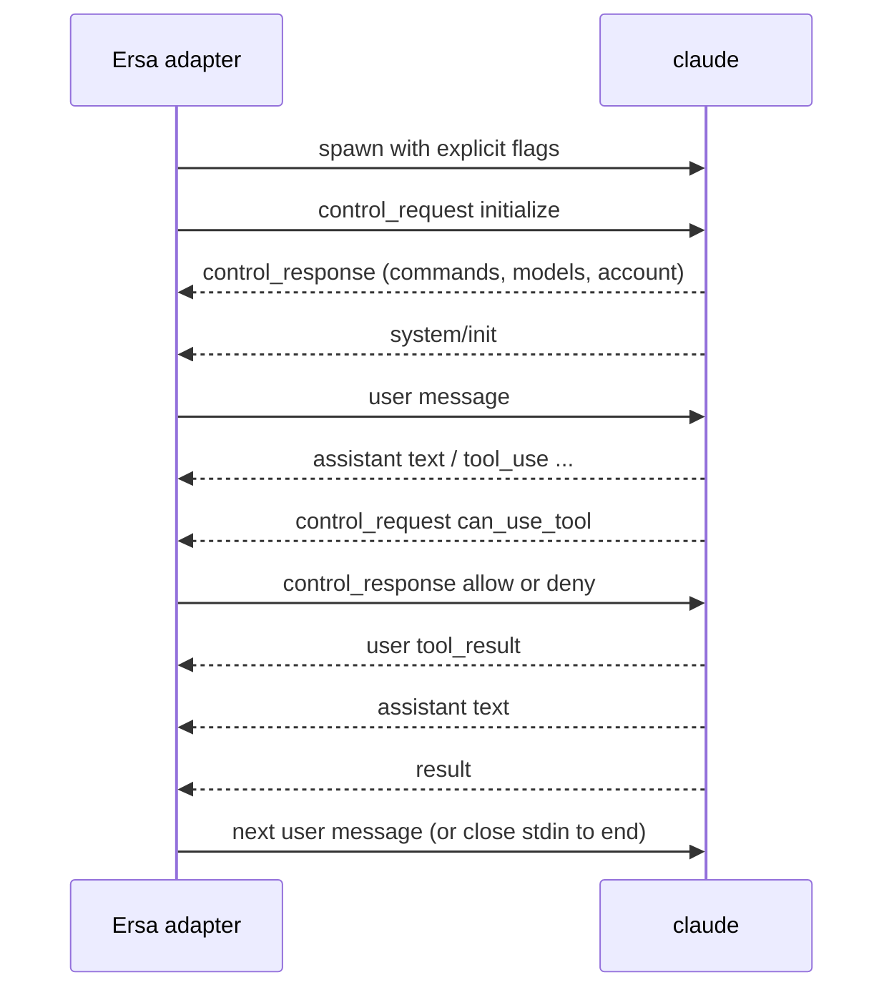

# Claude Code streaming JSON protocol

How the adapter drives the CLI's live stream, and how it reads the CLI's own session record, which is a session's history (ADR 0017). Stream observed on Claude Code 2.1.302 (Windows, winget install). Evidence is the fixture set in `protocol/fixtures/claude-code/2.1.302/`; each `.jsonl` is verbatim CLI output and each `.meta.json` records the exact command line, what was sent on stdin, exit code, and timings. The Claude Agent SDK's type definitions (`@anthropic-ai/claude-agent-sdk` 0.3.316, files `sdk.d.ts` and `sdk-tools.d.ts`) are the reference for field names and unions; they are proprietary and are read, not vendored.

## Parties

Ersa's Claude Code adapter (the host) and one `claude` process per session. The host starts the process, writes to its stdin, reads its stdout, and owns its lifetime.

## Transport and framing

Stdio. Newline-delimited JSON in both directions. Stdout lines are messages; stdin lines are user messages or control messages. Stdin must be flushed after every line. If stdin is left open with nothing written, the CLI waits about three seconds, warns on stderr, and proceeds (fixture 00). For one-shot runs stdin is closed or given an empty body.

## Invocation

Every behaviour-affecting flag is passed explicitly (ADR 0014), and the session is otherwise an ordinary Claude Code session, launched the way the vendor's own IDE integration launches one (ADR 0017). The command Ersa uses:

```
claude -p --input-format stream-json --output-format stream-json --verbose
       --include-partial-messages --permission-mode default
       --setting-sources user,project,local
       --permission-prompt-tool stdio --await-initialize
```

- `--setting-sources user,project,local` loads the user's, the project's and the local settings, and without `--strict-mcp-config` the user's MCP configuration loads too, so hooks, instructions and always-allow rules apply as they do in the terminal. This is for a trusted project only (ADR 0018): the CLI's own folder-trust prompt never appears in headless mode, so a session of an untrusted project loads the user's own settings and none of the workspace's configuration (its settings files and its MCP configuration). Fixtures 00 to 11 were recorded with `--setting-sources ""` and `--strict-mcp-config`, which isolate a session; Ersa no longer passes them.
- `--await-initialize` makes the CLI read the host's `initialize` control request during startup instead of racing it; the Agent SDK passes it. Fixtures 09 and 11 were recorded without it and still worked, so it is belt and braces, to be verified by a fixture.
- `--permission-mode` must be stated; the shelf flow depends on it.
- `--permission-prompt-tool stdio` makes permission prompts arrive on the control channel (fixture 11). Without it, or without `initialize`, prompts are auto-denied (fixtures 05, 08, 09).
- `--include-partial-messages` adds `stream_event` lines for token-level streaming (fixture 02). Ersa passes it, so replies stream.
- `--replay-user-messages` echoes each stdin user message back on stdout as a `user` message (fixture 07). Ersa does not pass it: Core emits `user.message` when it sends one, and the session record keeps the message.
- `--resume <session_id>` continues a session; the CLI keeps the same `session_id` and appends to the same session record (fixture 04). The id is the `session_id` of the session's `system/init`, which Ersa stores with the session.
- `--mcp-config <absolute path> --permission-prompt-tool mcp__<server>__<tool>` is the fallback permission route (fixture 10).

Environment: the adapter sets `CLAUDE_CODE_ENTRYPOINT=ersa`, so Ersa's sessions appear in the CLI's own session lists (the CLI hides sessions whose entrypoint is `sdk-cli`, `sdk-ts` or `sdk-py`). It removes `CLAUDECODE`, `CLAUDE_CODE_CHILD_SESSION`, `CLAUDE_CODE_ENTRYPOINT`, `NODE_OPTIONS`, `TRACEPARENT` and `TRACESTATE` from the environment it inherits, so nothing from whatever started Ersa reaches the session. It also removes the variables that tie a process to another host's session (`CLAUDE_CODE_SESSION_ID`, `CLAUDE_CODE_HOST_SESSION_ID`, `CLAUDE_CODE_MESSAGING_SOCKET`, `CLAUDE_CODE_MESSAGING_TOKEN`, `CLAUDE_CODE_SSE_PORT`, `ENABLE_IDE_INTEGRATION`, `CLAUDE_AGENT_SDK_VERSION`: seen when Ersa is started from inside Claude Desktop or a VS Code terminal). It keeps every variable that configures Claude Code itself (its provider, limits and configuration folder), since the user's terminal sessions use those too, and a settings file's `env` key applies as usual. `ersa` is not a documented entrypoint value; if a release stops honouring it, sessions hide from the CLI's lists and resume by id still works.

## Messages (stdout)

Every message carries `type`, most carry `session_id` and `uuid`. Observed in this version:

### system / init

First stdout message of every one-shot session. In a bidirectional session the `initialize` response comes first, and `init` is emitted at the start of each turn, so the first `init` arrives only after the first user message has been sent (fixtures 09, 11). Fields of interest: `session_id`, `model`, `permissionMode`, `apiKeySource`, `claude_code_version`, `tools` (names), `mcp_servers` (name, status, source), `capabilities` (string list such as `interrupt_receipt_v1`, `msg_lifecycle_v1`, `sdk_mcp_manifests`), `output_style`, `agents`, `skills`, `plugins`, `cwd`, `fast_mode_state`, `view_mode`, `powershell_path`, `startup_timing`. Feature detection reads `capabilities` here, never version strings. On resume, `init` repeats with the same `session_id` (fixture 04); in a bidirectional session a second `init` is emitted at the start of each turn (fixture 07).

### assistant

`message.content` is an array of content blocks: `text`, `tool_use` (`id`, `name`, `input`, `caller`), `thinking` (`thinking` text, often empty, with `signature`). Carries `parent_tool_use_id` (null for the main thread). One `assistant` line per content block in practice (fixtures 03, 05).

### user

Either an echoed stdin message (with `--replay-user-messages`) or a `tool_result` block the CLI produced after running a tool: `tool_use_id`, `content`, `is_error`. Permission denials also arrive as a `tool_result` explaining the denial (fixtures 05, 06).

### stream_event

Only with `--include-partial-messages`. Wraps the Messages API stream events: `message_start`, `content_block_start`, `content_block_delta`, `content_block_stop`, `message_delta`, `message_stop` (fixture 02). The complete `assistant` line still follows.

### system / permission_denied

`tool_name`, `tool_use_id`, `message` (or `decision_reason_type` such as `asyncAgent` and `decision_reason` when `--permission-prompts none`). Emitted when an approval was needed and no host could answer (fixtures 05, 06, 08, 09).

### system / status, task_summary, post_turn_summary, thinking_tokens

Progress and summary lines. `task_summary` and `post_turn_summary` are absent from the SDK 0.3.316 types and marked internal in the CLI's own schemas, so they may change or vanish without notice; the fixtures are the reference for their shape. `post_turn_summary` carries `status_category` (`completed`, `blocked`) and `status_detail`; `thinking_tokens` carries running estimates. The rail's activity state is derived from `assistant`, `user` tool results, `control_request`, `status`, and `result`, which are supported surface; `task_summary` and `post_turn_summary` only add detail when present, and their absence changes no state.

### rate_limit_event

Emitted during turns; carries the login's rate-limit status. Source for the tile's budget readout.

### result

Ends a turn. `subtype` (`success` observed; error subtypes exist in the SDK types), `is_error`, `num_turns`, `duration_ms`, `duration_api_ms`, `total_cost_usd`, `usage` (input, output, cache tokens, service tier), `modelUsage`, `permission_denials` (array of `{tool_name, tool_use_id, tool_input}`), `terminal_reason` (`completed`, `api_error`), `result` (final text), `session_id`. The cost tile reads `total_cost_usd`, which is a running total for the session (fixture 07). The context ring reads `usage`, but its top-level token counts are summed over every API call in the turn and overstate the context; the context in use is the last entry of `usage.iterations`, falling back to the top-level counts when that list is absent.

### Authentication failure

A synthetic `assistant` message with `model: "<synthetic>"`, `error: "authentication_failed"`, text "Not logged in", then a `result` with `terminal_reason: "api_error"` and zero usage (fixture 00). The adapter maps this to a session error state, not a transcript message.

## Session record

The CLI keeps each session at `~/.claude/projects/<encoded cwd>/<session id>.jsonl`, where the encoded cwd is the session's working directory with every character other than an ASCII letter or digit replaced by `-` (observed: `D:\Projects\ersa` becomes `D--Projects-ersa`). One JSON entry per line, appended as the session runs, including turns taken outside Ersa. It is a session's history (ADR 0017); retention is the CLI's (`cleanupPeriodDays`, 30 by default), and a deleted record is a session Ersa no longer shows.

Entries the adapter reads:

- `user` and `assistant` entries: their `message` is identical to the stream message with the same `uuid`, so one projection of messages serves both inputs, and `uuid` is the message id on which record and live stream are merged.
- On a `user` entry carrying a tool result, `permissionDecision`: the permission decision for that tool call.
- `custom-title` and `ai-title` entries: the session's title, set by the user and generated by the CLI.

The record omits text deltas (`stream_event`), permission prompts, `result` (turn end, cost) and rate limits; those are live only. The adapter ignores every other entry. The wrapper around `message` (every field of an entry other than `message`) is internal to the CLI and changes between versions. It is pinned the way the stream is: session-record fixtures recorded per CLI version beside the stream fixtures, and the same warning above the newest tested version. The only supported readers (`listSessions`, `getSessionMessages`) are in the TypeScript and Python Agent SDKs, which Core cannot use.

### Listing

The sessions of a directory are the record files under its encoded path. To list them the adapter reads the head and the tail of each file, never the whole file. Each session's title is its latest `custom-title`, else its latest `ai-title`, else its last prompt, else its first prompt.

### Live-session registry

The CLI writes `~/.claude/sessions/<pid>.json` for each running process, naming the session it has open. Before resuming a session the adapter reads the registry; when a running process has that session open, Ersa says so, since resuming it too would interleave both transcripts in one record.

## Control channel

### initialize (host to CLI)

```json
{"type":"control_request","request_id":"<host chosen>","request":{"subtype":"initialize","hooks":{}}}
```

Sent before the first user message. The CLI answers with `control_response` whose `response` carries `commands`, `agents`, `models`, `account`, `output_style`, and `claude_code_version` (fixtures 09, 11). 2.1.302 also sends `capabilities` (a shorter list than `system/init`'s, not used for feature detection), `pid`, `current_permission_mode`, and `session_state`, none of which are in the SDK 0.3.316 types. Optional request fields of interest for Ersa: `appendSystemPrompt` and `systemPrompt` (modes), `agents`, `skills`, `title`, `sdkMcpServers` with `sdkMcpServerConfigs` (in-process harness tools), `supportedDialogKinds`, `perTaskStopAffordance`.

### can_use_tool (CLI to host)

Arrives only after `initialize` and only with `--permission-prompt-tool stdio`:

```json
{"type":"control_request","request_id":"<cli chosen>","request":{"subtype":"can_use_tool",
  "tool_name":"Bash","display_name":"Bash","input":{...},"description":"...",
  "permission_suggestions":[{"type":"addRules","rules":[{"toolName":"Bash","ruleContent":"echo probe *"}],"behavior":"allow","destination":"localSettings"},
                            {"type":"addDirectories","directories":["..."],"destination":"session"}],
  "blocked_path":"...","tool_use_id":"toolu_..."}}
```

Other fields per the SDK types: `decision_reason`, `decision_reason_type`, `classifier_approvable`, `suppress_always_allow_rule`, `default_to_no`, `requires_user_interaction`, `agent_id`, `title`. The shelf renders `display_name`, `description`, `input`, `blocked_path`, and offers the `permission_suggestions` as "allow for this session" options.

The host answers:

```json
{"type":"control_response","response":{"subtype":"success","request_id":"<same>",
  "response":{"behavior":"allow","updatedInput":{...},"updatedPermissions":[...]}}}
```

or `{"behavior":"deny","message":"...","interrupt":false}`. An allow always carries `updatedInput`: the original `input` unless the user edited it, as recorded. After an allow the tool runs and its `tool_result` follows as usual (fixture 11).

### User message (host to CLI)

```json
{"type":"user","message":{"role":"user","content":[{"type":"text","text":"..."}]}}
```

`parent_tool_use_id` is omitted for the main thread. The SDK types mark it required, but every recorded stdin user message omits it and the CLI accepts that.

### control_cancel_request and keep_alive

Either side may send `{"type":"control_cancel_request","request_id":"..."}` to withdraw one of its own in-flight control requests; the receiver stops working on it and ignores any late answer. From the CLI it typically withdraws a pending `can_use_tool` prompt (after an interrupt, say), so the adapter treats the request as no longer pending and the shelf drops it. `{"type":"keep_alive"}` is a heartbeat with no meaning beyond liveness. Both are modelled from the SDK types and not yet recorded; record a fixture when the adapter implements interrupt.

### Other control requests the adapter uses

`interrupt`, `set_permission_mode`, `set_model`, `get_context_usage`, `get_session_cost`, and `mcp_message` (for `sdkMcpServers`). Shapes per the SDK types; fixtures to be recorded as each is implemented.

## Sequencing



- One turn runs at a time; the next user message is sent after `result`.
- A `can_use_tool` request must be answered before the turn continues; an unanswered request stalls the turn.
- Closing stdin after `result` ends the process cleanly with exit 0 (fixtures 07 to 11).

## Errors and recovery

- Authentication failure: see above. Surface as a session error with a "log in" action.
- Process exit without `result`: treat the turn as interrupted; the session record keeps the messages already written.
- Unknown message types: project to a typed passthrough event. Never drop.

## Versioning

Minimum tested: 2.1.302. Maximum tested: 2.1.302. The tested range covers the session record's wrapper as well as the stream. The adapter compares versions using `claude_code_version` from the `initialize` response, because it is the only version known before the first turn; above the maximum tested version it warns and continues. Feature detection reads `capabilities` from `system/init`, which arrives with the first turn; no feature is needed before then.

## Conformance

A conforming adapter replays every fixture in `protocol/fixtures/claude-code/<version>/`, stream and session record, through its parser and projection without error, and produces the expected `can_use_tool` round trip against a stub CLI built from fixture 11.

## Requirements

- **PROTO-CLAUDE-CODE-STREAM-R01**: The adapter shall start the CLI with every behaviour-affecting flag passed explicitly, never relying on a default.
- **PROTO-CLAUDE-CODE-STREAM-R02**: The adapter shall send an `initialize` control request before the first user message and shall not send a user message until the `initialize` response has arrived.
- **PROTO-CLAUDE-CODE-STREAM-R03**: When a `can_use_tool` control request arrives, the adapter shall emit a permission-request event carrying the tool name, display name, input, description, blocked path, and permission suggestions, and shall answer with the user's decision as a `control_response` echoing the same `request_id`.
- ~~**PROTO-CLAUDE-CODE-STREAM-R04**~~: retired 2026-11-01 (ADR 0017: no line is stored), replaced by R11.
- **PROTO-CLAUDE-CODE-STREAM-R05**: When the CLI reports `authentication_failed`, the adapter shall emit a session error event rather than a transcript message.
- **PROTO-CLAUDE-CODE-STREAM-R06**: The adapter shall read capabilities from the `system/init` message and shall not infer behaviour from version strings.
- **PROTO-CLAUDE-CODE-STREAM-R07**: The adapter shall flush stdin after every line written.
- **PROTO-CLAUDE-CODE-STREAM-R08**: The adapter shall derive cost from `result.total_cost_usd`, context from `result.usage` (its last `iterations` entry when present), and rate-limit budget from `rate_limit_event`.
- **PROTO-CLAUDE-CODE-STREAM-R09**: The adapter shall map unknown message types to a typed passthrough event and never drop a line.
- **PROTO-CLAUDE-CODE-STREAM-R10**: When the CLI version exceeds the maximum tested version, the adapter shall emit a `session.notice` with level `warning` and code `backend_version_untested`, and continue.
- **PROTO-CLAUDE-CODE-STREAM-R11**: The adapter shall parse every line of every stream fixture and every entry of every session-record fixture for its tested version range without error.
- **PROTO-CLAUDE-CODE-STREAM-R12**: When the session's project is trusted, the adapter shall start the CLI with `--setting-sources user,project,local` and without `--strict-mcp-config`.
- **PROTO-CLAUDE-CODE-STREAM-R13**: The adapter shall start the CLI with `CLAUDE_CODE_ENTRYPOINT` set to `ersa` and with `CLAUDECODE`, `CLAUDE_CODE_CHILD_SESSION`, `NODE_OPTIONS`, `TRACEPARENT` and `TRACESTATE` absent from its environment.
- **PROTO-CLAUDE-CODE-STREAM-R14**: When resuming a session, the adapter shall pass `--resume` with the `session_id` from that session's `system/init`.
- **PROTO-CLAUDE-CODE-STREAM-R15**: The adapter shall project a `user` or `assistant` entry of the session record to the same events as the stream message with the same `uuid`, apart from details only the live stream carries.
- **PROTO-CLAUDE-CODE-STREAM-R16**: When listing a directory's sessions, the adapter shall read only the head and tail of each record file, and shall title each session by its latest `custom-title`, else its latest `ai-title`, else its last prompt, else its first prompt.
- **PROTO-CLAUDE-CODE-STREAM-R17**: Before resuming a session, the adapter shall read the live-session registry and report when a running CLI process has that session open.
- **PROTO-CLAUDE-CODE-STREAM-R18**: When the session's project is not trusted, the adapter shall start the CLI so that it loads the user's own settings and no settings file or MCP configuration from the workspace.
- **PROTO-CLAUDE-CODE-STREAM-R19**: The adapter shall start the CLI with `CLAUDE_CODE_SESSION_ID`, `CLAUDE_CODE_HOST_SESSION_ID`, `CLAUDE_CODE_MESSAGING_SOCKET`, `CLAUDE_CODE_MESSAGING_TOKEN`, `CLAUDE_CODE_SSE_PORT`, `ENABLE_IDE_INTEGRATION` and `CLAUDE_AGENT_SDK_VERSION` absent from its environment.

## Out of scope

- Driving the interactive terminal UI.
- Hooks over the control channel (`hook_callback`) until a use appears.

## Open questions

- Exact shapes of `interrupt`, `set_model`, `get_context_usage`, `get_session_cost`, and `mcp_message` responses (to be recorded).
- A workspace's settings can change the permission mode the CLI runs in; how the effective mode `system/init` reports reaches the Interface, so the user sees the mode a session really has.
- Whether the CLI's own folder-trust record (in its configuration file, which running CLI processes also write) can be set safely from outside, so a trusted project's worktrees are trusted when resumed in a terminal (ADR 0018).

## Changes

- 2026-11-01: from #33 inbox: R12 applies to a trusted project (ADR 0018), wording narrowed; R18 (an untrusted project loads no workspace configuration) and R19 (host-session variables removed, Claude Code's own configuration kept) added; open questions on the effective permission mode and the CLI's trust record.

- 2026-11-01: aligned with ADR 0017: the user's settings and MCP configuration load (`--setting-sources user,project,local`, no `--strict-mcp-config`), entrypoint `ersa`, inherited variables cleared, resume by the `system/init` id; Session record section added (entries read, wrapper pinned by fixtures, listing, live-session registry); reconnect open question answered. PROTO-CLAUDE-CODE-STREAM-R04 retired, R11 to R17 added.

- 2026-11-01: from M0-T4 inbox: context comes from the last `usage.iterations` entry, since the top-level counts sum every call; R08 reworded to say where, meaning unchanged.

- 2026-11-01: Ersa passes `--include-partial-messages` and not `--replay-user-messages` (host lines are in the raw log); that open question closed.

- 2026-11-01: R10 names the event it emits (`session.notice`); meaning unchanged.

- 2026-11-01: `control_cancel_request` and `keep_alive` described, from the SDK types. No requirement IDs changed.

- 2026-11-01: `task_summary` and `post_turn_summary` are internal CLI surface; activity state no longer depends on them. No requirement IDs changed.

- 2026-11-01: from M0-T3 inbox: `system/init` arrives with the first turn, so version comparison uses the `initialize` response and feature detection uses `system/init`; observed fields beyond the SDK types noted; stdin user-message shape added; allow always carries `updatedInput`. No requirement IDs changed.

- 2026-10-31: written from fixtures 00 to 11 on 2.1.302; status ready; permissions via the stdio control channel per ADR 0014.
- 2026-10-31: explicit flags, feature detection, and permission routing via the harness tools server per ADR 0012.
- 2026-10-31: created as draft.
