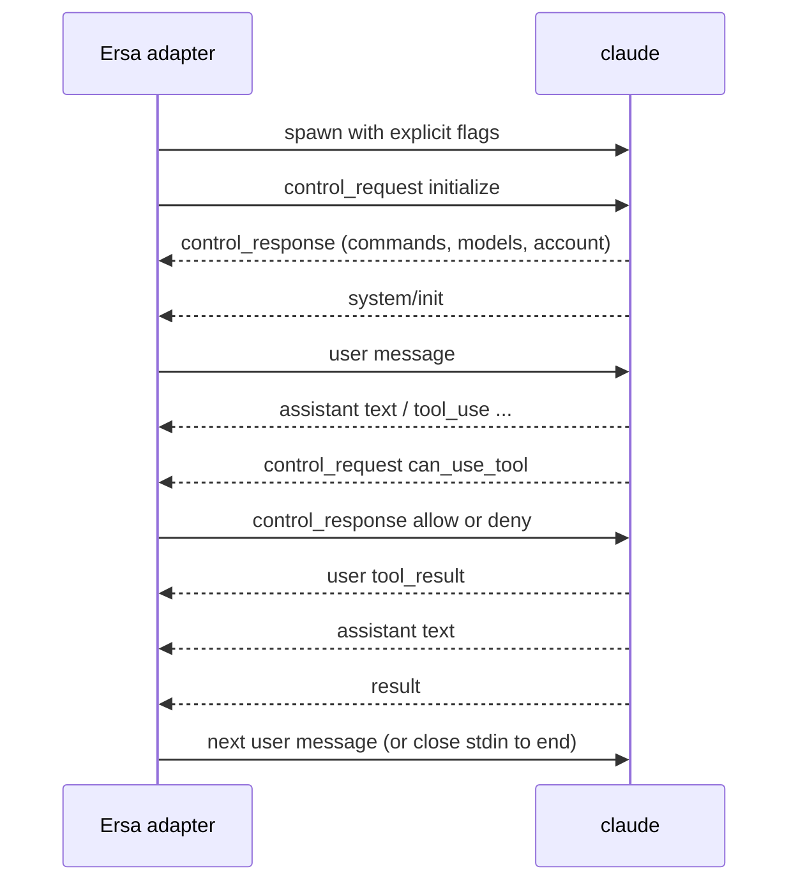

# Claude Code streaming JSON protocol

How the adapter drives the CLI's live stream, and how it reads the CLI's own session record, which is a session's history (ADR 0017). Observed on Claude Code 2.1.302 and 2.1.316 (Windows, winget install). Evidence is the fixture sets in `protocol/fixtures/claude-code/<version>/`; each stream `.jsonl` is verbatim CLI output and each `.meta.json` records the exact command line, what was sent on stdin, exit code, and timings. The 2.1.302 set (fixtures 00 to 11) was recorded with an isolating invocation; the 2.1.316 set (`00-session-tools`, `01-session-resume`) was recorded with Ersa's own invocation of the day (00 to 03 with `-p`, 06 without) by the repository's session-fixture recorder, which also keeps the session record the CLI wrote for each run, under `record/`. A bare fixture number in this brief names a 2.1.302 fixture. The Claude Agent SDK's type definitions (`@anthropic-ai/claude-agent-sdk` 0.3.316, files `sdk.d.ts` and `sdk-tools.d.ts`) are the reference for field names and unions; they are proprietary and are read, not vendored.

## Parties

Ersa's Claude Code adapter (the host) and one `claude` process per session. The host starts the process, writes to its stdin, reads its stdout, and owns its lifetime.

## Transport and framing

Stdio. Newline-delimited JSON in both directions. Stdout lines are messages; stdin lines are user messages or control messages. Stdin must be flushed after every line. If stdin is left open with nothing written, the CLI waits about three seconds, warns on stderr, and proceeds (fixture 00). For one-shot runs stdin is closed or given an empty body.

## Invocation

Every behavior-affecting flag is passed explicitly (ADR 0014), and the session is otherwise an ordinary Claude Code session, launched the way the vendor's own IDE integration launches one (ADR 0017). The command Ersa uses:

```
claude --input-format stream-json --output-format stream-json --verbose
       --include-partial-messages --permission-mode default
       --setting-sources user,project,local
       --permission-prompt-tool stdio --await-initialize
```

- No `-p`. The stream-json formats put the CLI in its headless mode on their own, which is how the VS Code extension starts it; the help's "only works with --print" holds for standalone use only (fixture 2.1.316/06-invocation-without-print). The fixture recorders that drive a stream session start it the same way; the one-shot recorder still passes `-p` with its prompt.
- `--setting-sources user,project,local` loads the user's, the project's and the local settings, and without `--strict-mcp-config` the user's MCP configuration loads too, so hooks, instructions and MCP servers apply as they do in the terminal. The workspace's always-allow rules (`permissions.allow`) apply only once the CLI's own trust record marks the workspace trusted. For a trusted project the adapter asks for that through the CLI's own mechanism: the `initialize` request carries `workspaceTrust { accepted: true, directory }`, where `directory` is the project's root, which Core passes with the session, and the CLI writes its own record, keyed by the repository's git root, so every linked worktree of the project shares it (fixture 2.1.316/03-workspace-trust). The response's `workspace_trust_recorded` says whether it was recorded; anything but `true` is a warning in Core's log and the session starts regardless. From the next session on the rules apply without the CLI's stderr warning. An untrusted project's session never carries `workspaceTrust`. Ersa writes nothing to the CLI's configuration. Two consequences follow from the record being the CLI's: revoking trust in Ersa stops the attestation but leaves the CLI's record, so the repository stays trusted for terminal sessions; and a project added at a subfolder of a repository trusts that whole repository. This is for a trusted project only (ADR 0018): the CLI's own folder-trust prompt never appears in headless mode, so a session of an untrusted project loads the user's own settings and none of the workspace's configuration (its settings files and its MCP configuration). Fixtures 00 to 11 were recorded with `--setting-sources ""` and `--strict-mcp-config`, which isolate a session; Ersa no longer passes them.
- `--await-initialize` makes the CLI read the host's `initialize` control request during startup instead of racing it; the Agent SDK passes it. Fixtures 09 and 11 were recorded without it and still worked, so it is belt and braces, to be verified by a fixture.
- `--permission-mode` must be stated; the shelf flow depends on it.
- `--model` and `--effort` are passed when the session names them (`session.create`'s `model` and `effort`, PROTO-CORE-API) and left out otherwise, so the CLI's own defaults apply. For `backend.list` the adapter lists what it knows the CLI accepts: the model aliases `fable`, `opus`, `sonnet` and `haiku` with `opus` marked as the default and `medium` as the default effort (what 2.1.316 sessions started without `--model` or `--effort` ran with, per the session-record fixtures; the CLI's own choice can differ when the user's settings or `ANTHROPIC_MODEL` say otherwise, which is why a session given no value reports none); the effort levels `low`, `medium`, `high`, `xhigh` and `max`; and the permission modes `default`, `acceptEdits`, `plan` and `auto`. `bypassPermissions` is not offered.
- `--permission-prompt-tool stdio` makes permission prompts arrive on the control channel (fixture 11). Without it, or without `initialize`, prompts are auto-denied (fixtures 05, 08, 09).
- `--include-partial-messages` adds `stream_event` lines for token-level streaming (fixture 02). Ersa passes it, so replies stream.
- `--replay-user-messages` echoes each stdin user message back on stdout as a `user` message (fixture 07). Ersa does not pass it: Core emits `user.message` when it sends one, and the session record keeps the message.
- `--resume <session_id>` continues a session; the CLI keeps the same `session_id` and appends to the same session record (fixture 04). The id is the `session_id` of the session's `system/init`, which Ersa stores with the session.
- `--mcp-config <absolute path> --permission-prompt-tool mcp__<server>__<tool>` is the fallback permission route (fixture 10).

Environment: the adapter sets `CLAUDE_CODE_ENTRYPOINT=ersa`, so Ersa's sessions appear in the CLI's own session lists (the CLI hides sessions whose entrypoint is `sdk-cli`, `sdk-ts` or `sdk-py`). It removes `CLAUDECODE`, `CLAUDE_CODE_CHILD_SESSION`, `CLAUDE_CODE_ENTRYPOINT`, `NODE_OPTIONS`, `TRACEPARENT` and `TRACESTATE` from the environment it inherits, so nothing from whatever started Ersa reaches the session. It also removes the variables that tie a process to another host's session (`CLAUDE_CODE_SESSION_ID`, `CLAUDE_CODE_HOST_SESSION_ID`, `CLAUDE_CODE_MESSAGING_SOCKET`, `CLAUDE_CODE_MESSAGING_TOKEN`, `CLAUDE_CODE_SSE_PORT`, `ENABLE_IDE_INTEGRATION`, `CLAUDE_AGENT_SDK_VERSION`: seen when Ersa is started from inside Claude Desktop or a VS Code terminal). It keeps every variable that configures Claude Code itself (its provider, limits and configuration folder), since the user's terminal sessions use those too, and a settings file's `env` key applies as usual. `ersa` is not a documented entrypoint value; if a release stops honoring it, sessions hide from the CLI's lists and resume by id still works.

## Messages (stdout)

Every message carries `type`, most carry `session_id` and `uuid`. Observed in this version:

### system / init

First stdout message of every one-shot session. In a bidirectional session the `initialize` response comes first, and `init` is emitted at the start of each turn, so the first `init` arrives only after the first user message has been sent (fixtures 09, 11). Fields of interest: `session_id`, `model`, `permissionMode`, `apiKeySource`, `claude_code_version`, `tools` (names), `mcp_servers` (name, status, source), `capabilities` (string list such as `interrupt_receipt_v1`, `msg_lifecycle_v1`, `sdk_mcp_manifests`), `output_style`, `agents`, `skills`, `plugins`, `cwd`, `fast_mode_state`, `view_mode`, `powershell_path`, `startup_timing`. Feature detection reads `capabilities` here, never version strings. On resume, `init` repeats with the same `session_id` (fixture 04); in a bidirectional session a second `init` is emitted at the start of each turn (fixture 07).

### assistant

`message.content` is an array of content blocks: `text`, `tool_use` (`id`, `name`, `input`, `caller`), `thinking` (`thinking` text, often empty, with `signature`). Carries `parent_tool_use_id` (null for the main thread). One `assistant` line per content block in practice (fixtures 03, 05).

### user

Either an echoed stdin message (with `--replay-user-messages`) or a `tool_result` block the CLI produced after running a tool: `tool_use_id`, `content`, `is_error`. Permission denials also arrive as a `tool_result` explaining the denial (fixtures 05, 06).

### stream_event

Only with `--include-partial-messages`. Wraps the Messages API stream events: `message_start`, `content_block_start`, `content_block_delta`, `content_block_stop`, `message_delta`, `message_stop` (fixture 02). The complete `assistant` line still follows.

### system / permission_denied

`tool_name`, `tool_use_id`, `message` (or `decision_reason_type` such as `asyncAgent` and `decision_reason` when `--permission-prompts none`). Emitted when an approval was needed and no host could answer (fixtures 05, 06, 08, 09).

### system / status, task_summary, post_turn_summary, thinking_tokens

Progress and summary lines. `task_summary` and `post_turn_summary` are absent from the SDK 0.3.316 types and marked internal in the CLI's own schemas, so they may change or vanish without notice; the fixtures are the reference for their shape. `post_turn_summary` carries `status_category` (`completed`, `blocked`) and `status_detail`; `thinking_tokens` carries running estimates. The rail's activity state is derived from `assistant`, `user` tool results, `control_request`, `status`, and `result`, which are supported surface; `task_summary` and `post_turn_summary` only add detail when present, and their absence changes no state.

### rate_limit_event

Emitted during turns; carries the login's rate-limit status. Source for the tile's budget readout.

### result

Ends a turn. `subtype` (`success` observed; error subtypes exist in the SDK types), `is_error`, `num_turns`, `duration_ms`, `duration_api_ms`, `total_cost_usd`, `usage` (input, output, cache tokens, service tier), `modelUsage`, `permission_denials` (array of `{tool_name, tool_use_id, tool_input}`), `terminal_reason` (`completed`, `api_error`), `result` (final text), `session_id`. The cost tile reads `total_cost_usd`, which is a running total for the session (fixture 07). The context ring reads `usage`, but its top-level token counts are summed over every API call in the turn and overstate the context; the context in use is the last entry of `usage.iterations`, falling back to the top-level counts when that list is absent.

### Authentication failure

A synthetic `assistant` message with `model: "<synthetic>"`, `error: "authentication_failed"`, text "Not logged in", then a `result` with `terminal_reason: "api_error"` and zero usage (fixture 00). The adapter maps this to a session error state, not a transcript message.

## Session record

The CLI keeps each session at `~/.claude/projects/<encoded cwd>/<session id>.jsonl`, where the encoded cwd is the session's working directory with every UTF-16 code unit other than an ASCII letter or digit replaced by `-` (observed: `C:\Users\user\repo` becomes `C--Users-user-repo`; an emoji, two code units, becomes two dashes). An encoded name longer than 200 characters is cut to 200 and suffixed with `-` and the base-36 digits of the absolute value of a 32-bit hash of the path's UTF-16 units, computed from 0 as `h = h*31 + unit` with wrapping (verified on 2.1.316). One JSON entry per line, appended as the session runs, including turns taken outside Ersa. It is a session's history (ADR 0017); retention is the CLI's (`cleanupPeriodDays`, 30 by default), and a deleted record is a session Ersa no longer shows.

Entries the adapter reads:

- `user` and `assistant` entries: their `message` content blocks are identical to those of the stream message with the same `uuid` (the stream's `stop_reason` and `usage` are partial where the record's are final), so one projection of messages serves both inputs, and `uuid` is the message id on which record and live stream are merged.
- `system` entries with subtype `local_command`: a local command's output (from `/rename`, say), which the stream carries as a synthetic `assistant` message (`model: "<synthetic>"`) with the same `uuid`. The adapter projects it as it projects that synthetic message, so history shows what was shown live, with one difference: the stream numbers the message's block under its own `message.id`, which the record entry does not carry, so the record's block id is the entry's `uuid` followed by the block index. The output is the entry's `content` inside `<local-command-stdout>` or `<local-command-stderr>` tags, either or both; the text inside the tags is projected as the stream carried it. An entry whose `content` has neither tag is the command's echo, which older CLIs (2.1.215) wrote beside the output, and projects to nothing. An entry whose `content` starts a tag it does not close, or is not a string, is a drifted entry: a protocol error and a passthrough, as for a drifted `user` or `assistant` entry.
- On a `user` entry carrying a tool result, `permissionDecision` (`decision`, `source`, `reasonType`, `grantScope`): parsed, but how history shows a decision is open (`PROTO-AGENT-EVENTS`, open questions).
- `custom-title`, `ai-title` and `last-prompt` entries: the title the user set, the title the CLI generated, and the latest prompt the CLI noted.

The conversation is one chain, not the whole file. Each entry names its `parentUuid`; a rewind or a prompt edit in the terminal starts a new branch while the old one stays in the file, and a subagent's entries (`isSidechain`) may sit in it too. The conversation is the chain from the latest main-thread entry back through `parentUuid`, following `logicalParentUuid` across a compaction so the history before it stays. Abandoned branches and sidechain entries are not the conversation.

The record omits text deltas (`stream_event`), permission prompts, `result` (turn end, cost) and rate limits; those are live only. The adapter ignores every other entry. The wrapper around `message` (every field of an entry other than `message`) is internal to the CLI and changes between versions. It is pinned the way the stream is: session-record fixtures recorded per CLI version beside the stream fixtures, and the same warning above the newest tested version. The only supported readers (`listSessions`, `getSessionMessages`) are in the TypeScript and Python Agent SDKs, which Core cannot use.

### Listing

The sessions of a directory are the record files under its encoded path. To list them the adapter reads the head and the tail of each file, never the whole file. Each session's title is its latest `custom-title`, else its latest `ai-title`, else its last prompt, else its first prompt. The last prompt is the latest `last-prompt` entry, else the last prompt entry in the tail; a prompt is a `user` entry the person wrote, never one the CLI wrote (`PROTO-AGENT-EVENTS`, projection rules). A title is one line, cut at 200 characters. In print mode `/rename <title>`, sent as a user message, writes a `custom-title` entry, and no `ai-title` appears (2.1.316 fixture `01-session-resume`), so an Ersa session the user has not renamed lists under its last prompt.

### Renaming

A session's title is the backend's, so renaming a session from Ersa renames it in the CLI and the new title shows in the CLI's own tools too. While Ersa's CLI process for the session is live, the adapter sends the `rename_session` control request: `{ subtype: "rename_session", title, source: "host", session_id }` (fixture 2.1.316/03-session-rename). `source: "host"` makes the CLI count it as the user's rename, and `session_id` makes a CLI that has moved to another session refuse it. The CLI answers with a bare `{ subtype: "success", request_id }` after writing a `system/session_title_changed` line (`title`) and then writes the `custom-title` entry itself; `session_title_changed` projects as a passthrough. Otherwise the adapter appends a `custom-title` entry to the session record (`{"type":"custom-title","customTitle":"<title>","sessionId":"<session id>"}`, as the 2.1.316 fixtures record it), as the vendor's IDE extension does. This is the only write Ersa makes to a session record. It appends even when the live-session registry says another process has the session open: that process shows the new name when it next reads its record's tail (after about 32 KB of its own writes, or at a compaction) and may write its old name again until then, so Core tells the user with the same notices a resume gives (PROTO-AGENT-EVENTS-R15).

### Live-session registry

The CLI writes `~/.claude/sessions/<pid>.json` for each running process, naming the session it has open. Before resuming a session the adapter reads the registry and reports one of three answers: not open, open by a running process (with its pid), or unknown (a registry file it could not read). Core's resume asks before starting the backend and turns an open or unknown answer into a `session.notice` (`PROTO-AGENT-EVENTS`), since resuming a session another process has open would interleave both transcripts in one record. Core asks the same before appending a title to the record of a session it is not running.

## Control channel

### initialize (host to CLI)

```json
{"type":"control_request","request_id":"<host chosen>","request":{"subtype":"initialize","hooks":{}}}
```

Sent before the first user message. The CLI answers with `control_response` whose `response` carries `commands`, `agents`, `models`, `account`, `output_style`, and `claude_code_version` (fixtures 09, 11). 2.1.302 also sends `capabilities` (a shorter list than `system/init`'s, not used for feature detection), `pid`, `current_permission_mode`, and `session_state`, none of which are in the SDK 0.3.316 types. Optional request fields of interest for Ersa: `appendSystemPrompt` and `systemPrompt` (modes), `agents`, `skills`, `title`, `sdkMcpServers` with `sdkMcpServerConfigs` (in-process harness tools), `supportedDialogKinds`, `perTaskStopAffordance`.

### can_use_tool (CLI to host)

Arrives only after `initialize` and only with `--permission-prompt-tool stdio`:

```json
{"type":"control_request","request_id":"<cli chosen>","request":{"subtype":"can_use_tool",
  "tool_name":"Bash","display_name":"Bash","input":{...},"description":"...",
  "permission_suggestions":[{"type":"addRules","rules":[{"toolName":"Bash","ruleContent":"echo probe *"}],"behavior":"allow","destination":"localSettings"},
                            {"type":"addDirectories","directories":["..."],"destination":"session"}],
  "blocked_path":"...","tool_use_id":"toolu_..."}}
```

Other fields per the SDK types: `decision_reason`, `decision_reason_type`, `classifier_approvable`, `suppress_always_allow_rule`, `default_to_no`, `requires_user_interaction`, `agent_id`, `title`. The shelf renders `display_name`, `description`, `input`, `blocked_path`, and offers the `permission_suggestions` as "allow for this session" options.

The host answers:

```json
{"type":"control_response","response":{"subtype":"success","request_id":"<same>",
  "response":{"behavior":"allow","updatedInput":{...},"updatedPermissions":[...]}}}
```

or `{"behavior":"deny","message":"...","interrupt":false}`. An allow always carries `updatedInput`: the original `input` unless the user edited it, as recorded. After an allow the tool runs and its `tool_result` follows as usual (fixture 11).

### Questions

Claude Code asks the user a question through its `AskUserQuestion` tool, which arrives as a `can_use_tool` request like any other. Its `input`, per the SDK types: `questions`, one to four of `{ question, header, options, multiSelect }`, where `header` is a short label and `options` are two to four `{ label, description }`. The CLI's own interface always lets the user answer in their own words as well.

The adapter projects such a request to `question.asked`, not `permission.requested` (`PROTO-AGENT-EVENTS`): each question's id is its index, each option's id its index, and `takes_text` is true. It answers `session.answer_question` with an allow whose `updatedInput` is the request's `input` plus `answers`, an object keyed by each question's `question` text whose value is the chosen option's `label`, the chosen labels joined by ", " for a multi-select question, or the user's own words. These shapes are modeled from the SDK types and not yet recorded; record a fixture when the adapter implements them.

### User message (host to CLI)

```json
{"type":"user","message":{"role":"user","content":[{"type":"text","text":"..."}]}}
```

`parent_tool_use_id` is omitted for the main thread. The SDK types mark it required, but every recorded stdin user message omits it and the CLI accepts that.

### control_cancel_request and keep_alive

Either side may send `{"type":"control_cancel_request","request_id":"..."}` to withdraw one of its own in-flight control requests; the receiver stops working on it and ignores any late answer. From the CLI it typically withdraws a pending `can_use_tool` prompt (after an interrupt, say), so the adapter treats the request as no longer pending and the shelf drops it. `{"type":"keep_alive"}` is a heartbeat with no meaning beyond liveness. Both are modeled from the SDK types and not yet recorded; record a fixture when the adapter implements interrupt.

### Other control requests the adapter uses

`interrupt`, `set_permission_mode`, `set_model`, `get_context_usage`, `get_session_cost`, and `mcp_message` (for `sdkMcpServers`). Shapes per the SDK types; fixtures to be recorded as each is implemented.

## Sequencing



- One turn runs at a time; the next user message is sent after `result`.
- A `can_use_tool` request must be answered before the turn continues; an unanswered request stalls the turn.
- Closing stdin after `result` ends the process cleanly with exit 0 (fixtures 07 to 11).

## Errors and recovery

- Authentication failure: see above. Surface as a session error with a "log in" action.
- Process exit without `result`: treat the turn as interrupted; the session record keeps the messages already written.
- Unknown message types: project to a typed passthrough event. Never drop.

## Versioning

Minimum tested: 2.1.316. Maximum tested: 2.1.316. The 2.1.302 fixtures still parse, but the invocation (setting sources per trust, entrypoint, environment) was verified on 2.1.316 only. Core takes this range from the adapter. The tested range covers the session record's wrapper as well as the stream. The adapter compares versions using `claude_code_version` from the `initialize` response, because it is the only version known before the first turn; above the maximum tested version it warns and continues. Feature detection reads `capabilities` from `system/init`, which arrives with the first turn; no feature is needed before then.

## Conformance

A conforming adapter replays every fixture in `protocol/fixtures/claude-code/<version>/`, stream and session record, through its parser and projection without error, and produces the expected `can_use_tool` round trip against a stub CLI built from fixture 11. Session-record fixtures keep verbatim only the entries the adapter reads and cut every other entry to its kind, because those bodies carry the CLI's system prompt and the machine's configuration; that is the intended evidence, and reading a new entry kind means recording the fixtures again.

## Requirements

- **PROTO-CLAUDE-CODE-STREAM-R01**: The adapter shall start the CLI with every behavior-affecting flag passed explicitly, never relying on a default.
- **PROTO-CLAUDE-CODE-STREAM-R02**: The adapter shall send an `initialize` control request before the first user message and shall not send a user message until the `initialize` response has arrived.
- **PROTO-CLAUDE-CODE-STREAM-R03**: When a `can_use_tool` control request arrives, the adapter shall emit a permission-request event carrying the tool name, display name, input, description, blocked path, and permission suggestions, and shall answer with the user's decision as a `control_response` echoing the same `request_id`.
- ~~**PROTO-CLAUDE-CODE-STREAM-R04**~~: retired 2026-11-01 (ADR 0017: no line is stored), replaced by R11.
- **PROTO-CLAUDE-CODE-STREAM-R05**: When the CLI reports `authentication_failed`, the adapter shall emit a session error event rather than a transcript message.
- **PROTO-CLAUDE-CODE-STREAM-R06**: The adapter shall read capabilities from the `system/init` message and shall not infer behavior from version strings.
- **PROTO-CLAUDE-CODE-STREAM-R07**: The adapter shall flush stdin after every line written.
- **PROTO-CLAUDE-CODE-STREAM-R08**: The adapter shall derive cost from `result.total_cost_usd`, context from `result.usage` (its last `iterations` entry when present), and rate-limit budget from `rate_limit_event`.
- **PROTO-CLAUDE-CODE-STREAM-R09**: The adapter shall map unknown message types to a typed passthrough event and never drop a line.
- **PROTO-CLAUDE-CODE-STREAM-R10**: When the CLI version exceeds the maximum tested version, the adapter shall emit a `session.notice` with level `warning` and code `backend_version_untested`, and continue.
- **PROTO-CLAUDE-CODE-STREAM-R11**: The adapter shall parse every line of every stream fixture and every entry of every session-record fixture for its tested version range without error.
- **PROTO-CLAUDE-CODE-STREAM-R12**: When the session's project is trusted, the adapter shall start the CLI with `--setting-sources user,project,local` and without `--strict-mcp-config`.
- **PROTO-CLAUDE-CODE-STREAM-R13**: The adapter shall start the CLI with `CLAUDE_CODE_ENTRYPOINT` set to `ersa` and with `CLAUDECODE`, `CLAUDE_CODE_CHILD_SESSION`, `NODE_OPTIONS`, `TRACEPARENT` and `TRACESTATE` absent from its environment.
- **PROTO-CLAUDE-CODE-STREAM-R14**: When resuming a session, the adapter shall pass `--resume` with the `session_id` from that session's `system/init`.
- **PROTO-CLAUDE-CODE-STREAM-R15**: The adapter shall project a `user` or `assistant` entry of the session record to the same events as the stream message with the same `uuid`, whose content blocks it shares, apart from details only the live stream carries.
- **PROTO-CLAUDE-CODE-STREAM-R16**: When listing a directory's sessions, the adapter shall read only the head and tail of each record file, and shall title each session by its latest `custom-title`, else its latest `ai-title`, else its last prompt, else its first prompt.
- **PROTO-CLAUDE-CODE-STREAM-R17**: Before resuming a session, the adapter shall read the live-session registry and report when a running CLI process has that session open.
- **PROTO-CLAUDE-CODE-STREAM-R18**: When the session's project is not trusted, the adapter shall start the CLI so that it loads the user's own settings and no settings file or MCP configuration from the workspace.
- **PROTO-CLAUDE-CODE-STREAM-R19**: The adapter shall start the CLI with `CLAUDE_CODE_SESSION_ID`, `CLAUDE_CODE_HOST_SESSION_ID`, `CLAUDE_CODE_MESSAGING_SOCKET`, `CLAUDE_CODE_MESSAGING_TOKEN`, `CLAUDE_CODE_SSE_PORT`, `ENABLE_IDE_INTEGRATION` and `CLAUDE_AGENT_SDK_VERSION` absent from its environment.
- **PROTO-CLAUDE-CODE-STREAM-R20**: When projecting a session record, the adapter shall project only the conversation: the chain from the latest main-thread entry back through `parentUuid`, following `logicalParentUuid` across a compaction, and no entry of an abandoned branch or a sidechain.
- ~~**PROTO-CLAUDE-CODE-STREAM-R21**~~: retired 2026-11-02 (the record cannot reproduce the stream's block id), replaced by R23.
- **PROTO-CLAUDE-CODE-STREAM-R22**: When renaming a session, the adapter shall send a `rename_session` control request if its CLI process for that session is live, and otherwise append one `custom-title` entry to the session record; it shall write nothing else to a session record.
- **PROTO-CLAUDE-CODE-STREAM-R23**: The adapter shall project a `system/local_command` entry of the session record to the same events as the synthetic `assistant` message with the same `uuid` on the stream, except that each block id is the entry's `uuid` and the block's index, and shall project an entry whose `content` carries no output tag to nothing.
- **PROTO-CLAUDE-CODE-STREAM-R24**: When the session's project is trusted, the adapter shall send `workspaceTrust` with `accepted: true` and the project's root as `directory` in the `initialize` request, and otherwise shall send no `workspaceTrust`.
- **PROTO-CLAUDE-CODE-STREAM-R25**: When the user answers a pending `AskUserQuestion` request, the adapter shall send an allow `control_response` echoing its `request_id`, whose `updatedInput` is the request's `input` with `answers` keyed by each question's text: the chosen option's label, the chosen labels joined by ", ", or the user's own words.

## Out of scope

- Driving the interactive terminal UI.
- Hooks over the control channel (`hook_callback`) until a use appears.

## Open questions

- Whether `system/session_title_changed` becomes an event of its own rather than a passthrough.
- Exact shapes of `interrupt`, `set_model`, `get_context_usage`, `get_session_cost`, and `mcp_message` responses (to be recorded).
- A workspace's settings can change the permission mode the CLI runs in; how the effective mode `system/init` reports reaches the Interface, so the user sees the mode a session really has.
- Whether `permissions.allow` already applies in the session that first attests trust: the CLI logs that it re-applies project settings after recording trust, but its stderr warning is printed before `initialize` is read, and checking needs a tool call. The opt-in live test checks the next session only.
- Whether revoking a project's trust in Ersa, or adding a project at a subfolder, needs a user-facing note, given that the CLI's record covers the whole repository and outlives Ersa's answer (owner).

## Changes

- 2026-11-05: for FLOW-APPROVE-PERMISSION: Questions added, from the SDK types and not yet recorded: `AskUserQuestion` projects to `question.asked` and is answered by an allow carrying `answers` (PROTO-CLAUDE-CODE-STREAM-R25 added).
- 2026-11-04: from #141 inbox: the encoded-cwd example uses the recordings' placeholder path instead of the owner's, since the repository is public. No requirement IDs changed.
- 2026-11-02: owner: the invocation drops `-p`, matching the VS Code extension; verified by fixture 2.1.316/06-invocation-without-print. No requirement IDs changed.
- 2026-11-02: from #54 inbox: Core asks the live-session registry before appending a title too, and a rename gives both open-elsewhere notices (PROTO-AGENT-EVENTS-R15). No requirement IDs changed.
- 2026-11-02: US spelling (ADR 0020, docs/design/CONTENT.md). Meaning unchanged; PROTO-CLAUDE-CODE-STREAM-R01 and R06 reworded for spelling only.
- 2026-11-02: from #43 inbox: `rename_session`'s recorded shapes (request with `source: "host"` and `session_id`, bare success after a `system/session_title_changed` line, the CLI writing `custom-title` itself); a rename of a session another process has open appends regardless and is told with the `session_open_elsewhere` notice. No requirement IDs changed; the shapes open question closed.
- 2026-11-02: from #52 inbox: the adapter marks `opus` and `medium` as the defaults it believes, and the brief says why a session given no value reports none. No requirement IDs changed.
- 2026-11-02: from #41 inbox: a `local_command` entry's block id is the entry's `uuid` and the block index, since the record lacks the stream's `message.id`; the echo entry older CLIs wrote projects to nothing; an unclosed tag or non-string content is a drifted entry. PROTO-CLAUDE-CODE-STREAM-R21 retired, R23 added.
- 2026-11-02: from #46 inbox: a trusted project's session attests trust through `initialize`'s `workspaceTrust`, keyed by the CLI to the git root; the response's outcome is a log warning at worst; the two consequences of the record being the CLI's named; open questions on the first attesting session and on a user-facing note; Core passes the project's root with the session. PROTO-CLAUDE-CODE-STREAM-R24 added (R23 is allocated on #49's branch); the headless-trust open question answered.
- 2026-11-02: for FLOW-NEW-SESSION: `--model` and `--effort` passed when named; the models, efforts and permission modes the adapter lists for `backend.list`. No requirement IDs changed.
- 2026-11-01: owner: Ersa trusts a workspace only through Claude Code's own mechanism, never by writing its configuration file. No requirement IDs changed.
- 2026-11-01: from #40 inbox: a trusted project's always-allow rules wait on the CLI's own trust record, named; minimum tested version raised to 2.1.316, where the invocation was verified, and Core takes the range from the adapter. No requirement IDs changed.
- 2026-11-01: from #35 inbox: Renaming added under Session record: a rename goes to the CLI, by `rename_session` on a live session, else by appending a `custom-title` entry, the only write Ersa makes to a session record (PROTO-CLAUDE-CODE-STREAM-R22 added).

- 2026-11-01: from #34 inbox: tested range 2.1.302 to 2.1.316, 2.1.316 stream and session-record fixtures named; record content blocks match the stream's (R15 reworded, meaning unchanged); session-record fixtures elide the entries the adapter does not read; the encoded cwd counts UTF-16 units and hashes long names; listing names the `last-prompt` entry and bounds titles; the record is a tree whose conversation is one chain (R20 added); `system/local_command` entries project like the stream's synthetic message (R21 added); `permissionDecision` parsed, its display open; the live-session check's three answers reach the user through Core's resume.

- 2026-11-01: from #33 inbox: R12 applies to a trusted project (ADR 0018), wording narrowed; R18 (an untrusted project loads no workspace configuration) and R19 (host-session variables removed, Claude Code's own configuration kept) added; open questions on the effective permission mode and the CLI's trust record.

- 2026-11-01: aligned with ADR 0017: the user's settings and MCP configuration load (`--setting-sources user,project,local`, no `--strict-mcp-config`), entrypoint `ersa`, inherited variables cleared, resume by the `system/init` id; Session record section added (entries read, wrapper pinned by fixtures, listing, live-session registry); reconnect open question answered. PROTO-CLAUDE-CODE-STREAM-R04 retired, R11 to R17 added.

- 2026-11-01: from M0-T4 inbox: context comes from the last `usage.iterations` entry, since the top-level counts sum every call; R08 reworded to say where, meaning unchanged.

- 2026-11-01: Ersa passes `--include-partial-messages` and not `--replay-user-messages` (host lines are in the raw log); that open question closed.

- 2026-11-01: R10 names the event it emits (`session.notice`); meaning unchanged.

- 2026-11-01: `control_cancel_request` and `keep_alive` described, from the SDK types. No requirement IDs changed.

- 2026-11-01: `task_summary` and `post_turn_summary` are internal CLI surface; activity state no longer depends on them. No requirement IDs changed.

- 2026-11-01: from M0-T3 inbox: `system/init` arrives with the first turn, so version comparison uses the `initialize` response and feature detection uses `system/init`; observed fields beyond the SDK types noted; stdin user-message shape added; allow always carries `updatedInput`. No requirement IDs changed.

- 2026-10-31: written from fixtures 00 to 11 on 2.1.302; status ready; permissions via the stdio control channel per ADR 0014.
- 2026-10-31: explicit flags, feature detection, and permission routing via the harness tools server per ADR 0012.
- 2026-10-31: created as draft.
